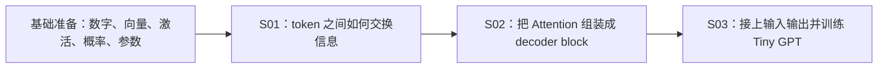

# A1·S01–S03 汇总课表与授课安排

> 审阅稿 · 2026-09-14 · 根据 Summer 本次学习反馈编写。
> 阅读入口：[浏览器版课表](s01-s03-overview.html) · [浏览器版讲义](s01-s03-primer.html) · [Summer 学习流程](../../learners/summer/learning-workflow.md)。
> Markdown 是编辑源稿。先完整教学，再按知识点进入问答、少量手算、口述编程、debug 与回顾；以下安排及样例尚待执行，不表示课次通过。

## 1 · 三节课只围绕一个目标

**从一排文字出发，理解模型怎样读取上下文、预测下一个 token，并通过训练把预测做得更好。**

这是 [正式课表](../../curriculum.md) 前三课的入门安排。基础准备是桥梁，不新增 Lesson；统一的 `Understand / Implement / Improve` 完成标准仍见 [learning modes](../../learning-modes.md)。

| 课次 | 核心问题 | 先补什么 | 本课讲解顺序 | 读后进入的小闭环 |
|---|---|---|---|---|
| 基础准备 | 数字怎样变成可学习的计算？ | 不默认线性代数、概率或训练经验 | token/ID → vector/matrix/shape → dot/matmul → 加权和 → ReLU/LeakyReLU → softmax → sigmoid/BCE → logit/prob/log-prob | 短问答，选择几个格子或函数值手算；不独立启动训练 |
| [A1·S01](s01-attention-reactivation.md) | 每个 token 怎样取回别处的信息？ | 输入表示、矩阵乘、概率转换 | 带 shape 的 QKV → QKᵀ → scaling → softmax → PV → mask | 问答 → 少量点积 → 口述单头实现 → 数值对拍 → Key 置换或 mask 干预 → 回顾 |
| [A1·S02](s02-causal-mask-multihead.md) | 怎样组装能续写的网络积木？ | 顺序、轴变换、非线性、函数 | causal → B/T/H/d_h → reshape/transpose → concat/W_O → residual → LayerNorm → FFN/Pre-LN block | 追踪元素归属 → 口述多头与 block → shape/causal 检查 → 单变量改动 → 回顾 |
| [A1·S03](s03-tiny-gpt-training.md) | 怎样让网络学会预测与生成？ | embedding、logits、loss、gradient、batch | IDs → embedding/position → blocks → D→V_vocab → shifted targets → CE/backward/step → grad norm → validation/generation | 口述真实数据与 loss 接口 → 小 batch 验证 → 读日志/debug → 干预和独立 next-token 评测 → 回顾 |

## 2 · 先充分教学，再由 Summer 完成小闭环

先展示全程地图；讲解时每轮一个知识点，给“定义 → 已算好的例子 → 可视化/shape → 下一步连接”。讲解阶段不要求逐个报乘积。阅读后明确进入练习阶段，再安排一题简短问答和少量手算，而不是把完整讲义重复考一遍。

| 阅读阶段 | 讲义范围 | 自然停止点 |
|---|---|---|
| 先会读数字与函数 | §1，知识点 1–8 | 区分 ID/向量、点积/矩阵乘、激活/概率转换/loss、logit/prob/log-prob |
| 走完一次 Attention | §2，知识点 9–13 | 沿 Q/K/V→score→weights→output 说出每一步的 shape |
| 组装 decoder block | §3，知识点 14–18 | 看懂可读范围、batch/head 轴、残差和 FFN |
| 网络接上文字与学习 | §4，知识点 19–23 | 看清 D→V_vocab、targets 偏移、梯度与更新、两个 loops |
| 判断证据支持到哪里 | §4 知识点 24 与 §5 | 区分目标正确、记忆、泛化和生成样本 |

读后按以下顺序推进：

**知识点问答 → 少量手算 → 口述编程 → 运行/debug → 改动前预测 → 单变量改动与判定 → 整体回顾。**

Summer 负责核心操作、轴、目标与改动判断；AI 按口述转写、执行、展示结果并搭验证 harness。AI 先给出的答案属于示范，不能冒充学员的实现证据。每个 session 可只完成一小段；debug 若只是修好程序，并不自动达到 Improve。

[Summer 学习流程](../../learners/summer/learning-workflow.md) 保存这个长期使用方式、24 个知识点的问答入口、手算选择、一个待执行的 S01 完整案例，以及记录和续课规则。这里链接该唯一安排，不重复维护另一份题单。当前不启动练习或训练，不新增学员完成记录。

## 3 · 例子与可视化怎样使用

主例子使用 word-level 的 `the cat sat.` 与 `the dog slept.`，共五个单词与一个句号，V_vocab=6。S01 省略 batch，用 T=3、D=d_k=d_v=2；S02 展示 B=2、T=3、D=4、H=2、d_h=2；S03 沿用 B/T/D 并接上词表输出。每次 shape 变化在讲义中明示。

原 S03 实验仍是 English character-level。开始动手前展示实际 corpus、tokenization、windows、targets 与固定 prompts 的来源；讲义的六项词表不替代实验配置。手工向量、函数曲线和概率都是教学构造，不是训练结果。

| 可视化 | 放在哪里 | 现场观察什么 | 解释边界 |
|---|---|---|---|
| 3×2 @ 2×3 矩阵与逐格对应 | 知识点 3、10 | 一个 dot product 对应输出一格；整张表是 matrix multiplication | Q=K 是手工示例，不说明真实语义 |
| HTML ReLU / LeakyReLU 曲线 | 知识点 5 | 移动 x，看负半轴输出与局部斜率差异 | 直接计算函数，不是训练曲线 |
| HTML logit → prob → log-prob → BCE | 知识点 7–8 | 改 z 影响概率；改标签 y 只改变 loss | 独立二分类小例子，不是 LM 训练结果 |
| QKV 流程图与 shape 表 | 知识点 9–12 | T×D 到 T×T，再到 T×d_v | V 是张量名，V_vocab 才是词表大小 |
| 多头完整轴变换表 | 知识点 15 | B/T/H/d_h 的拆分、交换与合并 | 元素总数一致不代表语义正确 |
| [QKV 机器人检索](demos/qkv-robot-walkthrough.html) | S01 主线之后，可选 | 匹配属性与读取内容为何分开 | cross-attention 类比；未训练；加权位置不是控制指令 |
| [Multi-head 与 block](demos/multihead-and-block.html) | 知识点 15–18 | 分 heads 与 block 的组成 | 演示状态不是学员已通过的证据 |
| [Gradient norm 仪表盘](../t0-training-loop/demos/gradient-norm-dashboard.html) | 知识点 22 后，可选 | loss 与 gradient norm 的走势不同 | 二分类 toy；各自归一化只比形状，不能读绝对尺度 |

π0.5、FAST、Action Expert 暂不展开；前三课先建立 Attention 输出、LM head 与训练目标之间的接口认识。

## 4 · 基础覆盖与回读入口

| 容易卡住或混淆的概念 | 讲义回读位置 |
|---|---|
| token / ID / embedding；B、T、D | 1–2、19；附录 A/B |
| dot / matmul / transpose；3×2 @ 2×3 | 3、10 |
| ReLU / LeakyReLU / GELU；非线性为什么必要 | 5、18 |
| softmax / sigmoid / BCE；单标签与多标签 | 6–7 |
| logit / prob / log-prob / log-odds / NLL | 8、20、22a |
| Q/K/V 与 W_Q/W_K/W_V；d_k、d_v 与 V_vocab | 9–12、20 |
| causal、position、batch、head、reshape / transpose | 14–15、19 |
| residual / LayerNorm / FFN | 16–18 |
| D→V_vocab；CE 的类别轴与 label shape | 20–21 |
| backward / step；loss / grad norm / update norm | 22–23 |
| 深层梯度消失/爆炸；分层观察；pre/post clipping | 22d |
| overfit、held-out、true next-token contract | 21、24 |

## 5 · 本轮审阅与下一入口

请围绕讲义是否补齐前提、数值例子和 shape 是否连贯、函数图是否直观，以及学习流程能否让 Summer 作出自己的判断来审阅。本稿与流程案例均可继续调整；正式课次和完成标准保持原定义。

本轮将授课方式写入 Summer 的 `learning-workflow.md`，从 baseline 和共享 learning modes 加入口；保留待填写的能力自述，不更新 progress 或 ledger。审阅后的现场教学从该流程的第一个小闭环开始，按实际作答和运行结果留痕。
