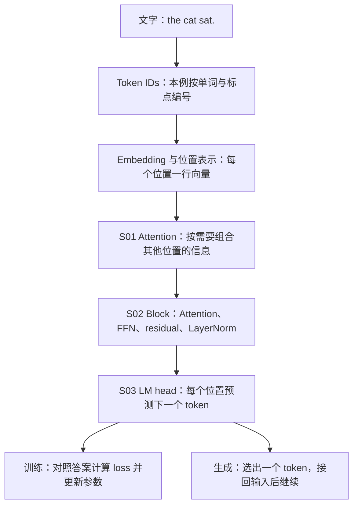
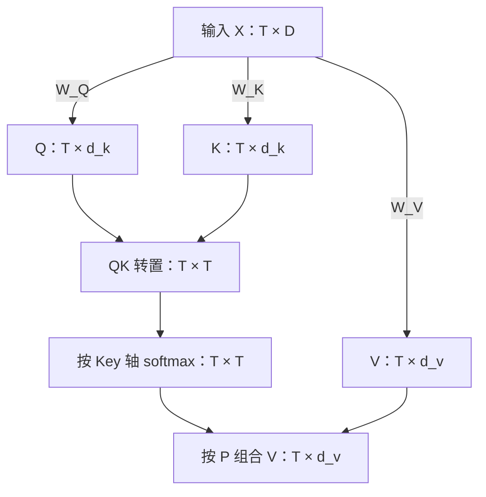
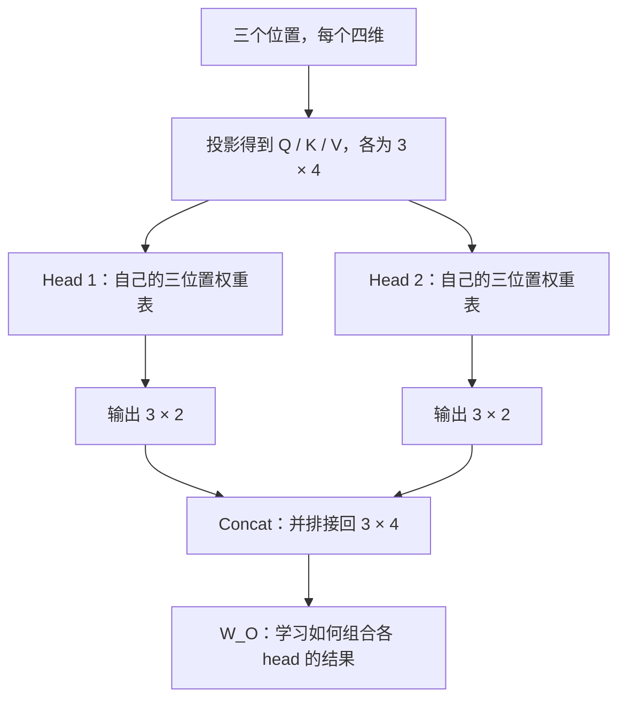
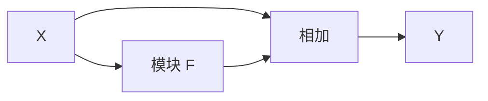
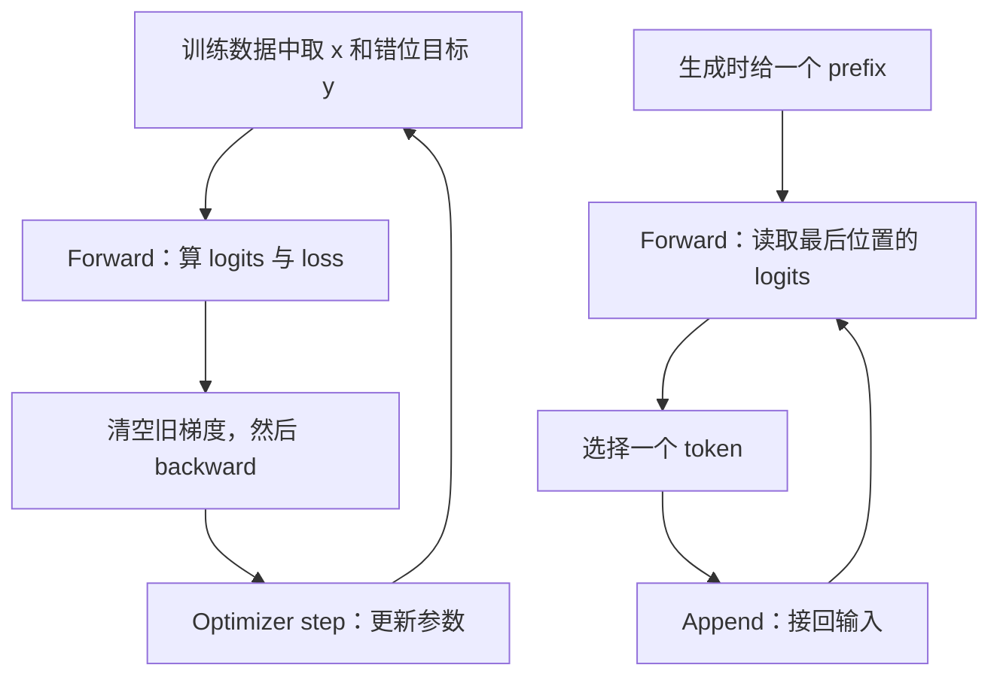

# A1·S01–S03 入门讲义：从一排文字到一个会续写的小模型

> 审阅稿 · 2026-09-14 · 面向 Summer 本次入门需要，也供相同基础的学员使用。
> 阅读推荐：[浏览器版 HTML](s01-s03-primer.html)，公式与图已内置，可离线打开；本 Markdown 是编辑源稿。HTML 的正文可单文件阅读，课程与演示链接需保留仓库相对目录。
> 配套 [汇总课表与授课安排](s01-s03-overview.md)。本稿先完整讲解；读后按 [Summer 学习流程](../../learners/summer/learning-workflow.md) 做知识点问答、少量手算、口述编程与调试回顾。练习样例是待执行安排，尚不是学习结果。阅读完成不自动记为课次通过。

## 0 · 先看全程，知道每一步为什么存在

我们要理解一个具体过程：给模型一小段文字，它怎样预测接下来出现的 token。前三课分别解决三个问题：**S01 让位置之间交换信息，S02 把这种计算组装成网络，S03 用正确答案训练网络并让它续写。**



这是一张概念地图，实际网络中 S01 的 Attention 位于 S02 的 block 内；不是先单独跑一遍 Attention，再额外跑完整 block。

本文不假设你已学过线性代数或反向传播。每个新概念都给出够用的定义和已算好的例子；公式用于对齐含义，不要求背诵。现场每轮读一个“知识点”，由讲师展示结果，再连接下一点。

主例子是 `the cat sat.`（猫坐下了）与 `the dog slept.`（狗睡着了）。它们只用于把计算讲清楚，不足以作为泛化评测语料。向量、概率和模型尺寸凡未另说明均是人为示例；它们不是训练结果，也不是后续实验的固定配置。

## 1 · 先会读模型里的数字

### 知识点 1 · Token 是处理单位，ID 是编号，向量才是后面运算的表示

**Token（处理单位）** 是 tokenizer 把文字切分后交给模型的单位。一个完整单词可以是一个 token；一个词片段、字符或标点也可以是一个 token，取决于具体的 **tokenization（切分方法）**。

入门先采用 **word-level tokenization（词级切分）**：英文单词各占一个 token，句号单独占一个，空格只作分隔、不进入本例词表。

```text
the cat sat.   → [the, cat, sat, .]
the dog slept. → [the, dog, slept, .]
```

两句话共有五个不同单词和一个句号，形成六项 **vocabulary（词表）**：

| Token | `the` | `cat` | `dog` | `sat` | `slept` | `.` |
|---|---:|---:|---:|---:|---:|---:|
| Token ID | 0 | 1 | 2 | 3 | 4 | 5 |

ID 从 0 开始编号。两句分别编码为 `[0, 1, 3, 5]` 和 `[0, 2, 4, 5]`。编号只是查找位置，ID 5 不比 ID 2“强”，相邻 ID 也不保证意思相近。后面用 **embedding table（嵌入表）** 为每个 ID 查出一行可训练的向量。

先区分三件东西：单词 `cat` 是原始符号；数字 `1` 是它的 ID；例如 `[0.2, -0.4, 0.1, 0.7]` 才是它的一个示意向量表示。

**为什么不直接把词根当作 token？** 词根属于语言学结构；现代 tokenizer 常用的 **subword（词片段）** 通常从语料中学习，不保证遵守词根、前缀或后缀的边界。可以用 `played → play + ed` 帮助想象“一个词拆成几个片段”，但这不是某个实际 tokenizer 的已验证输出。真实切法必须检查那个模型的 tokenizer。词级例子足够直观；遇到词表外的新词时，它还需要额外处理，而真实 tokenizer 往往能借助更小的片段表示。

> **讲义与实验的接口：** 本稿用 word-level 讲清机制。原 [S03 实验](s03-tiny-gpt-training.md) 仍使用 English character-level：一个字符一格。进入原实验时，更换的是切分方式、词表与 token 序列长度；Q/K/V、causal mask、embedding、LM head 和 targets 错位一格的关系不变。本文的六项词表不是对原实验配置的修改。

### 知识点 2 · Vector、matrix 与 shape：数字排在哪里，各维代表什么

**Scalar（标量）** 是一个数；**vector（向量）** 是一串有顺序的数；**matrix（矩阵）** 是按行列排列的数；**tensor（张量）** 在这里是这些多维数组的统称。**Shape（形状）** 记录每个轴的长度。

后面反复使用三个轴名：**B 是一起处理的样本数，T 是每条样本的 token 数，D 是每个 token 的表示宽度**。一个 `(B,T,D)` 张量就是“B 条样本，每条 T 行，每行 D 个数”。前导与 S01 先只看一条样本，省略 B；S02 多头和 S03 训练再把 B 明写出来。

若三个 token 各用两个数字表示，按行堆起来：

$$
X=\begin{bmatrix}2&0\\0&2\\1&1\end{bmatrix},\qquad \operatorname{shape}(X)=(3,2).
$$

三行分别属于三个 token，两个列位置属于表示的两个维度。这里可以把三行对应到 `the`、`cat`、`sat`，但这些手工数字没有预设语义；真实 embedding 的各维也通常不能逐列命名为“颜色”“动物”等人类概念。

另一类矩阵是 **parameters / weights（参数 / 权重）**，常记为 $W$。输入 $X$ 随样本改变，参数 $W$ 则由训练逐步修改。由二者算出的中间向量叫 **activations / hidden states（中间激活 / 隐藏表示）**。它们不是另一套需要独立保存和优化的权重。

### 知识点 3 · Dot product 与 matrix multiplication：对应相乘再相加

**Dot product（点积）** 把两个等长向量对应相乘后相加：

$$
[1,2]\cdot[3,4]=1\times3+2\times4=11.
$$

**Matrix multiplication（矩阵乘法）** 把“左边每一行与右边每一列做点积”批量执行。

这里直接用后面 QKᵀ 的尺寸：三个 token，每个向量两个数。令 Q 和 K 暂时取同一组手工数：

$$
Q=K=\begin{bmatrix}2&0\\0&2\\1&1\end{bmatrix}\quad (3,2),\qquad
K^\top=\begin{bmatrix}2&0&1\\0&2&1\end{bmatrix}\quad (2,3).
$$

**Transpose（转置）** 交换行和列，所以 K 的每一行变成 Kᵀ 的一列。一次矩阵乘会得到所有位置之间的匹配分数：

$$
\underbrace{Q}_{3\times2}\quad\underbrace{K^\top}_{2\times3}
=\underbrace{\begin{bmatrix}4&0&2\\0&4&2\\2&2&2\end{bmatrix}}_{3\times3}.
$$

| 输出中的格子 | 左边的一行 · 右边的一列 | 已算好的值 | 对应关系 |
|---|---|---:|---|
| 第 1 行第 1 列 | `[2,0] · [2,0]` | 4 | Query 1 匹配 Key 1 |
| 第 1 行第 2 列 | `[2,0] · [0,2]` | 0 | Query 1 匹配 Key 2 |
| 第 1 行第 3 列 | `[2,0] · [1,1]` | 2 | Query 1 匹配 Key 3 |

因此 **`(3,2) @ (2,3) → (3,3)` 就是 matrix multiplication**；它的每一个格子都是一个 dot product。`(1,2) @ (2,2) → (1,2)` 也是同一种运算；这里的三位置例子直接对应 Attention。

记住 shape 规则：**`(m,n) @ (n,p) → (m,p)`**。中间的 n 个特征被“对应相乘再求和”；外面的 m 和 p 留下来，分别是 Query 位置与 Key 位置。这一步得到的是 **位置 × 位置** 的分数表，既不是词表，也不是新的特征维度。

矩阵乘还有另一种用途：`X @ W` 将每个 token 的输入维度组合成新的特征，叫 **linear projection（线性投影）**。同样的矩阵乘，根据两边各轴的含义，可以完成“位置匹配”或“特征变换”。不要只背数字。

Python 数组中 `@` 表示矩阵乘，`*` 通常是逐元素乘。带 batch 的 K 要交换最后两个轴，即 `transpose(-2, -1)`；不要把整块张量的 B、T、D 全部倒过来。知识点 15 会展开。

### 知识点 4 · Weighted sum：按比例组合内容

**Weighted sum（加权和）** 就是每份内容乘上自己的权重后相加。例如两份内容为 `[2, 0]` 与 `[0, 2]`，权重为 0.75 与 0.25：

$$
0.75[2,0]+0.25[0,2]=[1.5,0.5].
$$

权重非负且总和为 1 时，也可以叫加权平均。它不是只挑第一份，也不会把第二份完全删除；每一份都有相应贡献。Attention 后半段做的就是这件事。

这里的“权重”是当前计算得到的分配比例。它和上一点中经训练保存的参数 $W$ 同名但不是同一种对象，后面分别记为 $P$ 和 $W$。

### 知识点 5 · Activation function：为什么要让网络有“拐弯”的能力

**Activation function（激活函数）** 对中间数值做非线性变换。常见的名称是 **ReLU**；与它相近的常见版本是 **LeakyReLU**。先把两者一起认识。

$$
\operatorname{ReLU}(x)=\max(0,x),\qquad
\operatorname{LeakyReLU}(x)=\begin{cases}x&x\ge0\\\alpha x&x<0.\end{cases}
$$

这里演示取 $\alpha=0.1$，它是教学选择，不代表任何库的默认值。

| 输入 x | -2 | -1 | 0 | 1 | 2 |
|---|---:|---:|---:|---:|---:|
| ReLU(x) | 0 | 0 | 0 | 1 | 2 |
| LeakyReLU(x)，α=0.1 | -0.2 | -0.1 | 0 | 1 | 2 |

直观看，ReLU 把负半轴压平，正半轴原样保留；LeakyReLU 在负半轴留下一条小斜坡。对一行 `[-2,1,3]` 逐元素作用，ReLU 得到 `[0,1,3]`，**shape 仍是 `(3,)`**；对 `(B,T,D)` 的张量作用，shape 也不变。

连续两次线性变换，无论堆多宽，整体仍可以合成一次线性变换；即使带 bias，也只是一次 affine transformation。插入非线性激活，网络才可以表达这样的“不同区域，采用不同变化规则”。这就是 FFN 的 `linear → activation → linear` 结构不能只剩两次 linear 的原因。

ReLU 在负区间的局部导数为 0，某些单元可能长期收不到有效更新，俗称 **dying ReLU**；LeakyReLU 的负斜率提供一条小梯度路径，但也不保证整个深层网络梯度正常。导数和 gradient 在知识点 22 再细讲。

本课 Tiny GPT 实际使用 **GELU**：$\operatorname{GELU}(x)=x\Phi(x)$，其中 $\Phi$ 是标准正态分布的累计概率。它提供平滑的非线性，不必现在推导；只需知道“GELU 用了概率函数”不意味着它的输出是概率。ReLU、LeakyReLU、GELU 的输出都不要求落在 0–1，也不要求加起来等于 1。

```reader-demo
activation
```

HTML 中可移动 x 查看 ReLU 与 LeakyReLU 两条曲线；曲线是函数直接计算的结果，没有训练过程。

### 知识点 6 · Score 与 probability：softmax 把分数变成分配比例

**Score（分数）** 可以是任意实数，负分也正常；**probability（概率）** 非负且在全部候选上总和为 1。

**Softmax** 先对每个分数做指数运算，再除以总和：

$$
p_j=\frac{\exp(s_j)}{\sum_m\exp(s_m)}.
$$

$\exp(s)=e^s$，其中 $e\approx2.718$。只需先知道：指数值总是正的，原分数越高指数值越大。例如分数 `[0, 0]` 得到 `[0.5, 0.5]`；分数 `[2, 0]` 得到约 `[0.881, 0.119]`。

Softmax 自身没有可训练参数。它把分数差转换为相对比例，但并不验证“高分候选是否真的正确”。Attention 中的比例用于分配读取内容；语言模型输出层的比例则用于预测下一个 token，二者的候选集合不同。

### 知识点 7 · Sigmoid、softmax 与 BCE：转换概率和评价错误是两件事

**Sigmoid**将一个实数分数 z 映射到 0–1：

$$
p=\sigma(z)=\frac{1}{1+\exp(-z)}.
$$

z 为 -2、0、2 时，p 分别约为 0.119、0.5、0.881。若问题是“这个物体能抓取吗”，把 p 解释为“是”的概率，“否”的概率就是 1−p。

**Softmax** 则对一组分数一起归一化，适合“在多个互斥候选中选一个”。相同分数 `[2,0]` 经过 sigmoid 和 softmax，会出现不同结果：

| 转换 | 输出 | 在回答什么 | 归一化范围 |
|---|---|---|---|
| 对 `[2,0]` 分别 sigmoid | `[0.881,0.500]` | 两个各自的是/否判断，如“红色吗”和“方形吗”；两者可同时成立 | 每个事件的“是 + 否”为 1；两个“是”不要求总和 1 |
| 对 `[2,0]` 一起 softmax | `[0.881,0.119]` | 两个互斥候选，如“选 cat 还是 dog” | 两个候选的概率总和为 1 |

两种转换不改变输入的 shape；softmax 需要指明沿哪一个轴归一化。也可以用两个 logits 的 softmax 表示二分类：第一类的概率等于 $\sigma(z_1-z_2)$，所以这里 `[2,0]` 的第一项恰好等于 sigmoid(2)。

**Binary cross-entropy（BCE，二元交叉熵）是 loss，不是概率转换函数。** 它既需要预测概率 p，也需要真实标签 y（这里 y 为 0 或 1）：

$$
\ell_{BCE}=-\big[y\log p+(1-y)\log(1-p)\big].
$$

例如 p=0.8：标签 y=1 时 loss≈0.223；标签 y=0 时 loss≈1.609。同一个预测，由于正确答案不同，loss 就不同。对多个位置/事件可先逐项计算，再按约定平均。

| 任务 / 输出 | 概率转换 | 训练 loss 的常见接口 |
|---|---|---|
| 一个是/否事件；一项 logit | sigmoid | `BCEWithLogitsLoss(logits, binary_targets)` |
| 多个可同时为真的标签；每项一项 logit | 每项 sigmoid | 对各标签计算 BCE，再按约定聚合 |
| 下一个 token 属于词表中的哪一项；V_vocab 个 logits | 沿词表轴 softmax | `cross_entropy(logits, class_ids)` |

训练时优先把 **原始 logits** 交给组合后的稳定 loss 接口。`BCEWithLogitsLoss` 已包含 sigmoid；`cross_entropy` 已包含 log-softmax，不要在它们前面重复转换。单独 `BCELoss` 才接收概率。Attention 里的 softmax 只是分配读取比例，本身不是某个 BCE 或 CE loss。

### 知识点 8 · Logit、prob、log-prob：同一个预测的不同表示

**Logit / logits** 在神经网络分类输出的代码中通常指概率转换前的实数分数；**probability / prob** 是转换后的概率 p；**log-probability / log_prob** 是 $\log p$。下表把同一组二选一预测从头连起来：

| 表示 | 两个候选的值 | 数值范围 / 约束 | 含义 |
|---|---|---|---|
| logits z | `[2,0]` | 任意实数；总和无要求 | 模型的相对分数 |
| probs = softmax(z) | `[0.881,0.119]` | 每项 0–1；这一组总和 1 | 在二者中选谁的概率 |
| log_probs = log_softmax(z) | `[-0.127,-2.127]` | 不大于 0；不要求总和 1 | 每个概率取自然对数 |
| NLL，正确答案为第一项 | `0.127` | 非负；这是一个位置的标量 loss | 取正确项的负 log-prob |

这些是**示例分数**，不是用前文 QKᵀ 算出来的 Attention 权重，也不是已训练模型的输出。

二分类中，数学上的 **logit function** 特指 $\operatorname{logit}(p)=\log\frac{p}{1-p}$，是 sigmoid 的逆函数。例如 p=0.8 的 logit≈1.386；log-prob≈−0.223；两者明显不是同一个数。端点 p=0 或 1 对应 log-odds 的无穷极限。

多分类的 logits 则不唯一：`[2,0]` 与 `[102,100]` 的 softmax 相同，因为所有分数加同一个常数会抵消。不能把每个类别的 logit 直接当成该类别的 log-prob 或 log-odds。

$$
\log p_i=z_i-\log\sum_j\exp(z_j).
$$

为什么这些表示在 NN 中反复出现：

- **Logits 容易产生：** 最后的 linear 层自然输出实数，不必先把参数限制在 0–1；sigmoid/softmax 再施加概率约束。
- **Prob 便于解释与采样：** 可以读作置信分配，并据此抽取下一个 token；概率是否校准仍需数据验证。
- **Log-prob 便于处理序列：** 序列概率是各步条件概率的乘积；取 log 后变成求和。例如 `0.1×0.1×0.1=0.001`，对应 `−2.303−2.303−2.303≈−6.908`。长序列直接乘小数容易数值下溢。
- **NLL / CE 便于训练：** 提高正确答案的概率，等价于降低它的负 log-prob。自动微分可沿这条连续计算链把误差信号传回参数。

实际实现用 `log_softmax` 或带 logits 的 loss，在数学等价的基础上采用稳定计算。例如先减去最大 logit 再做指数；比先求 softmax 再取 log 更能避免数值溢出/下溢。这里解释数值动机，不要求学员手工实现生产级稳定核。

```reader-demo
probability
```

HTML 中移动 z 并切换标签 y，可以同时看到 sigmoid prob、log-prob 和 BCE；softmax 对 `[z,0]` 的输出也一起显示。注意：切换 y 会改变 loss，预测概率不会因此改变。

## 2 · A1·S01：一次完整 Attention

### 知识点 9 · Q、K、V 是同一输入的三种用途

**Query（Q，查询）** 用来发起匹配；**Key（K，检索键）** 用来接受匹配；**Value（V，内容）** 是匹配后实际参与组合的向量。



计算为 $Q=XW_Q, K=XW_K, V=XW_V$。三套投影参数在训练中学习；Q/K/V 是本次输入计算出的结果。相同输入在同一层中承担不同角色，下一层还会从新的 hidden states 重新产生 Q/K/V。

**Self-attention** 表示 Q/K/V 来自同一序列；**cross-attention** 表示 Q 来自一个序列，K/V 来自另一个序列。这个区别看输入来源，不看三个 W 是否相等。

读 QKV 时先标注轴，再看数字。这里先省略 batch：**T 是 token 数，D 是模型表示宽度；$d_k$ 是 Query/Key 的匹配维度，$d_v$ 是 Value 的内容维度**。

| 对象 / 操作 | 通用 shape（单头、无 batch） | 本例 T=3、D=d_k=d_v=2 |
|---|---|---|
| 输入 X | `(T,D)` | `(3,2)` |
| 参数 W_Q、W_K | 各为 `(D,d_k)` | 各为 `(2,2)` |
| 参数 W_V | `(D,d_v)` | `(2,2)` |
| Q=XW_Q、K=XW_K | 各为 `(T,d_k)` | 各为 `(3,2)` |
| V=XW_V | `(T,d_v)` | `(3,2)` |
| Kᵀ | `(d_k,T)` | `(2,3)` |
| R=QKᵀ → S → P | 各为 `(T,T)` | 各为 `(3,3)` |
| O=PV | `(T,d_v)` | `(3,2)` |

Q 与 K 的最后一维必须一致才能点积；V 的 $d_v$ 可以与 $d_k$ 不同。只是这份小例子都取 2，便于算数。各套 W 在所有 token 位置共享，既没有为每个词单独保存一个 W，也没有把 token ID 当矩阵值。

**V 是 Value 张量的名字，不是“D 变成的维度”。** 词表大小始终写作 **V_vocab**。只有 S03 的 LM head 才把每个位置的 D 维表示映射为 V_vocab 个候选分数；那是一次新的投影。

本课主线保持 self-attention。可选的 [机器人检索演示](demos/qkv-robot-walkthrough.html) 用指令查询物体，属于 cross-attention；它能帮助理解“匹配属性”和“取回内容”为什么分开，但不替代本课的同源例子。

### 知识点 10 · 一张分数表：每一行属于一个 Query

沿用知识点 2 的三个向量。为了看清计算，临时把三套 W 都设为 **identity matrix（单位矩阵）**：对角线为 1，其余为 0，乘它保持原向量不变。因此本例 $Q=K=V=X$。这是演示简化，不是模型必须如此初始化或训练的约定。

先算未缩放的点积分数 $R=QK^\top$：`(3,2) @ (2,3) → (3,3)`。这就是知识点 3 的完整矩阵乘；Query 轴留下作行，Key 轴留下作列：

$$
R=\begin{bmatrix}4&0&2\\0&4&2\\2&2&2\end{bmatrix}.
$$

第 1 行 `[4, 0, 2]` 表示第 1 个 token 分别与三个位置匹配的结果。第 3 行都是 2，表示它对三个位置的原始匹配分相等。

点积是可学习的匹配方式，会同时受到向量方向和长度影响，不能直接当作人类语义相似度。真实 Q/K 由训练形成；本例的对角高分来自手工输入及 Q=K 的特殊设置。

### 知识点 11 · 缩放与 softmax：分数表变成 Attention map

Key 向量的长度记为 $d_k$。使用

$$
S=R/\sqrt{d_k},\qquad P=\operatorname{softmax}(S,\text{按行}).
$$

为什么缩放：在分量近似独立、零均值、方差合适的假设下，点积方差随维度增大。分数差过大容易使 softmax 过度集中，对分数的局部梯度也可能变小。除以 $\sqrt{d_k}$ 稳定尺度，并不保证任何输入都不会饱和；关于 gradient 的含义，知识点 22 会展开。

本例 $d_k=2$，完整结果如下，已算好无需逐项计算：

| Query 所在位置 | 缩放后分数 S：看位置 1 / 2 / 3 | 权重 P：看位置 1 / 2 / 3 |
|---|---|---|
| 位置 1 | `[2.828, 0, 1.414]` | `[0.768, 0.045, 0.187]` |
| 位置 2 | `[0, 2.828, 1.414]` | `[0.045, 0.768, 0.187]` |
| 位置 3 | `[1.414, 1.414, 1.414]` | `[0.333, 0.333, 0.333]` |

P 叫 **attention map（注意力权重表）**。每行对所有可读位置分配总计 1 的权重；显示到三位小数时可能有舍入误差。按行归一化，不要求每列也加起来等于 1。

### 知识点 12 · O = PV：输出仍是一行行向量

P 的 shape 是 `(3,3)`，V 是 `(3,2)`，所以 **`O = P @ V : (3,3) @ (3,2) → (3,2)`**。对 Key 位置求和之后，保留 Query 位置和 Value 特征。位置 1 的输出是一行 `(2,)` 向量：

$$
o_1=0.768[2,0]+0.045[0,2]+0.187[1,1]\approx[1.723,0.277].
$$

计算时保留完整精度后统一舍入，三个输出为：

$$
O=PV\approx\begin{bmatrix}1.723&0.277\\0.277&1.723\\1&1\end{bmatrix}.
$$

位置 3 的分数相同，所以权重均匀，输出是三个 V 的平均。平均刚好等于 `[1,1]` 是这个例子的数字巧合，不是 Attention 强制它复制自己。

注意 Attention 到此只产生新的表示。它既没有选出下一个 token，也没有直接给出动作；token 预测要到 S03 接上 **language-model head（LM head，语言模型输出层）** 才发生。

### 知识点 13 · Mask 与 Attention 的边界

**Mask（掩码）** 指明哪些位置允许被读取。对被禁止的位置，在 softmax 前把分数填成 $-\infty$，其指数值为 0，于是分不到权重。例如位置 1 禁止读取位置 3 后，权重变为约 `[0.944, 0.056, 0]`。

把分数乘以 0 不等价：$e^0=1$，仍会分走权重。普通 softmax 的每个有效 Query 至少要有一个可读位置；全被屏蔽需要实现另行处理。

这一版尚无位置编码，也无位置相关 mask。把输入行重排，输出会按同样方式重排，叫 **permutation equivariance（置换等变性）**。它不会凭空知道 token 位于第几个位置。

还要澄清一个常见简化：共享 $W_Q=W_K$ 是可以实现的约束，不是数学上禁止。未加 mask 时，它让点积分数表对称；按行 softmax 后，因为行分母可能不同，P 不一定对称。独立投影给模型更灵活的、有方向的匹配能力。

S01 的自然停止点：已经看见完整的“生成 Q/K/V → 匹配 → 分配 → 加权读取”。下一课保持这套运算，解决读取范围、多头和网络组装。

## 3 · A1·S02：从 Attention 到 decoder block

### 知识点 14 · Causal mask：一次处理全句，也不能偷看答案

**Autoregressive（自回归）** 生成，是根据已有 token 预测下一个，再把预测接回输入。以 `the cat sat.` 为例：看到 `the`，目标是 `cat`；看到 `the cat`，目标是 `sat`；看到 `the cat sat`，目标是句号。

训练可以把 `the`、`cat`、`sat` 同时放入输入，但它们各自的预测只能使用当前位置及过去的信息。**Causal mask** 固定如下可读范围：

| 发起查询的位置 | 可读 `the`（位置 1） | 可读 `cat`（位置 2） | 可读 `sat`（位置 3） | 此位置的预测目标 |
|---|---|---|---|---|
| `the` | 允许 | 禁止 | 禁止 | `cat` |
| `cat` | 允许 | 允许 | 禁止 | `sat` |
| `sat` | 允许 | 允许 | 允许 | `.` |

“输入中有当前 token”正常，因为答案是下一个 token。若预测位置 1 能读输入位置 2，就直接看见答案 `cat` 了。另一句中 `the` 后面是 `dog`，因此这里的“目标”指这一条样本的答案，不表示 `the` 后永远只能接 `cat`。

对 S01 的同一份向量，causal 版 P 为：

$$
P_{\mathrm{causal}}\approx\begin{bmatrix}1&0&0\\0.056&0.944&0\\0.333&0.333&0.333\end{bmatrix}.
$$

第一行 Attention 加权结果是它自己的 V，但整个 block 还会做投影、残差和 FFN，不能因此说第一个 token 的网络输出等于原输入。

固定 causal mask 会引入前后不对称，任意重排输入时通常不再保持原来的置换等变性。它规定“能看谁”；显式 position embedding 告诉网络“在什么位置”。二者不能互相替代，causal mask 也可能提供部分隐式位置线索。

### 知识点 15 · Multi-head：同时学习多套信息组合方式

单头每条样本只有一张 P。**Multi-head attention（MHA）** 让多个 heads 各自形成 P，分别组合内容，随后汇合。不同 heads 的具体功能由训练形成，不保证固定分工为“语法头”“位置头”等。

为展示两个 heads，这里把模型宽度从 S01 的 2 改为 4；序列仍有三个位置。设 head 数 $H=2$，每头维度 $d_h=4/2=2$。



#### Shape 实战：B、T、H、d_h 的轴怎样变换

**B（batch size）** 是一起处理的样本数，不是一个需要被混合的特征轴。**T（sequence length）** 是每条样本的 token 数；S01 中有时写 L，含义相同。**H（head count）** 是头数；标准等宽 MHA 取 $d_h=D/H$，所以 D 必须能被 H 整除。本例 B=2、T=3、D=4、H=2、d_h=2：

| 步骤 | 带轴名的 shape | 本例数字 | 实际发生什么 |
|---|---|---|---|
| X | `(B,T,D)` | `(2,3,4)` | 两条样本，各三个 token |
| 投影得到 Q/K/V | 各为 `(B,T,D)` | 各为 `(2,3,4)` | `W_Q/W_K/W_V` 各 `(D,D)`；每列可读取全部输入特征 |
| 将最后 D 维分成 H×d_h | `(B,T,H,d_h)` | `(2,3,2,2)` | `reshape`：拆分 projected feature 轴 |
| 把 head 轴移到 T 前 | `(B,H,T,d_h)` | `(2,2,3,2)` | `transpose(1,2)`：交换轴的次序 |
| 只对 K 的末两轴转置 | `(B,H,d_h,T)` | `(2,2,2,3)` | `transpose(-2,-1)`；B/H 不动 |
| Q @ Kᵀ | `(B,H,T,T)` | `(2,2,3,3)` | 每个 batch、每个 head 独立做 `(3,2) @ (2,3)` |
| scale、causal mask、softmax | `(B,H,T,T)` | `(2,2,3,3)` | 沿最后一个轴，即 Key 位置，分配权重 |
| P @ V | `(B,H,T,d_h)` | `(2,2,3,2)` | 每个 batch、head 独立加权读取 |
| 把 head 轴移回 | `(B,T,H,d_h)` | `(2,3,2,2)` | 再 `transpose(1,2)`，恢复按 token 排列 |
| 拼回模型宽度 | `(B,T,D)` | `(2,3,4)` | 合并末两维，必要时先整理连续内存 |
| 乘 W_O | `(B,T,D)` | `(2,3,4)` | `W_O:(D,D)`，学习各 head 的组合 |

**Reshape 与 transpose 不是一回事。** 把 `(B,T,H,d_h)` 直接 reshape 为 `(B,H,T,d_h)`，即使元素数相同，也会把 token/head 的归属弄错。正确交换轴后，`Q_heads[b,h,t,r]` 应对应 `Q_projected[b,t,h*d_h+r]`；合并输出前也要先交换回来。PyTorch 中 `transpose` 后通常不连续，`reshape` 可以按需复制；用 `view` 时通常要先 `contiguous()`。连续性是存储问题，轴的语义顺序仍需你自己保证。

B 和 H 在 batched matmul 中是前导批维，不参与本次的点积求和。在这套 self-attention 中 Q/K/V 的 B、H 对齐；不要依赖意外 broadcasting 掩盖错误。`(T,T)` 的公共 causal mask 可以扩展为 `(1,1,T,T)` 广播到 B/H；每条样本不同的 padding mask 还要单独保留 B 信息。

开发时固定三个习惯：**每一步写轴名与尺寸；softmax 明写轴；检查一个具体元素的归属。** 例如查 P 的每个有效行在 Key 轴之和为 1；修改样本 2 不应影响样本 1；修改未来 token 不应影响过去位置的输出。只检查 shape 数字相同，还不足以发现 T/H 交换错误。

**Concat（拼接）** 把各头输出并排放回去；**output projection $W_O$** 才负责可学习的线性混合。每头分数除以 $\sqrt{d_h}$，不是总宽度的平方根。

在总宽度 D 固定的标准 MHA 中，reshape 本身不增加 Q/K/V 参数；也不能由此推断内存完全不变，因为有 H 张 attention maps。朴素 attention 的两次主要矩阵乘随 $L^2D$ 增长，完整注意力权重存储随 $HL^2$ 增长。序列长度 L 翻倍时这些二次项约为四倍，不能把这个结论套给所有网络操作。

### 知识点 16 · Residual connection：保留原表示，再加入修改量

**Residual connection（残差连接）** 的基本形式是：

$$
Y=X+F(X).
$$

F 是一个处理模块。假设原表示 `[1,2]`，模块算出修改量 `[0.1,-0.3]`，新表示就是 `[1.1,1.7]`。模块可以在原表示基础上修正，不必每层重新生成全部信息。



直通路径也为梯度提供直接传播的分量，有助于深层网络训练；它不保证总梯度永不消失，也不保证信息绝不改变。相加要求两条分支的 shape 一致，这就是 block 输入输出通常维持同宽的重要原因。

### 知识点 17 · LayerNorm：控制单个 token 表示的数值尺度

**LayerNorm（层归一化）** 对每个 token 自己的 D 个特征计算均值和方差，然后标准化，再进行可学习的缩放和平移。它不跨 batch 混合其他样本的统计量。

均值是这些数的平均；方差是“每个数减去均值后的平方”的平均。例如向量 `[1,3]` 的均值是 2、方差是 1，标准化后约为 `[-1,1]`；实现还加一个很小的 $\epsilon$ 防止除以零，并带可训练参数。

它帮助控制送进下一模块的数值尺度，通常改善训练条件。它不是 softmax：LayerNorm 输出可为负，也不要求和为 1；它也不是 gradient norm，后者是训练时观察梯度大小的指标。

**Pre-LN** 表示先做 LayerNorm，再送进 Attention 或 FFN。本课采用这种结构，便于保留清晰的残差直通路径；“采用 Pre-LN”不等于任何超参下训练都稳定。

### 知识点 18 · FFN 与 block：位置间交流之后，逐位置加工

**Feed-forward network（FFN）** 是对每个位置分别应用的同一个小网络。它不在这个子层直接读取其他位置，而是加工该位置已汇集的信息。

本课使用 `D → 4D → D` 的常见形式：先线性扩展中间维度，经过 **activation function（激活函数）**，再投影回 D。激活函数提供非线性：例如 ReLU 把负数变成 0；本课 Tiny GPT 使用平滑的 GELU。激活函数的数值行为见知识点 5；它作用于扩展后的 `(B,T,4D)`，不改变该 shape，第二次 linear 才投影回 `(B,T,D)`。没有非线性，两次线性变换可以合成一次，扩大中间层并不能获得相同的表达收益。4D 是本课的结构选择，不是所有 FFN 必须遵守的常数。

一个 **Transformer block** 将两组子层接起来：

$$
Y=X+\operatorname{MHA}(\operatorname{LN}(X)),
$$
$$
Z=Y+\operatorname{FFN}(\operatorname{LN}(Y)).
$$

第二次残差加的是已经更新的 Y，第二个 LN 也读取 Y。Attention 负责位置之间的内容组合，FFN 负责逐位置非线性加工，residual 负责相加连接，LayerNorm 调整数值尺度。叠多个 block 就能反复执行这两类处理。

S02 到此只得到了“输入向量，输出向量”的网络。权重若尚未训练，能 forward 只证明程序能计算，不证明模型已理解文字。可用 [MHA 与 block 演示](demos/multihead-and-block.html) 对照这条路径，然后进入 S03。

## 4 · A1·S03：把网络接上文字、答案与学习

### 知识点 19 · Embedding、position 与 batch：给 block 准备输入

回到知识点 1 的六项词表。**Token embedding** 是一张 $6\times D$ 的可训练表。ID 1 查第 1 号行（从 0 编号，即表中第二行）得到 `cat` 的向量；这是查表，不是把编号 1 当作大小或语义来乘。

本课 Tiny GPT 还为各位置准备 **learned position embedding（可学习位置嵌入）**。对应位置向量与 token 向量相加，得到 block 的输入：

$$
X_0=E_{\mathrm{token}}[x]+E_{\mathrm{position}}[\mathrm{positions}].
$$

同一个单词若出现在不同位置，会查到相同 token embedding，但会加上不同位置表示；经过 blocks 后，它还会因上下文不同得到不同 hidden states。

**Batch** 是一起处理的多条样本。设 $B=2$ 条样本、每条 $T=3$ 个 token、每个向量 $D=4$ 维：

| 对象 | 示例 / 含义 | Shape |
|---|---|---|
| 输入 IDs | `the cat sat` 与 `the dog slept`；`[[0,1,3],[0,2,4]]` | `(2,3)` |
| 查表并加位置 | 每个 ID 变成四维向量 | `(2,3,4)` |
| Blocks 输出 | 每个位置仍有一个四维 hidden state | `(2,3,4)` |

Batch 维不会让 `the cat sat` 读取另一条样本 `the dog slept` 的内容。T 在这里承担 S01 中 L 的角色：序列长度。上述尺寸只演示 shape；不代表后续 baseline 必须采用这些尺寸。

### 知识点 20 · LM head：把表示翻译成“下一个 token”的分数

**Language-model head（LM head）** 把每个位置的 D 维 hidden state 映射成词表大小个分数，叫 **logits（未归一化分数）**。本课在 blocks 之后先做一次 final LayerNorm，再送入线性的 LM head。为避免与 Attention 的 Value 矩阵 V 混淆，本文把词表大小写作 $V_{\mathrm{vocab}}$。

本例 $V_{\mathrm{vocab}}=6$，所以输出 shape 是 `(B,T,V_vocab)=(2,3,6)`。每条样本的每个位置都给六个候选 token 打分；不是整句只给一个答案。

把最后一步也写成 shape 运算：

$$
\underbrace{X_{\mathrm{final}}}_{B\times T\times D}
\underbrace{W_{\mathrm{LM}}}_{D\times V_{\mathrm{vocab}}}
\longrightarrow\underbrace{\mathrm{logits}}_{B\times T\times V_{\mathrm{vocab}}}.
$$

本例是 `(2,3,4) @ (4,6) → (2,3,6)`；带 final LayerNorm 的最终表示记作 X_final。**B、T 都留下，D 经 LM head 投影变为 V_vocab**。生成时只取最后位置，得到 `(B,V_vocab)=(2,6)`，再沿词表轴 softmax / sampling。训练时各位置的 label shape 是 `(B,T)`；若展平，logits 与 labels 必须按同一顺序变成 `(B*T,V_vocab)` 和 `(B*T,)`。使用不展平的 PyTorch `cross_entropy` 接口时，类别轴应位于第 1 维，即 logits 要排成 `(B,V_vocab,T)`，不能把 `(B,T,V_vocab)` 原样传入。

例如看完 `the cat` 后，LM head 可以给“下一个 token 是 sat”较高分，再由 softmax 转成概率。这个概率分布的候选是整个词表（五个单词和句号）；S01 的 P 则在输入位置之间分配权重。**两处都用 softmax，但在回答不同问题。**

也正因为输出层和训练目标赋予输出含义，Attention 本身没有“我要输出语言/动作”的固定开关。前三课先把 next-token prediction 这条接口讲透。

### 知识点 21 · Shifted targets 与 teacher forcing：每个位置究竟答什么

取一句话的四个 token 形成一个训练窗口，前面三个作输入，后面三个作答案：

| 数据窗口 | 输入 x | 目标 y |
|---|---|---|
| `the cat sat .` | `[the, cat, sat]` → `[0,1,3]` | `[cat, sat, .]` → `[1,3,5]` |
| `the dog slept .` | `[the, dog, slept]` → `[0,2,4]` | `[dog, slept, .]` → `[2,4,5]` |

**Target（目标/标签）** 是我们希望模型预测的正确答案。这里 y 比 x 向后错开一个 token，叫 **shifted targets**。位置 t 用已见的前缀预测下一个 token，而不是复述当前 token。

训练时每个位置都能读取真实的历史 token，称为 **teacher forcing**。配合 causal mask，所有位置的预测可以在一次 forward 中并行计算，互相不会偷看各自的未来答案。

若误写成 `y=x`，任务就变成复制当前 token。通过 embedding、residual 和输出层，模型可能很快做到，loss 也可能很好看；但它没有被要求预测下一个 token。因此“loss 下降”必须先追问这条 loss 对应的 target 究竟是什么。

### 知识点 22 · Loss、gradient 与 optimizer：参数究竟怎样变化

这是训练基础的集中补充，现场按下面四小步分别讲，不一次堆给学员。

#### 22a · Loss：先把预测错误变成一个数

**Loss（损失）** 是对当前预测错误的数值评分。Next-token prediction 使用 **cross-entropy（交叉熵，CE）**。对一个位置，它是正确答案概率的负自然对数：

$$
\ell=-\log p(\text{正确 token}).
$$

这里 log 是自然对数，是 exp 的逆运算。正确 token 概率为 0.8 时，loss 约 0.223；概率为 0.1 时，loss 约 2.303。因此给正确答案的概率越低，惩罚越大。整个 batch 通常对所有有效预测位置的 loss 取平均。

#### 22b · Gradient：参数轻微变化时，loss 怎么变

**Derivative（导数）** 描述某个变量轻微增加时，函数值在当前位置怎样变化；对每个参数分别考虑得到 **partial derivative（偏导数）**；把全部参数的偏导数组成向量，就是 **gradient（梯度）**，记作 $\nabla_\theta L$。

用一个独立的标量例子说明更新：若 $L=(w-3)^2$，当前 $w=1$，则 loss 是 4、梯度是 -4。**Learning rate（学习率）** 设为 0.1，普通梯度下降执行

$$
w_{\mathrm{new}}=w-0.1\times(-4)=1.4,
$$

新 loss 是 2.56。负梯度使 w 增大，朝降低该例 loss 的方向移动。步长太大仍可能越过合适区域；不保证每个 batch 或每次更新都下降。

#### 22c · Backward 与 optimizer：计算修改方向，再更新参数

在真实网络中，**backpropagation（反向传播）** 通过链式法则计算各参数梯度；**autodiff（自动微分）** 工具完成这些计算。**Optimizer（优化器）** 再使用梯度更新参数。本课实现采用 AdamW，它包含历史统计与 weight decay，实际更新不能直接等同于上述普通梯度下降公式。

#### 22d · Gradient norm：深度网络中，学习信号有没有传回来

**Gradient norm（梯度范数）** 衡量一组参数梯度的整体长度。把所有参与更新的参数梯度接成向量 g，常用 L2 norm：

$$
\lVert g\rVert_2=\sqrt{\sum_i g_i^2}.
$$

例如 g=[3,4]，norm=5。梯度 [-3,-4] 的 norm 也为 5，所以这个数保留大小，丢掉方向。它既不是 loss，也不是激活函数的输出；LayerNorm 处理的是 forward 中的特征，gradient norm 观察的是 backward 算出的梯度。

**为什么深层网络尤其需要它？** 反向传播要把很多层的局部导数/矩阵依次相乘。用一条标量路径作直觉：若 20 层的局部导数都是 0.5，连乘约 $9.54\times10^{-7}$；若都是 2，连乘为 1,048,576。真实网络有矩阵、分支和残差，并不等于这两条简单路径；它们说明了 **vanishing gradients（梯度消失）** 和 **exploding gradients（梯度爆炸）** 为什么会发生。Loss 的单个数值看不出哪个早期层已经收不到信号。

| 观察到什么 | 候选解释，不能直接当结论 | 下一步看什么 |
|---|---|---|
| 全局 norm 很大或突然尖峰 | 异常 batch、loss 尺度变化、梯度放大、数值问题 | 原始 loss、逐层 norm、输入范围、是否出现 NaN/Inf |
| 早期层 norm 很小，后面层仍大 | 梯度衰减、饱和、断开的计算图、冻结参数 | 分层/参数组梯度、`requires_grad`、梯度为 None 还是确实接近 0 |
| loss 很高，norm 却很小 | 饱和、目标/实现错误、样本梯度抵消、梯度链断开 | 真实 targets、单样本梯度、单 batch overfit |
| norm 较稳定，但验证不改善 | 更新可能可计算，但泛化或任务目标仍有问题 | held-out 指标、数据划分、实际更新长度与目标合同 |

**全局值 + 分层值要一起看。** 全局 norm 可能被最后一层的大梯度主导，掩盖前几层衰减；不同参数数量、loss 的 sum/mean、batch/累积方式、精度缩放与测量位置都会影响尺度，没有全模型通用的“健康 norm 必须小于某个常数”。跨层还可辅助看每参数 RMS，避免参数量差异混淆。

**记录位置要固定：** 在 `backward` 完成后、`optimizer.step` 之前，记录 **pre-clip norm**。使用 AMP loss scaling 时先 unscale；做 gradient accumulation 时在同一累积边界比较。需要 clipping 时同时记阈值、裁剪频率与 post-clip norm；只画裁剪后曲线，很可能把尖峰隐藏掉。清空梯度后读到的 0/None 没有同样含义。

**Gradient clipping（梯度裁剪）** 在 norm 超过阈值 c 时把整组梯度按同一比例缩小。理想化公式（非零 norm）为：

$$
g_{\mathrm{clip}}=g\,\min\left(1,\frac{c}{\lVert g\rVert_2}\right).
$$

例如 g=[3,4]、c=1，裁剪后是 `[0.6,0.8]`，norm 从 5 变为 1。它限制一次梯度的尺度，不修复错误 targets、NaN 来源或梯度消失，也不等于限制 loss。PyTorch 的 `clip_grad_norm_` 原地修改梯度，返回的是裁剪前总 norm；读取日志时不要误认成裁剪后值。

普通、无 momentum/weight decay 的 SGD 有 $\lVert\Delta\theta\rVert=\eta\lVert g\rVert$。AdamW 会结合历史统计并施加 weight decay，不能用 raw gradient norm 直接推断实际参数移动距离；必要时另外记录 update norm 或 update-to-weight ratio。

原 [Gradient norm 仪表盘](../t0-training-loop/demos/gradient-norm-dashboard.html) 展示二分类 toy 中 loss 与 gradient norm 的走势差别；各曲线按自己的最大值归一化，只能比较形状，不能读取实际梯度尺度或当作深层网络证据。

参数 W 在 optimizer step 时改变；Q/K/V 等 activations 在下次 forward 重新计算。看完这个知识点，应能把“loss 多大”“梯度传回来多少”“参数实际移动多少”分成三件事。

### 知识点 23 · 训练循环与生成循环：一个改参数，一个追加 token



**Training loop** 重复读样本、算预测、对照答案、算梯度和更新权重。常见的 `zero_grad` 清掉旧梯度，因为框架默认会累加；它应在本次 backward 之前执行，可以放在 forward 前，也可以放在 forward 后。`backward` 只计算梯度，`step` 才改变参数。

**Generation loop** 没有正确的未来答案，使用自己的输出作后续输入。参数保持固定，取当前序列最后位置的预测，选一个 token，追加后继续 forward。训练能够并行计算全部位置，并不意味着自回归生成也能一次知道全部未来 token。

**Argmax** 每次取概率最大的候选；**sampling（采样）** 按概率抽取候选。Temperature 调整分布集中程度，top-k 限制候选范围；它们改变生成选择方式，不能修复错误标签或 mask。上下文超过本课模型的窗口长度时，实现只保留最后一段输入。

代码中的 `model.eval()` 切换 dropout 等模块的运行方式；`no_grad()` 关闭该段计算的梯度记录。二者作用不同，评测和生成通常配合使用。入门阅读无需安装环境或启动训练。

### 知识点 24 · 三层证据：能记住、能泛化、任务写对了

训练前先展示 **corpus（语料）**、tokenization、训练窗口和目标、**train/validation split（训练/验证划分）**，以及用于生成的固定 prompt 来自哪里。学员需要先知道“模型见过什么”，才有条件解释结果。

**Single-batch overfit** 是反复训练同一小批样本，让容量足够的模型把它记住。它能检查训练链是否基本接通；成功不证明泛化，也不能独立证明 target shift 写对了。

**Validation** 用未用于参数更新的数据评估。训练 loss 继续降低、验证 loss 却上升，是 overfitting 的常见信号。两者都降低，支持模型在当前 held-out 分布上有改善；不自动证明换机器人、换任务或换语料后也成立。

本课在句子层面先划分 train/validation，再分别重复生成所需语料，防止同一句话的副本同时落入两侧。后续正式实验以 true next-token validation loss/accuracy 为主；生成文本只作 qualitative sanity check，不能只挑一句流畅输出判定训练成功。

可选指标 **perplexity（PPL）** 等于 $\exp(\text{平均 CE})$。若模型每次在六个候选 token 上均匀分配概率，则 CE 为 $\log6\approx1.792$，PPL 为 6。它便于理解概率预测的难度，但不是语言质量评分；不同 tokenization 或评测数据下不能随意横比。

前三课共同保留的一个判断是：**优化得好，不等于任务写得对。** 即使训练目标错成复制当前 token，也应使用独立的、真正错位一格的 next-token validation 来检验，不能让评测一起复制同一个错误。

## 5 · 三课的衔接与容易混淆的概念

| 概念对 | 区别 |
|---|---|
| Token ID / embedding | 编号 / 查表得到的可训练表示 |
| W_Q / Q | 经训练保存的投影参数 / 当前输入算出的 Query |
| Attention weights P / model weights W | 随输入变化的分配比例 / 优化器更新的参数 |
| Attention output / next-token prediction | 上下文融合后的向量 / LM head 对词表的预测 |
| Causal mask / position embedding | 规定读取关系 / 提供显式位置表示 |
| Attention / FFN | 跨位置组合内容 / 同一个网络逐位置加工 |
| LayerNorm / gradient norm | 网络中的特征归一化 / 训练中梯度长度指标 |
| Forward / backward / step | 计算输出 / 计算梯度 / 更新参数 |
| Teacher forcing / generation | 使用真实历史 token / 使用自己生成的历史 token |
| 低训练 loss / 泛化 / 目标正确 | 三个不同问题，需要不同证据 |

三节课读完，模型全路径为：

$$
\text{IDs}\ \xrightarrow{\text{embedding + position}}\ X_0
\ \xrightarrow{\text{blocks + final LN}}\ X_{\mathrm{final}}
\ \xrightarrow{\text{LM head}}\ \mathrm{logits}.
$$

训练把 logits 与错位的 targets 对照，修改模型参数；生成从最后位置的 logits 选择下一个 token，追加到输入。S01/S02 的计算在这两个阶段都会被使用。

本稿到这里完成预先讲解。下一步沿 [Summer 学习流程](../../learners/summer/learning-workflow.md) 对应这些知识点做短问答、少量手算、口述编程、运行调试、单变量改动判断和整体回顾；每次只推进一个小闭环。正式课程材料与审阅入口见 [汇总课表](s01-s03-overview.md)。

## 附录 A · 符号只作开卷参考

| 符号 | 在本文中的含义 |
|---|---|
| $x$ / $X$ | 按上下文分别表示 token IDs 或一组输入表示；每次出现以 shape 为准 |
| $L$、$T$ | 序列长度；S01 常写 L，S03 常写 T |
| $B$、$D$ | Batch size、每个 token 的模型表示宽度 |
| $H$、$d_h$ | Attention head 数、每头的维度；X_final 才表示最终隐藏表示 |
| $d_k$、$d_v$ | Q/K 匹配宽度、Value 内容宽度；不等于词表大小 |
| $Q,K,V$ | Query、Key、Value 矩阵 |
| $R,S,P,O$ | 未缩放分数、缩放后分数、Attention 权重、Attention 输出 |
| $V_{\mathrm{vocab}}$ | 词表大小，与 Value 矩阵 V 区分 |
| $W,\theta$ | 单组权重、全部模型参数的统称 |
| $\top,\sum,\sqrt{\cdot}$ | 转置、求和、平方根 |
| $\exp,\log$ | 自然指数、自然对数 |
| $\partial L/\partial w,\nabla_\theta L,\eta$ | 对一个参数的偏导数、梯度、learning rate |
| $\lVert g\rVert_2$ | 梯度向量的欧氏长度，平方和开方 |
| $\mathbb R^{m\times n}$ | 有 m 行 n 列、元素为实数的矩阵集合 |

## 附录 B · 看实现前的最少代码词汇

| 表达 | 白话含义与注意点 |
|---|---|
| `shape` | 每个轴有多长；写出轴的含义再查数字 |
| `dtype` | 元素的数据类型；token IDs 通常是整数，embedding/weights/activations 是浮点数 |
| `device` | 数组在哪个计算设备；参与同一操作的张量需兼容 |
| `@` / `*` | 矩阵乘 / 逐元素乘；形状恰巧兼容不代表运算正确 |
| `reshape` / `transpose` | 重新解释数组的分组形状 / 交换轴；split heads 通常两者都要 |
| `concat` | 沿指定轴连接数组；自身不进行学习 |
| `axis=-1` / `dim=-1` | 沿最后一个轴；Attention softmax 应沿 Key 位置轴 |
| `cross_entropy` | 通常接收原始 logits 与正确类别 ID，内部完成稳定的 log-softmax；不要先重复做 softmax |
| `assert` | 检查预定条件，不满足就停止并报错 |
| `seed` | 随机数起点，用于尽量复现初始化、采样；不是任何设备下逐位相同的保证 |

## 材料依据

本稿按 [S01](s01-attention-reactivation.md)、[S02](s02-causal-mask-multihead.md)、[S03](s03-tiny-gpt-training.md) 的共同核心补充前置解释，采用 [glossary](../../glossary.md) 的 English-first 术语与 [learning modes](../../learning-modes.md) 的学习层级。不引用其他学员的个人通过状态，也不把手工例子当作真实模型证据。

切分方式的进一步说明见 [Hugging Face：Tokenizer summary](https://huggingface.co/docs/transformers/main/en/tokenizer_summary)。HTML 阅读版使用浏览器原生 [MathML](https://developer.mozilla.org/en-US/docs/Web/MathML)，不依赖在线公式脚本。

本轮补充的函数与实现边界参考：[LeakyReLU](https://docs.pytorch.org/docs/2.14/generated/torch.nn.LeakyReLU.html)、[BCEWithLogitsLoss](https://docs.pytorch.org/docs/2.14/generated/torch.nn.BCEWithLogitsLoss.html)、[log_softmax](https://docs.pytorch.org/docs/2.14/generated/torch.nn.functional.log_softmax.html)、[clip_grad_norm_](https://docs.pytorch.org/docs/2.14/generated/torch.nn.utils.clip_grad_norm_.html)。这是接口说明，不更改本课现有环境或依赖版本。
