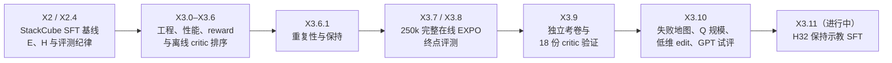

# EXPO-FT 复现案例集：从 X2 到 X3.10 的问题、证据与 RL 基础

> 通读稿 · 2026-10-13 · 配合 [RL 基础讲义](rl-foundations-primer.md) 阅读。
> 阅读推荐：[浏览器版 HTML](expo-ft-casebook.html)；本 Markdown 是编辑源稿。
> 本文从 pi-expo-sim 的计划、报告与讨论中整理出 30 个案例，每个案例都对回 RL 基础讲义的知识点。**Gym 不是事实源**：数字只为说明问题，以链接的原报告为准；结论边界一律沿用原报告的措辞，不在这里加强或减弱。

## 0 · 怎么读这份案例集

### 时间线

阶段状态与入口见 pi-expo-sim README（内部资料） 和 X3 总索引（内部资料）。

### 每个案例的结构

- **问题**：当时需要回答什么，或遇到了什么意外；
- **竞争假设**：同时成立的几种解释；
- **怎么查的**：用了什么测量、对照或诊断；
- **结论与边界**：确认了什么，以及**明确没有确认什么**；
- **RL 基础**：对应 RL 基础讲义的知识点编号；
- **讨论**：留给你思考的开放问题，没有标准答案，可以在课上逐个展开。

### 七条横向经验（先读这一段）

1. **RL 之前，执行方式已经能决定成败。** 只改执行长度 E，成功率能从接近 0 到七成（案例 2）。不先固定执行变量，后面的 RL 收益无从归因。
2. **Q 的含义由 backup 里的后续策略决定。** 固定 SFT 接续学到的 Q，和在线 EXPO 的 Q 不是同一个对象（案例 16）；离线排序的负结果不能直接外推为"EXPO 无效"。
3. **critic 的 loss 下降、训练集上会排，都不等于会挑。** 平均排序正确和 argmax 正确是两回事；训练集上的选择收益可能来自记住偶然结局（案例 12、13、18）。
4. **在噪声估计上取 max 必然偏高，这条原理出现在三个层面**：critic 挑候选、事后 oracle 估上限、研究者在多个臂里挑赢家（案例 11、25、27）。
5. **reward 里"有"某个信号，不等于 agent 能利用它。** 负奖励存在不代表 critic 学会回避（案例 9）；shaping 只改学习难度，不改理想排序（案例 7）。
6. **负结果要说清否定的是哪个配置。** 250k / R1 / 降 UTD 的一次运行退步，不等于方法无效，也不能把责任分给 Q 选择、edit 或 BC 中的任何一项（案例 17）。
7. **可比较的数字必须能说清集合、代码、runtime 和分母。** 隐藏物理状态、跨机数值微差、零步拒绝都会悄悄改变比较的对象（案例 24–26）。

## A · RL 之前：执行方式与前提

### 案例 1 · E4 几乎为 0：抓住了，却抬不起来

- **问题**：StackCube 是简单的堆叠任务，H16 模型在主口径 E4 下 final 成功率只有 0–0.2%。
- **竞争假设**：训练不够；链路 bug（单位、符号、checkpoint）；短 chunk 反复重规划，加上输入缺阶段信息，在原地停滞；小偏差累积导致 OOD 漂移。
- **怎么查的**：训练观测上比较预测与示教动作，排除简单 bug；同一批 dev seeds 换 E8 对照；逐步记录抬升高度；扫描全部示教，发现首次闭爪时都连续保持 6 步相同的机械臂目标。
- **结论与边界**：输入只有当前两路图像和关节位置、没有历史；E4 每次只执行 chunk 中接近"保持不动"的前缀，于是反复重新开始等待。这只是**机制假设**，证据来自两个 dev 案例，没有做干预实验（X2 失败分析（内部资料）「为什么简单任务仍会出现这种问题」）。
- **RL 基础**：1（观测缺阶段信息，非 Markov）、31（执行长度）。
- **讨论**：如果给 policy 加一个"已等待步数"的输入，E4 的问题会消失吗？这和 critic 需要剩余时间输入是同一个问题吗？

### 案例 2 · 不更新权重，只改 E，成功率从接近 0 到七成

- **问题**：执行长度 E 本身是不是瓶颈？
- **竞争假设**：E 越长越好；存在固定门槛；增益其实来自预测长度 H。
- **怎么查的**：固定 20k EMA，dev250 上扫 E4/6/8/12/16，同 seed 配对 bootstrap，按阶段分类失败；冻结配置后在新 seeds 上跑独立 final-v2。
- **结论与边界**：dev 上 E16 的 once/end 为 73.6%/58.0%，E6 仅 11.6%（E 扫描（内部资料）「全量结果」）。E16 并非在所有场景都改善；这组实验没有回答 H 的作用。
- **RL 基础**：31（semi-MDP，决策间隔）、8（chunk 等价于不加修正的 n-step）。
- **讨论**：E 同时改变了"多久重规划一次"和"TD 跨越多少步"。在线 RL 时，这两个旋钮应该绑在一起还是分开？

### 案例 3 · 固定 E16，H32 比 H16 好约 20 个点

- **问题**：预测更长、执行一样长，为什么执行的前缀会变好？
- **竞争假设**：执行时间或重规划次数（已排除，E 固定）；更远的未来监督改善了表征；action tokens 之间是双向 attention，不执行的后半段也影响前缀；伴随的数据与 normalization 混杂。
- **怎么查的**：从同一 base、固定数据顺序和超参各训 20k；dev 配对后跑新的 final-v3；读源码确认 attention mask；理论论证"若两者都精确学到同一分布，前缀分布是联合分布的边缘，不必然更好"。
- **结论与边界**：final-v3 中 H32 为 91.4%/70.8%，H16 为 71.2%/52.0%（H32 final-v3（内部资料））。只有一个训练 seed；监督长度和 token 耦合的贡献没有分离。对 RL 的含义：E 不变时，H 翻倍不会让 transition 跨度翻倍；但 critic / edit 若作用于整段 chunk，维度会翻倍。
- **RL 基础**：31、8、28–29（联合生成整段动作）。
- **讨论**："边缘分布等价"在有限容量模型上为什么不成立？这对"critic 应该看整段 chunk 还是只看执行段"有什么启示？

### 案例 4 · 离线 loss 和中途小样本不能用来选模型、决定停训

- **问题**：训练到 5k 时 E4 为 0/32，当时据此暂停了训练。
- **竞争假设**：模型训坏了；只是执行口径的问题。
- **怎么查的**：teacher 动作比对；同 seeds 改用 E8 跑 4 例，成功 2/4；之后恢复训练并核对 hash 连续。
- **结论与边界**：报告承认把中途评测设为停训门禁是**执行错误**（5k 早期检查（内部资料））。dev 规则选出的 10k/E4 在 final 上只有 0.2%，也**不允许**事后换成更好的组合（X2 final（内部资料）「dev 选型与 final 的边界」）。
- **RL 基础**：闭环指标与离线指标（T0·S03）；评估中的预注册。
- **讨论**：如果一开始就知道 E 是关键变量，dev 选型规则应该怎样写，才既不浪费 final 又不事后反选？

### 案例 5 · 从 RoboDojo 换到 StackCube：先满足 RL 的前提

- **问题**：RoboDojo `stack_bowls` 上，毫米级修正看不出净收益。
- **怎么查的**：同一状态重复展开的波动与修正量同一量级；并行环境之间有串扰；成功判据包含双臂归位；RLT 经验表明，执行者能力（L0）和奖励密度（L1）不满足时，调策略改进的旋钮无效。
- **结论与边界**：改到回合短、判定精确、支持状态快照的 StackCube，RoboDojo 保留为迁移检验场（README（内部资料）、前序经验（内部资料））。
- **RL 基础**：5（selection space 是前提）、19、25；RLT 复审的 L0–L4 分层。
- **讨论**：一个任务"适合做 online RL"至少要先测哪三件事？哪些可以在完全不训练的情况下测？

## B · 任务目标、终止与 reward

### 案例 6 · 成功之后为什么保持不住

- **问题**：E16 有 370 例曾经成功，其中 88 例在第 200 步失败。
- **竞争假设**：偶然一帧命中；掉落；成功后又重新抓取、被扰动；示教缺少成功后的保持段。
- **怎么查的**：逐步复查状态，88 例在首次丢失时全部失去了静止条件，多数出现再次抓取；检查示教，首次成功后只有 2–5 步轨迹就结束，而策略首次成功的中位数在第 107 步，之后评测还要执行 93 步（X2 final-v2（内部资料）「成功为何没有保持」）。后续用仿真真值触发脚本干预：张开夹爪保持即可把 SFT 保住的 36/47 提到 47/47（重复性与保持（内部资料）「叠好后，停止原策略能保住多少」）。
- **结论与边界**："缺少保持示教"是优先假设；脚本 47/47 不是 VLA 的成绩，也不是全局上界。交接报告指出，若照搬 DROID 的"成功即终止"，成功后的扰动根本不会进入学习。X3.11 正在做 H32 的保持示教 SFT。
- **RL 基础**：3（终止与截断定义了任务目标）、20（示教覆盖不到的阶段）。
- **讨论**：评测看 `success_end`，训练 reward 若"成功即终止"，两者优化的目标有什么差别？保持能力应该由 SFT 数据、reward 还是终止规则来教？

### 案例 7 · 四种 reward 谁更好：potential shaping 不改变理想排序

- **问题**：R1/R2/R3 的过程奖励，能否让 critic 比只看结局的 R0 更容易学会选动作？
- **竞争假设**：过程奖励提前给信号，有助于 TD 传播；或者因为都是势差分，理想排序完全相同，差别只在有限样本的学习难度。
- **怎么查的**：推导——γ=1 时回报为 `S_200 − Φ(s_t)`，同一状态的候选之间只差一个常数（reward 设计（内部资料）「为什么使用差分」）；实验——5 种配置 × 4 折，三项预登记比较，Bonferroni 区间。
- **结论与边界**：三项比较区间都跨零，旧 dev 面板上方向也不一致，"没有可确立的最佳奖励"（critic 排序（内部资料）「主结果」）。R1 是必须选一个时按"规则最少"暂选的，不是被证明的胜者。
- **RL 基础**：33（reward 来源与 shaping）、3。
- **讨论**：既然 shaping 不改最优动作，它在什么条件下最可能帮上忙？在 E16 的块级 backup 里，块内奖励之和会抹掉哪些信息？

### 案例 8 · reward 代理本身会制造不连续

- **问题**：手写的连续势函数 Φ，在真实轨迹上是否按预期给分？
- **竞争假设**：负分来自真实的滑移或破坏；或来自代理设计（门控、夹爪开度）的人为跳变。
- **怎么查的**：在 train32 轨迹上做被动审计，评分前冻结事件口径，挑代表性单步拆解。
- **结论与边界**：发现运输门控由开变关的跳变，同一步里既有速度恶化，也有"4cm 硬门控"关闭，不能都称为"滑移惩罚"（R1-v2 被动审计（内部资料））。R3 修订后负分总量下降，逐步波动反而上升，原因是对夹爪合拢敏感，"不能称为纯数值噪声，也未证明一定有利"（reward 族（内部资料））。
- **RL 基础**：33、1（reward 读仿真真值，critic 读不到）。
- **讨论**：reward 用到了 critic 看不到的真值，会让 critic 面对什么样的"非 Markov"问题？

### 案例 9 · 有负奖励，不等于 critic 学会了"别干扰已成功的状态"

- **问题**：R1 设计为成功 +1、丢失 −1、恢复 +1。在线训练后，成功之后 critic 是否会少选"合拢"这类会干扰的动作？
- **竞争假设**：负信号太稀疏；同一 chunk 内"丢失后又恢复"互相抵消；候选池里根本没有安全动作。
- **怎么查的**：成功后的决策中，比较实际选中"合拢"的比例与候选池内比例，按 episode 整簇 bootstrap；固定输入检查非合拢候选的覆盖。
- **结论与边界**：选中合拢的比例与池内比例的差区间跨零，没有观察到稳定回避；候选池覆盖没有崩塌（完整 EXPO（内部资料）「W&B与训练行为应怎样解读」）。负奖励存在不等于学会阻止干扰；不合拢也不等于能保持。
- **RL 基础**：33、8/31（chunk 内奖励聚合）、7（Q 由后续策略决定）。
- **讨论**：要让 critic 学会"成功后别动"，replay 里至少需要什么样的对比样本？

## C · critic 到底学到了什么

### 案例 10 · 单次结局标签：是在测"动作好"，还是"后面运气好"

- **问题**：每个候选只执行一次、之后由 SFT 接续，单次 0/1 结局不同，不等于候选的真实成功概率不同。
- **竞争假设**：候选间有稳定优劣；差异主要来自后续采样噪声；两者都有但信号小于噪声。
- **怎么查的**：固定首块动作，各加 4 次独立接续，用保留兄弟候选协方差的方差修正；"几次用来挑、另几次用来验"；X3.9 在 192 个新场景上重复。
- **结论与边界**：可重复的选择信号**存在**，X3.9 中两次挑、两次验的收益为 +4.68pp，区间不跨零（X3.9（内部资料）「真实接续给出了可重复选择空间」）。但这是"先执行再挑"的诊断，不是可部署的裁判。
- **RL 基础**：6（MC 标签方差大）、2（Q 绑定后续策略）、5。
- **讨论**：如果每个候选的标签是 4 次接续的平均，critic 的训练目标从 MC 变成了什么？代价是什么？

### 案例 11 · 事后最优 oracle 不是天花板

- **问题**：同样本上的 oracle best-of-8 看起来余量很大，这个余量能学到吗？
- **怎么查的**：分开报告三个量——同样本 oracle、跨重复选优、去噪后的方差。
- **结论与边界**：同四次结局里挑最大的收益"含明显的事后选择偏差，不是真实天花板"；方差的单位是概率平方，不能开方当作"完美挑选能提升多少"（X3.9（内部资料） §3.4、§4.1）。
- **RL 基础**：9（挑选和评估必须用独立样本——这正是 double Q 的思路）。
- **讨论**：EXPO 的 TD target 用 target critic 在 OTF 选出的动作上取 min，这算不算"挑与评分离"？分离得彻底吗？

### 案例 12 · 成对排序学到了，八选一却不赚

- **问题**：critic 给成功分支打分更高的比例超过一半，为什么选中的动作成功率没有提升？
- **竞争假设**：成对信号太弱，或集中在容易的对上；全同结局的场景稀释了收益；argmax 对 top 附近的误差更敏感。
- **怎么查的**：同时报告 pairwise 准确率（只在混合结局的场景上算）和 selection gain（全部场景）。
- **结论与边界**：pairwise 约 59–64%，selection gain 区间全部跨零；128 个场景中只有 53 个是混合结局（critic 排序（内部资料）「主结果」）。"部分好坏比较学到了"，不等于稳定挑中好动作。
- **RL 基础**：5（best-of-N 只有 argmax 选对才改进 base）。
- **讨论**：哪种训练目标更贴近"argmax 选对"：逐点回归、成对排序，还是 listwise？

### 案例 13 · 训练集上会排，换个接续优势就消失

- **问题**：critic 在训练场景上自评有十几个点的选择收益，验证集拿不到。是没见过足够多的场景，还是记住了单次偶然结局？
- **竞争假设**：场景覆盖或表征泛化不足；标签是单次 0/1，Q 拟合了噪声。
- **怎么查的**：X3.10 固定 54 个有 4 次接续的训练场景，不重训、冻结旧 Q 的选择，分别用训练用的那次接续和另外三次接续计分，配对 bootstrap。计划事先登记了两种结果各自支持哪种解释。
- **结论与边界**：两个 critic 的训练自评优势分别从约 +13pp、+18pp 降到 +0.4pp、+2.9pp，配对下降区间不跨零（X3.10（内部资料） §4.1）。支持"记住了部分偶然结局"，不能只归因于缺场景；记忆占多少比例没有测。
- **RL 基础**：6、9、16（每个模型 32 万次抽样，但独立训练场景只有几十个）。
- **讨论**：这个实验只改了"标签的随机性"，输入完全不变。你能为 X3.11 之后的 critic 设计一个同样干净的检查吗？

### 案例 14 · 数据规模曲线是平的，而且混进了"遍历次数"

- **问题**：再加多少场景，Q 才能学会？
- **怎么查的**：嵌套子集 54⊂108⊂216，按哈希排序选成员、不看结局；冻结特征、3 个 seed、固定 5k 更新，不挑中期 checkpoint；主读数用未消费的验证集，已消费的集合只作探索。
- **结论与边界**：没有确立随规模改善的趋势；216−54 的差值区间跨零（X3.10（内部资料） §4.2）。固定 5k 更新意味着三档每个样本分别被看了约 741/370/185 遍，这不是纯数据效应。
- **RL 基础**：16（UTD 与重复遍数）、17。
- **讨论**：一条可信的数据规模曲线应该固定什么：更新次数、遍数，还是"训练到收敛"？

### 案例 15 · 给 critic 补信息、换监督，都没解决

- **问题**：是观测不足、监督形式不对，还是视觉表征不好？
- **怎么查的**：依次登记并执行——39 维物理真值输入、同场景成组训练加差值损失、冻结 VLA prefix 特征、条件软标签、归一化相对物理量、等预算硬/软标签对照。
- **结论与边界**：各项选择收益区间都跨零。报告明确**不**结论"问题不在视觉"，理由是每项诊断都同时改了多个因素，而且数据有限（critic 排序（内部资料）、X3.9（内部资料） §3.2、§4.3）。
- **RL 基础**：1（可观测性）；对照设计。
- **讨论**：一个"阴性诊断"的检验力由什么决定？如果只能再做一个诊断，你会选哪一个、固定哪些变量？

### 案例 16 · 固定 SFT 接续的 Q，不是在线 EXPO 的 Q

- **问题**：离线排序的负结果，能否说明 EXPO 无效？
- **怎么查的**：X3.6 的 TD 用数据中"下一次实际执行的 SFT chunk"做 backup，是 sampled-SARSA 式，"不是官方 EXPO 的未来 N8 选优 backup"（X3.6 计划（内部资料） §1）。
- **结论与边界**：安全的首段可能被后续 SFT 抵消，所以负结果"不能证明完整 EXPO 无效"；反过来，候选有差异也不保证在线有效（重复性与保持（内部资料）「固定SFT接续不是完整EXPO」）。
- **RL 基础**：7（backup 用谁的动作就学谁的价值）、2、25、18。
- **讨论**：如果后续策略换成 OTF，哪些在 SFT 接续下"看不出差别"的候选会被拉开？

## D · 完整在线 EXPO（X3.7 / X3.8）

### 案例 17 · 跑完 250k，OTF 和 VLA 都比原 SFT 差

- **问题**：250k 交互后，OTF（VLA + critic 选择 + edit）和 VLA 单独推理，是否优于原 SFT（A0）？
- **竞争假设**：Q 选择不准；随机 edit 破坏动作；成功 BC 的数据分布；为预算降低 UTD 导致欠训练。文档并列这几项，没有排序。
- **怎么查的**：固定 250k 终点，不挑中期最好的 checkpoint；共用 seed 配对 bootstrap；中期 fast100 只作方向参考，不据此停训或换配方。
- **结论与边界**：holdout500 末步成功 A0 53.0%、VLA-only 37.6%、OTF 7.2%（完整 EXPO（内部资料）「终点结果」）。能确认的只是"这一个 R1/250k 压缩配置没有带来收益"；不能推出 EXPO-FT 整体无效，也不能分开各组件的责任；区间不含重训方差。预登记的 B1 对照因条件不满足未触发，所以"额外成功数据 + BC"与 EXPO 本身的效应也无法分离。
- **RL 基础**：5（best-of-N 依赖 Q 排序可靠）、19、20、25。
- **讨论**：如果只能再跑一次 250k，你会关掉哪一个组件来做消融？为什么先关它？

### 案例 18 · loss 很低，但策略没有变好

- **问题**：训练曲线看上去收敛，闭环成功率却下降。
- **怎么查的**：把终点 loss 与固定评测并列；更早的 X3.3 对照中，MC 回归误差大幅下降，但选中分支的成功率反而低于直接用第一个候选（工程诊断（内部资料）「固定数据价值诊断」）。
- **结论与边界**：原文明确写"低loss与模型真的变好是两回事"；loss 下降不等于选得更准（完整 EXPO（内部资料）、W&B 指南（内部资料））。
- **RL 基础**：2、6、11（critic loss 衡量的是对自己 bootstrap 目标的拟合）。
- **讨论**：在线训练中，哪个能实时记录的指标最接近"选得准不准"？它需要额外的 rollout 吗？

### 案例 19 · 自动温度：计划里的目标熵根本达不到

- **问题**：源码核对发现原目标熵 −64 不可达。edit 的提议被 ±0.2 截断，每维熵上限是 `log 0.4 ≈ −0.916`，D=128 时上限约 −117.29。
- **竞争假设**：温度方向写反；只是训练不够。
- **怎么查的**：改用官方已有的尺度修正 `target(D) = D·(−0.5 + log 0.2)`，每维约 −2.109；训练中按每个有效维度比较实测熵与目标（X3.7/3.8 计划（内部资料） §5.3）。
- **结论与边界**：50k、100k 时每维熵约 −0.926，贴着均匀分布上界，远高于目标；终点温度 0.165，"不能称为收敛"（完整 EXPO（内部资料）「50k固定评测」「100k方向性报告」）。不说明温度符号写反；也不能用 loss 标量大小判断哪一项梯度主导。
- **RL 基础**：15（auto-α 的目标熵必须与动作空间的尺度和截断一致）。
- **讨论**：目标熵定得过高（不可达），温度会怎样变化？对 edit 的探索宽度意味着什么？

### 案例 20 · 随机 edit、动作平滑度与"保持"失败

- **问题**：OTF 经常先成功、末步又失败，命令也很抖。
- **竞争假设**：随机 edit 太宽；成功后再抓取把方块弄掉；Q 选择偏好扰动大的动作。
- **怎么查的**：不增加仿真，被动统计曾成功末步失败的回合数、最长连续成功时长、执行命令的三阶差分 jerk。
- **结论与边界**：三项指标都按 A0 → VLA-only → OTF 的顺序变差（完整 EXPO（内部资料）「B1条件、错误及保持诊断」）。jerk 是命令差分，不是实测的机械 jerk；各策略"曾成功"的子集不同；没有建立接触因果。
- **RL 基础**：19、30（有界残差仍会累积成不平滑的轨迹）、15。
- **讨论**：EXPO-FT 原文的 edit 作用在笛卡尔速度上，这里作用在关节目标上。同样的 ±0.2，在两种动作空间里意味着什么？

### 案例 21 · 只模仿成功轨迹，VLA 本身也退步了

- **问题**：VLA 唯一的更新通道是示教与在线成功窗口各半的 BC，为什么 VLA 单独推理也变差、动作也越来越抖？
- **怎么查的**：跟踪各里程碑上 VLA 的 jerk 与成功率。
- **结论与边界**：VLA−A0 的末步成功率差区间不跨零；文档**没有**给出机制，B1 未跑，无法归因（完整 EXPO（内部资料）「250k终点」）。
- **RL 基础**：27（被模仿的数据由谁产生）、24、21。
- **讨论**（以下是供讨论的假设，文档未提出）：在线成功窗口里的动作，是 VLA 自己的样本，还是被 edit 修改过、由 critic 挑出来的执行动作？如果是后者，"成功 BC"实际在让 VLA 模仿什么？

### 案例 22 · 为了时间预算降低 UTD

- **问题**：为在 48 小时内跑完，critic 更新强度从每 32 步 20 次降到 5 次，edit 和 BC 的更新机会不变。
- **结论与边界**：计划把它登记为科学配置变化，"可能欠训练"；正结果会支持延长训练，负结果只约束这套压缩配方。没有做消融（X3.7/3.8 计划（内部资料） §5.1）。
- **RL 基础**：16（UTD 是科学变量）、17。
- **讨论**：降低 critic 的 UTD、同时保持 edit 和 BC 的更新频率，会改变三者之间的什么相对关系？

## E · edit 与动作参数化（X3.10）

### 案例 23 · 低维 edit：哪些修正根本不可达，训练前就能算出来

- **问题**：下一轮想用"夹爪开合时机 τ + 3 维连贯平移"替代逐维随机 edit。它能修什么、不能修什么？候选之间的几何差异能不能直接拿来挑？旧 Q 能不能给新 edit 打分？
- **怎么查的**：统计首块中的开合切换次数；用特权真值做固定阶段规则和成对 logistic，只拟合一次；把提案幅度与候选间几何差异的分布对比。
- **结论与边界**（X3.10（内部资料） §5）：
  - 过半首块没有开合切换，在这些块上 τ 是恒等操作；τ 不能新增"松手"。
  - 几何规则与 logistic 的选择收益区间都跨零；2.2mm 是目标 FK 距离的中位数，**不是**价值差异的上限。
  - 旧 Q 只见过 VLA 候选，它给新 edit 的高分不能当证据，必须先做 base/edit 配对执行。
  - 方案只是下一轮的提案，不宣称编辑收益。
- **RL 基础**：30（残差的参数化决定可达范围）、20（新动作类别上的外推）、28–29（离散 τ 与连续平移的混合动作）、27（replay 存实际执行的 edited 命令）。
- **讨论**：离散的 τ 不能用重参数化梯度。edit 的 policy 和熵项应该怎样定义？

## F · 评估、统计与工程

### 案例 24 · 隐藏物理状态与同 runtime 基线

- **问题**：分数差来自算法，还是来自 runtime、编译和 reset 的差异？
- **怎么查的**：发现普通 reset 留有隐藏物理状态（同一 seed 在第 47 步分叉），改用 canonical reset；在同一 runtime 下重建 A0；换编译配置后，逐 seed 有约四分之一的回合结局翻转，但总差为 0（工程诊断（内部资料）、X3 基线（内部资料））。
- **结论与边界**：基线必须和被测对象在同一个 runtime 合同下；总成功率相同不代表逐 seed 行为相同。
- **RL 基础**：1（隐藏状态让环境对 agent 非 Markov）。
- **讨论**：逐 seed 翻转四分之一而总差为 0，对"配对比较的检验力"意味着什么？

### 案例 25 · argmax 遇到近乎并列的 Q：微小数值差翻转选择

- **问题**：同一 checkpoint 在两台机器上做纯前向，选出的动作是否相同？
- **怎么查的**：取 200 个固定状态，逐项比较 base、edit、Q 和最终选择。
- **结论与边界**：200 例中有 2 例选择不同，不同处的 Q 间隔只有 1e−4 量级（完整 EXPO（内部资料）「20k：200状态跨机前向核对完成」）。批量推理还会让少数夹爪命令的符号翻转（性能与数值取舍（内部资料））。
- **RL 基础**：9、14；可复现性。
- **讨论**：critic 对候选的打分几乎并列，这本身说明了什么？是不是比"选错"更值得警惕？

### 案例 26 · 第三种结局：零步拒绝

- **问题**：训练到 43k 时，选中的动作越过关节限位被拒绝，执行步数为零；合同规定的 `policy_error` 分支在实现中没有接上。
- **怎么查的**：反变换全部 16 个候选，发现多数 base 候选本身已经越界，edit 扩大了越界。
- **结论与边界**：补上零步拒绝回执，从 40k checkpoint 逐值重演；重演消耗的更新单独记账，不算学习进度；不加裁剪、不过滤候选；未完成的前缀标为 incomplete，不当作终止或成功；评测中越界回合按失败保留在分母（完整 EXPO（内部资料）「43k运行故障」）。
- **RL 基础**：3（终止、截断之外的第三种结局）、27。
- **讨论**：如果当时把越界动作直接裁剪进限位，replay 里的"执行动作"和 critic 的输入会出现什么不一致？

### 案例 27 · 不"扩试到显著"：预登记与封存考卷

- **问题**：有多个臂、多个 checkpoint、多个评测面板时，怎样避免挑选偏差？
- **怎么查的**：默认提名一个臂，只有领先超过一个配对 bootstrap SE 才替换；hash 封存后才打开考卷；次要比较用 Bonferroni；按场景做 cluster bootstrap；固定 checkpoint；已消费的面板上做的诊断标为探索。
- **结论与边界**：X3.9 中另一个臂的区间略高于零，但不能事后改选；默认臂未过预登记门槛（X3.9（内部资料） §3.2、§6.3）。
- **RL 基础**：与 9 同源——研究者在多个臂里挑最好，本身就是一次 max。
- **讨论**：你自己的实验里，哪些选择是在看到结果之后才做的？

### 案例 28 · 三种验收不能互相替代

- **问题**：候选生成从串行改成批量后快了很多，但动作也变了。
- **结论与边界**：与旧版等价、自身可复现、成功率，是三种不同的验收，不能互相替代；墙钟缩短约百倍同时改变了卡数、数值行为和计算形状，不是单一优化的因果倍率（性能与数值取舍（内部资料）「三种验收不能互相替代」、X3 性能（内部资料））。
- **RL 基础**：工程与科学变量的边界。
- **讨论**：一个性能优化改变了 1% 的 argmax 选择，它算"工程改动"还是"科学配置改动"？

## G · 外部 teacher 与基础策略

### 案例 29 · 让 GPT 当排序导师：试评没产出标签，也不等于能力否定

- **问题**：VLM/LLM 能否看图给候选排序，成为 critic 的 teacher？
- **怎么查的**：24 题，只给白名单输入；全部排序封存后才解封答案；预登记并列与拒答的计分方式。
- **结论与边界**：24 题全部并列；严格格式与独立换序的一致性都不达标；不是技术隔离，后端身份未知。gain=0 只是"全并列退回均匀选择"这条规则的恒等结果，不是测出来的。本轮不产出蒸馏标签，**不能**推出"GPT 视觉无效"（X3.10（内部资料） §6）。
- **RL 基础**：32（teacher 在环）；外部 judge 的可行性验证。
- **讨论**：在评价一个 judge 的排序能力之前，必须先验证哪三件事？

### 案例 30 · 更强的 SFT，不等于更容易排序

- **问题**：H32 更强，为什么 X3.10 不直接换成 H32？
- **结论与边界**：换 H 会同时改变候选分布、冻结表征和失败构成；X3.10 主线固定 H16，H32 只做零仿真的历史附表；不能比较不同成功子集上的条件比例来断言"H32 损害保持"（X3.10（内部资料） §7）。
- **RL 基础**：2（换基础策略，Q 的对象就换了）、20、5（selection space 随候选分布变化）。
- **讨论**：base 更强时，selection space 会变大还是变小？用什么测量可以在训练前回答？

## H · 映射回 RL 基础讲义

| RL 基础知识点 | 相关案例 |
|---|---|
| 1 MDP 与缺失信息 | 1、8、15、24 |
| 2 价值绑定 policy | 10、16、18、30 |
| 3 终止与截断 | 6、7、26 |
| 5 policy improvement / selection space | 5、10、12、17、30 |
| 6 MC 与 TD | 10、13、18 |
| 7 backup 动作决定学到谁 | 9、16 |
| 8 n-step / chunk | 2、3、9 |
| 9 maximization bias | 11、13、25、27 |
| 11 deadly triad | 18 |
| 15 SAC / auto-α | 19、20 |
| 16–17 UTD、primacy | 13、14、22 |
| 19–20 离 behavior 太远、外推 | 17、20、23、30 |
| 24、27 加权 BC、数据身份 | 21、23、26 |
| 25 offline-to-online | 5、16、17 |
| 28–30 expressive policy 与残差 | 3、20、23 |
| 31 semi-MDP | 1、2、3、9 |
| 32 teacher 在环 | 29 |
| 33 reward 来源 | 7、8、9 |

## I · 文档中写明的开放问题

以下来自各报告的"下一步"部分，不构成执行授权：

- 把 Q 选择、随机 edit、BC 的数据效应分开；不能因为 loss 低就直接加长同一配方（完整 EXPO（内部资料）「恢复、成本与下一步」）。
- 构造更贴近"同场景内相对优劣"的监督，例如相对排序目标或多次接续取均值（X3.10（内部资料） §9）。
- base 与小幅 τ+平移 edit 的配对真实执行，固定接续噪声，再检查 IK 与控制器响应。
- 保持示教 SFT 另立范围（X3.11，#104（内部资料））。
- GPT teacher 先解决技术隔离、严格格式与独立换序。
- 若进入 TD，先冻结每步还是每块折扣、块内聚合与终止 mask（X3.9 计划（内部资料） §8）。
- critic 输入目前含特权历史；若要完全不用真值，需要另定输入合同。

X3.10 的收口理由是研究优先级选择，**不是**证伪候选选择、edit 或 RL。
