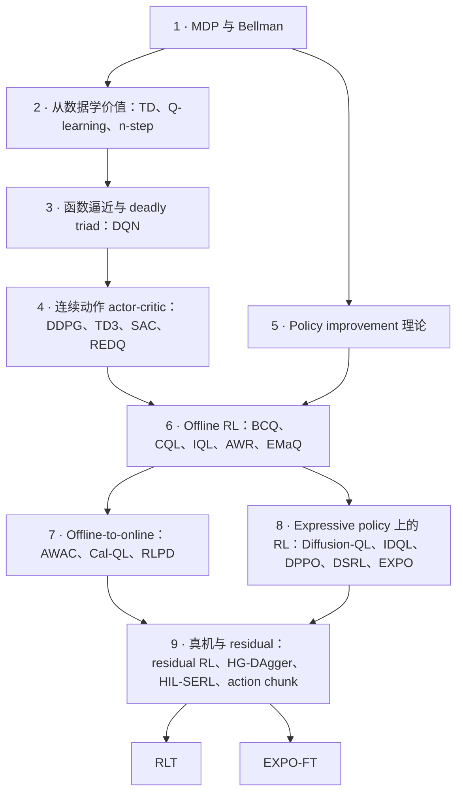

# RL 基础讲义：VLA online RL 背后的强化学习

> 通读稿 · 2026-10-05 · 面向正在复现 RLT 与 EXPO-FT 的学员；也供 T2/T3 其他课次引用。
> 阅读推荐：[浏览器版 HTML](rl-foundations-primer.html)，公式、图与交互示例已内置，可离线打开；本 Markdown 是编辑源稿。
> 本讲义只讲知识，不出题、不安排 toy 实验。论文本身的机制以真实训练与复现为主线学习；本讲义补的是这些论文默认读者已经具备的 RL 基础。

恢复学习可从本文 §2 和 [P0 批量诊断](rl-control-practice.md#p0--恢复价值学习)进入。[统一温习讲义](rl-control-review-primer.html)补齐 on-policy、连续控制与 HORA / AnyRotate teacher-student。完整顺序为 PPO → TD3 → SAC → 生成策略后训练，另有 BPTT 选修；课次、练习与验收见 [Gym 课表](../../curriculum.md#rl-基础讲义与课次的对应t2t3-共用)。

## 0 · 地图：两篇论文站在哪些基础之上

RLT 和 EXPO-FT 的方法部分都很短，因为它们默认读者已经熟悉一整条技术谱系：Bellman 方程、TD 学习、off-policy actor-critic、overestimation 的控制、offline RL 的分布偏移、offline-to-online 的数据混合、expressive policy 的优化难题、residual RL 与人在环。论文里一句"we use an ensemble of 10 critics with clipped double Q"背后，是 Double Q-learning、TD3、REDQ 三篇论文的结论。



**怎么读：** 第 1–4 部分是 off-policy 价值学习的主干；你的 Spinning Up 档案（[RL 问答精编](../../references/rl-spinningup-digest.md)）已覆盖其中大部分定义，这里重点补"为什么这样设计、在什么条件下失效"。第 5–9 部分是两篇论文直接站立的地方，多数内容不在 Spinning Up 范围内。第 10 部分把 RLT 与 EXPO-FT 的每个设计选择映射回知识点。附录 A 给出分层阅读路径。

**与课表的关系：** 本讲义承担 T2·S01、T2·S07、T3·S02/S05/S06/S07 的 `Understand` 层，知识点与课次的对应见[课表](../../curriculum.md#rl-基础讲义与课次的对应t2t3-共用)。

**约定：** 标【例】的数字是为讲清概念人为设定的；方法描述以原论文为准，文末列出出处。正文用到的论文用"作者/方法名"指代，链接集中在附录 B。

**伪代码怎么读（2026-10-18 补充）。** 每段先说明输入与更新对象，再按实际执行顺序展开。它们是教学流程，省略 logger、optimizer 初始化和部署工程；不代表已运行的 trainer。

| 写法 | 执行含义 |
|---|---|
| `s_next` / `a_next` | 公式中的 `s'` / `a'`；撇表示下一状态或动作 |
| `old_value` / `V_old` | 更新前的数值或快照；与下一状态是两个维度 |
| `target` → `td_error` → 更新 | 先构造目标，再算目标与当前估计之差，最后修改当前估计 |
| `stopgrad(x)` | 使用 x 的数值，阻断这条路径的梯度；不是把 x 设为 0 |
| `minimize loss over Q` | 只更新 Q 的参数；其他网络是否保留输入梯度会另行标明 |
| `b` | 是否允许 bootstrap；真正 terminal 为 0，continuing-task 的外部 truncation 为 1 |

以下 `step(a)` 都返回 **reset 前**的下一状态、该步 reward、`terminated` 与 `truncated`。需要 reset 时先保存真实 transition；无论何时计算 backup，都不能把新 episode 的初始状态当作 `s_next`。Replay 算法用 `env_state` 保存 environment 的当前位置，用 batch 中的 `s/s_next` 做训练，避免采样旧数据覆盖当前位置。TD 中 `alpha` 是学习率；SAC 中 `alpha` 是 entropy temperature，角色不同。

## 1 · MDP 与 Bellman 方程

### 知识点 1 · MDP、policy 与 return

**Markov decision process（MDP）** 由状态 `s`、动作 `a`、转移 `P(s'|s,a)`、reward `r(s,a)` 和折扣 `γ` 组成。"Markov"的意思是：下一步只取决于当前的 `(s, a)`，不需要更早的历史。

**Policy** `π(a|s)` 是给定状态时选动作的规则，可以是随机的，也可以是确定的 `a = μ(s)`。目标是最大化期望折扣 return：

$$J(\pi) = \mathbb{E}_\pi\Big[\sum_{t\ge 0}\gamma^t r_t\Big]$$

工程含义：当 observation 缺了决定后果的信息（例如剩余时间、遮挡的接触状态），环境从学习者的角度看就不再是 Markov 的。很多"critic 学不准"的根源在这里，而不在算法。

### 知识点 2 · V、Q、A 三个价值函数

$$V^\pi(s) = \mathbb{E}_\pi[G_t\mid s_t=s],\qquad Q^\pi(s,a) = \mathbb{E}_\pi[G_t\mid s_t=s,a_t=a],\qquad A^\pi(s,a) = Q^\pi(s,a) - V^\pi(s)$$

- `V` 评价状态，`Q` 评价"状态 + 第一步动作"，`A`（advantage）衡量某个动作比该 policy 的平均水平好多少。
- 三者都绑定一个 policy `π`：第一步之后都按 `π` 行动。**同一个 `(s,a)`，换一个后续 policy，Q 就变了。**
- 关系：`V^π(s) = E_{a~π}[Q^π(s,a)]`，所以 `E_{a~π}[A^π(s,a)] = 0`。

### 知识点 3 · Bellman 方程：把无限时域拆成一步递归

**Bellman expectation equation**（评估一个给定的 policy）：

$$Q^\pi(s,a) = r(s,a) + \gamma\,\mathbb{E}_{s'\sim P}\,\mathbb{E}_{a'\sim\pi}\big[Q^\pi(s',a')\big]$$

**Bellman optimality equation**（最优 policy 的价值）：

$$Q^*(s,a) = r(s,a) + \gamma\,\mathbb{E}_{s'\sim P}\big[\max_{a'}Q^*(s',a')\big]$$

两者只差在下一步动作怎么取：前者按 `π` 取期望，后者取最大。**后面所有算法的差别，几乎都可以归结到"下一步动作怎么取"这一处。**

**终止与截断。** 实现中 backup 写成 `r + γ·mask·Q(s', a')`，`mask = 0` 表示之后再无回报。任务语义上真的结束（**termination**：成功、掉落）时置 0。若有限 horizon 本来就是任务定义的一部分，需给 state 足够的时间信息，并把 horizon 结束当 terminal。若只是 continuing task 被外部 time limit 切断（**truncation**），则从 reset 前的 final state bootstrap；多步累计或 advantage 递推在此断开，不跨进新 episode。下面的伪代码均按此约定区分 `terminated` 与 `truncated`。

### 知识点 4 · Bellman operator 与 contraction

把右边看作一个作用在整个函数上的算子 `T`：输入一张 Q 表，输出 backup 一次后的新表。它满足

$$\|\mathcal T Q_1 - \mathcal T Q_2\|_\infty \le \gamma\,\|Q_1 - Q_2\|_\infty$$

即 **γ-contraction**：反复应用 `T`，任意初值都会收敛到唯一的不动点（`Q^π` 或 `Q*`）。这是 value iteration 与 TD 学习能收敛的根据（精编 Q7、Q8）。

**边界：** 这个保证只在 tabular、能精确执行 backup 时成立。一旦用神经网络近似 Q、又在别的 policy 采的数据上训练，保证就没了（知识点 11）。

#### 执行过程 · Value iteration

**输入：** 有限 MDP 的已知模型、`gamma < 1`；`P(s_next, r | s, a)` 同时枚举下一状态与 reward。**更新：** 整张 Q 表。此时不需要采样 environment。

```text
初始化 Q；terminal state 的所有 Q 值固定为 0
repeat:
    Q_old = copy(Q)                         # 本轮统一读旧表
    for 每个非 terminal 的 (s, a):
        Q[s, a] = sum over (s_next, r):
            P(s_next, r | s, a) *
            (r + gamma * max_a_next Q_old[s_next, a_next])
until max_abs(Q - Q_old) < tolerance
pi(s) = argmax_a Q[s, a]                    # 从收敛的表提取 policy
```

公式中的 `max` 在这里成为一次可执行的动作枚举；每轮都是对整张旧表做 Bellman optimality backup。固定 policy 的 evaluation 则把 `max Q_old` 换成 `sum pi(a_next | s_next) * Q_old`。

### 知识点 5 · Policy iteration 与 policy improvement theorem

**Policy iteration** 交替两步：评估当前 policy 得到 `Q^π`；再对 `Q^π` 取贪心得到新 policy。

**Policy improvement theorem**：如果新 policy `π'` 满足对所有状态

$$\mathbb{E}_{a\sim\pi'}\big[Q^\pi(s,a)\big] \ \ge\ V^\pi(s),$$

那么 `V^{π'}(s) ≥ V^π(s)` 对所有状态成立。贪心 `π'(s) = argmax_a Q^π(s,a)` 只是满足条件的一种特例。

**这个定理是 EXPO 的理论根据之一。** 设 `μ` 是 base policy。"从 `μ` 采 N 个动作，按 `Q^μ` 挑最高的"得到的 policy 记作 `π_N`。最大值不小于平均值，所以 `E[Q^μ(s, π_N(s))] ≥ E_{a~μ}[Q^μ(s,a)] = V^μ(s)`，`π_N` 至少和 `μ` 一样好，N 越大越好。这正是 EMaQ（知识点 23）和 EXPO 的出发点。前提是 Q 估得准；用估计的 Q 去挑，就会引入知识点 9 的偏差。

#### 执行过程 · Policy iteration

**输入：** 同一个已知 MDP、一个初始 deterministic policy。**更新：** 先 Q、后 policy；evaluation 期间 policy 固定。

```text
初始化 pi；为 argmax 固定一个 tie-breaking 规则
repeat:
    固定 pi，反复执行 Bellman expectation backup，求得 Q_pi
    pi_old = copy(pi)
    for 每个非 terminal state s:
        pi[s] = argmax_a Q_pi[s, a]          # policy improvement
until pi 与 pi_old 相同
```

这里先充分评价再改 policy；value iteration 则每轮直接做 optimality backup。精确 policy improvement 的保证依赖精确 evaluation；近似停止的实际实现还需控制 evaluation 误差。

## 2 · 从数据学价值

### 知识点 6 · Monte Carlo 与 TD：bias 与 variance 的取舍

- **Monte Carlo（MC）**：等 episode 结束，用实际 return 作目标。无偏，但方差大，必须等到结束。
- **Temporal difference（TD）**：用一步 reward 加对下一状态的估计作目标，`V(s) ← V(s) + α[r + γV(s') − V(s)]`（非 terminal transition）。通常比完整 MC return 的方差低、可以逐步更新，但目标依赖自己的估计（bootstrapping），估计有偏时目标也有偏。

稀疏 reward 的长任务中，MC 目标几乎全是 0，方差主导；TD 能让价值逐步往前传，但传得慢，每次 backup 只前进一步。

#### 执行过程 · Monte Carlo evaluation

**输入：** 固定 policy `pi` 采到的完整 terminal episode。**更新：** V 表。这里采用 every-visit、固定学习率版本；外部 truncation 的不完整 episode 不能直接假定尾部 return 为 0。

```text
初始化 V
repeat:
    episode = 用固定 pi 从 reset 运行到真正 terminal
              # 保存 (s_t, a_t, r_t)，本例 r_t 是执行 a_t 得到的 reward
    G = 0
    for t 从 episode 最后一步倒序到 0:
        G = r_t + gamma * G                # 只用本条 episode 的实测 reward
        V[s_t] = V[s_t] + alpha * (G - V[s_t])
```

循环倒着走是为了累加 return，不是在倒放 environment；没有 `V[s_next]` 参与 target，所以没有 bootstrapping。

#### 执行过程 · TD(0) evaluation

**输入：** 固定 policy `pi`，每次一条真实 transition。**更新：** 当前状态的 V 表项。先形成 target，更新结束才把当前位置移到 `s_next`。

```text
初始化 V；s = reset()
repeat:
    a = sample(pi(. | s))
    s_next, r, terminated, truncated = step(a)
    old_value = V[s]                        # 当前状态，更新前的估值
    next_value = 0 if terminated else V[s_next]
    target = r + gamma * next_value
    td_error = target - old_value
    V[s] = old_value + alpha * td_error     # 被修改的仍是 V[s]
    if terminated or truncated:
        s = reset()
    else:
        s = s_next                         # 此时才进入下一状态
```

**沿用放置物块的例子。** `s = 夹着物块、尚未对准`，移动到 `s_next = 已对准盒口` 得到 `r=0`；再放下成功得到 10 并 terminal。若目前 `V[s]=4`、`V[s_next]=10`，取 `gamma=0.9, alpha=0.2`，本步依次算出 `target=9`、`td_error=5`、`V[s]=5`。`V[s_next]` 本步不变；机器人还没有亲眼看到后续成功，就先借用了对下一状态的估计。这正是 bootstrapping。

所以紧凑公式右侧第一个 `V(s)` 不带撇：它是**当前状态原来的估值**。`s'` 区分状态，`old/new` 区分更新前后；两者不能互换。

### 知识点 7 · SARSA 与 Q-learning：backup 里的动作决定学到谁的价值

| | TD target | 学到的价值 | 类型 |
|---|---|---|---|
| **SARSA** | `r + γ Q(s', a'_数据)` | 采数据的那个 policy 的价值 | on-policy evaluation |
| **Expected SARSA** | `r + γ E_{a'~π} Q(s', a')` | 指定 policy `π` 的价值 | 可 off-policy |
| **Q-learning** | `r + γ max_{a'} Q(s', a')` | 最优价值 `Q*` | off-policy control |

Q-learning 能从任何 behavior policy 的数据中学 `Q*`，因为 target 不依赖数据里的下一步动作。代价是 `max`：在连续或高维动作空间难求，而且会放大估计误差（知识点 9）。

**这张表是读懂 RLT 与 EXPO 的钥匙。** RLT 的 backup 用当前 actor 的动作，学的是 actor 的价值；EXPO 用 best-of-N 选出的动作，学的是 OTF policy 的价值。完整谱系见 RLT 方法迭代参考 §6（内部资料）。

#### 执行过程 · SARSA 与 Q-learning 的分叉点

**输入：** 与 environment 的交互，behavior 为随 Q 改善的 epsilon-greedy policy。**更新：** Q 表；下面分别执行其中一种算法。SARSA 提前选的 `a_next` 必须被带到下一步实际执行。

```text
初始化 Q；s = reset()；a = epsilon_greedy(Q[s])
repeat:
    s_next, r, terminated, truncated = step(a)
    if terminated:
        target = r
    else:
        a_next = epsilon_greedy(Q[s_next])
        # SARSA：用 behavior 选出的下一动作
        target = r + gamma * Q[s_next, a_next]
        # Q-learning：将上一行替换为下一行
        # target = r + gamma * max_a Q[s_next, a]
    Q[s, a] += alpha * (target - Q[s, a])
    if terminated or truncated:
        s = reset()；a = epsilon_greedy(Q[s])
    else:
        s, a = s_next, a_next
```

Q-learning 的 `a_next` 仍可用于探索执行，但不进入 target。Expected SARSA 则把 target 的尾项换成 `sum_a pi(a | s_next) * Q[s_next, a]`。这里展示更新路径；tabular 收敛还需足够的 state-action coverage 与适当学习率条件。

### 知识点 8 · n-step return 与 off-policy 修正

n-step target 用 n 步真实 reward 再接估计：

$$G^{(n)}_t = \sum_{k=0}^{n-1}\gamma^k r_{t+k} + \gamma^n\,Q(s_{t+n}, a')$$

n 越大，会用更多实测 reward、减少对早期估值的依赖，通常能让价值传播得更远；偏差和方差的变化仍取决于数据、估计误差与任务。**问题在于 off-policy**：当数据按 primitive action 记录，中间 n−1 步的动作来自 behavior policy，未必来自要评估的 policy。可用 importance sampling 比值 `π/μ` 修正，但比值连乘可能产生高方差；Retrace 使用截断系数 `λ·min(1, π/μ)`。

不加修正的 n-step target 会把中间的 behavior 决策带进估值；改变尾部的下一动作不能修正前面已经发生的 reward 和状态。偏差的方向和大小取决于这些决策的后果。

**Action chunk 要先确定 action 接口。** 若把一次选出的 chunk 当成 macro-action，内部 C 步是这个动作的执行后果；chunk 边界才做下一次 policy 决策。用每步折扣时，先累计实际执行的 reward，再以 `gamma^C` 接续下一 chunk 的估值。跨越 C 个物理步本身不意味着跨越了 C 次 behavior policy 决策；中途 replan 或人类覆盖时，要核对 replay 存的是哪段实际执行动作，以及 target 对应的边界。

#### 执行过程 · 先累加 n 步，再接一次估计

**输入：** 从 `s_t` 起的一段 transition；实际收集 `k <= n` 步，遇到 terminal 或 truncation 就停止。**输出：** 一次 target；之后再用它更新 `V[s_t]`。

```text
target = 0；discount = 1
for j = 0, ..., k-1:
    target += discount * r[t+j]
    discount *= gamma
if 最后一步不是 terminated:
    target += discount * V[s[t+k]]          # truncation 用 reset 前 final state
V[s_t] += alpha * (target - V[s_t])
```

这段是 on-policy V evaluation 的 n-step 核心，累计的是实测 reward；用于 off-policy 时不能省略前文讨论的数据来源与修正问题。

### 知识点 9 · Maximization bias 与 double estimator

对一组带噪声的估计取最大，期望会系统性偏高：

$$\mathbb{E}\big[\max_i \hat Q_i\big] \ \ge\ \max_i \mathbb{E}\big[\hat Q_i\big]$$

【例】8 个动作真实价值都是 0.5，估计噪声标准差 0.1，被选中那个的估计期望约 `0.5 + 0.1 × 1.42 = 0.642`。候选越多、噪声越大，偏高越严重；偏高的值进入 TD target 后会被 bootstrapping 放大传播。

**Double Q-learning**（van Hasselt）的修正：用一个估计器**挑**动作，用另一个独立的估计器**评**这个动作：

$$y = r + \gamma\, Q_B\big(s',\ \arg\max_{a'} Q_A(s', a')\big)$$

挑和评的噪声独立，"挑中的恰好被高估"这件事就不会自动传进 target。后续的 clipped double Q（TD3）、ensemble min（REDQ）都是这个思路的变体。

```reader-demo
max-bias
```

### 知识点 10 · Sutton & Barto 中对应的 tabular 版本

上面四个知识点在 Sutton & Barto 第 6–7 章都有 tabular 版本与小例子：6.4 SARSA、6.5 Q-learning、6.6 Expected SARSA、6.7 maximization bias（有一个专门的小 MDP 演示 Q-learning 被 max 误导）、第 7 章 n-step 与 off-policy n-step。精编中"tabular DP 手算"与"importance sampling 推导"两项缺口，都在这两章补齐。

## 3 · 函数逼近与 DQN

### 知识点 11 · Deadly triad

Sutton & Barto 11.3 指出，下面三者同时出现时，价值学习可能发散：

1. **Function approximation**：用神经网络近似 Q，改一个状态的估计会牵动其他状态；
2. **Bootstrapping**：target 用的是自己的估计；
3. **Off-policy training**：训练数据的分布与被评估 policy 的分布不同。

现代 off-policy actor-critic 三者全占。后面的 target network、double estimator、ensemble、LayerNorm、BC 正则，都可以理解为在三角之中某一处减压。

### 知识点 12 · DQN：replay buffer 与 target network

DQN 用两个部件让神经网络 Q-learning 变得可用：

- **Experience replay**：存下 transition 随机抽样，打破时间相关、复用数据；
- **Target network**：用一份慢速更新的参数 `θ⁻` 计算 target，`y = r + γ max_{a'} Q_{θ⁻}(s', a')`，避免追着自己剧烈变化的估计回归（精编 Q11）。

连续控制方法普遍用 Polyak averaging `θ⁻ ← (1−τ)θ⁻ + τθ` 代替 DQN 的周期性硬拷贝。Double DQN 用在线网络挑动作、target 网络评动作，是知识点 9 在 DQN 上的落地。

#### 执行过程 · DQN 与 Double DQN

**输入：** 离散 action environment。**更新：** 在线 Q network；target network 每隔 C 次 optimizer updates 硬拷贝。下面 TD target 与 loss 对 batch 内每条 transition 计算再取平均。

```text
初始化 Q；Q_target = copy(Q)；replay = empty；updates = 0
env_state = reset()
repeat:
    env_action = epsilon_greedy(Q(env_state, .))
    env_next, reward, terminated, truncated = step(env_action)
    replay.add(env_state, env_action, reward, env_next, b = 1 - terminated)
    env_state = reset() if terminated or truncated else env_next
    if replay 样本足够且到达更新时机:
        (s, a, r, s_next, b) = replay.sample_batch()
        next_q = max_a_next Q_target(s_next, a_next)
        # Double DQN 将上一行换成以下两行：
        # a_star = argmax_a_next Q(s_next, a_next)
        # next_q = Q_target(s_next, a_star)
        target = stopgrad(r + gamma * b * next_q)
        minimize mean((Q(s, a) - target)^2) over Q
        updates += 1
        if updates % C == 0: Q_target = copy(Q)
```

当前预测用在线 Q，target 用慢网络；Double DQN 又把“挑哪个动作”和“给这个动作打分”分给两份网络。神经网络训练改的是共享参数，已不再只改一个 Q 表项。

## 4 · 连续动作的 off-policy actor-critic

### 知识点 13 · 为什么需要 actor：连续动作里的 argmax

连续动作空间里，`max_{a'} Q(s', a')` 本身就是一个优化问题，每次 backup 都解一次不现实（精编 Q10）。办法是训练一个 **actor** `μ_θ(s)` 去近似这个 argmax，用 actor 的输出代替 `max`。

**DPG / DDPG**：确定性 actor 的梯度来自 critic 对动作的梯度：

$$\nabla_\theta J = \mathbb{E}_s\Big[\nabla_a Q(s,a)\big|_{a=\mu_\theta(s)}\ \nabla_\theta \mu_\theta(s)\Big]$$

这一步让 actor 沿 `∇_a Q` 爬坡。只要 critic 在某处高估，actor 就会被引过去，这是 off-policy actor-critic 最常见的失败方式，也是 RLT 复审里"actor 走出 Q 可信区域"的机制。

### 知识点 14 · TD3：三个修补

TD3 针对 DDPG 的高估与不稳，给了三个修补（精编 Q12–Q13）：

1. **Clipped double Q**：两个 critic，target 取较小值，`y = r + γ min_{i=1,2} Q_{θ'_i}(s', ã')`；
2. **Target policy smoothing**：`ã' = clip(μ'(s') + clip(ε, −c, c))`，`ε ~ N(0, σ)`，让 target 不依赖 Q 曲面上的尖峰；
3. **Delayed policy update**：critic 更新多次后 actor 才更新一次，target 网络同步放慢。

注意作用位置：smoothing 加在 **target 动作**上，与采数据时的 exploration noise 是两件事。

#### 执行过程 · TD3 的一次交互与更新

**初始化：** actor `mu`、critics `Q1/Q2`，各自的 target 拷贝，以及 replay。**更新：** 每次更新 critics；每 d 次 critic updates 才更新 actor 和所有 targets。batch 运算沿用 DQN 的逐条计算再取平均。

```text
env_state = reset()；updates = 0
repeat:
    env_action = clip(mu(env_state) + exploration_noise, action_bounds)
    env_next, reward, terminated, truncated = step(env_action)
    replay.add(env_state, env_action, reward, env_next, b = 1 - terminated)
    env_state = reset() if terminated or truncated else env_next
    if replay 样本足够且到达更新时机:
        (s, a, r, s_next, b) = replay.sample_batch()
        noise = clip(normal(0, sigma), -c, c)
        a_next = clip(mu_target(s_next) + noise, action_bounds)
        next_q = min(Q1_target(s_next, a_next), Q2_target(s_next, a_next))
        target = stopgrad(r + gamma * b * next_q)
        minimize mean((Q1(s, a) - target)^2 + (Q2(s, a) - target)^2)
            over Q1, Q2
        updates += 1
        if updates % d == 0:
            minimize -mean(Q1(s, mu(s))) over mu
            所有 target 参数 = (1-tau) * target参数 + tau * 对应在线参数
```

Actor step 固定 critic 参数，但保留 `Q1 → action → mu` 的梯度路径；否则 actor 收不到方向。DDPG 可由同一流程理解：一个 critic、没有 target smoothing、每次都更新 actor/targets。此处动作直接定义在 environment action space；若额外有 executor mapping，需先明确 Q 究竟评价 proposal 还是 executed action。

### 知识点 15 · SAC：maximum entropy RL 与自动温度

SAC 的目标在 return 之外加上 policy 熵：

$$J(\pi) = \mathbb{E}\Big[\sum_t \gamma^t\big(r_t + \alpha\,\mathcal H(\pi(\cdot\mid s_t))\big)\Big]$$

对应的 **soft Bellman backup**：

$$y = r + \gamma\Big(\min_{i}Q_{i}'(s',a') - \alpha\log\pi(a'\mid s')\Big),\qquad a'\sim\pi(\cdot\mid s')$$

actor 用重参数化 `a = tanh(μ_θ(s) + σ_θ(s)·ε)`，最小化 `E[α log π(a|s) − Q(s,a)]`，梯度同样穿过 critic 对动作的导数。

**自动温度（auto-α）**：设定目标熵 `H̄`（常取 `−dim(A)`），优化

$$J(\alpha) = \mathbb{E}_{a\sim\pi}\big[-\alpha\,(\log\pi(a\mid s) + \bar{\mathcal H})\big]$$

它对 α 的梯度等于"当前熵 − 目标熵"。熵低于目标时 α 增大，鼓励探索；高于目标时 α 减小。目标熵必须和动作空间的尺度、截断方式一致：动作被压进 `[−β, β]` 时，每维熵最多只有 `log(2β)`，目标定得比这还高，α 就会被持续往上推（StackCube 复现中遇到过，见[复现案例集](expo-ft-casebook.md)案例 19）。这补上了精编中"SAC auto-α"那一项缺口。

**EXPO 的 edit policy 就是一个 SAC 式的小 policy**：Gaussian、带熵正则与温度更新，只是输出被 `β·tanh` 限制在一个小范围内，作用在 base 动作上。

#### 执行过程 · SAC 的一次 replay 更新

**输入：** 已有 replay batch；交互阶段从当前 stochastic policy 采样、执行并存 transition，reset 规则同 TD3。**初始化：** policy `pi`、`Q1/Q2`、两个 target critics、`log_alpha`。这里 `rsample` 表示可重参数化采样，`logp` 包含 tanh 与 action scale 的 density correction。

```text
(s, a, r, s_next, b) = replay.sample_batch()
alpha = exp(log_alpha)

a_next, logp_next = pi.rsample_and_logprob(s_next)
next_q = min(Q1_target(s_next, a_next), Q2_target(s_next, a_next))
target = stopgrad(r + gamma * b * (next_q - alpha * logp_next))
minimize mean((Q1(s, a) - target)^2 + (Q2(s, a) - target)^2) over Q1, Q2

a_pi, logp = pi.rsample_and_logprob(s)        # 当前状态上重新采样
q_pi = min(Q1(s, a_pi), Q2(s, a_pi))
minimize mean(stopgrad(alpha) * logp - q_pi) over pi
minimize -mean(exp(log_alpha) * stopgrad(logp + target_entropy))
    over log_alpha
两个 target critics 做 Polyak update
```

SAC 的下一动作来自**当前 policy**，没有 TD3 的 target actor。Actor update 仍须保留 critic 对动作的梯度；temperature update 只改 `log_alpha`。这里直接实现前文 `J(alpha)` 并经 `exp` 求导；常见代码用 `-log_alpha * stopgrad(logp + target_entropy)`，梯度方向相同但缩放不同。两种写法不能不加说明地当成数值完全相同的更新。

### 知识点 16 · Ensemble、REDQ 与 UTD

**UTD ratio（update-to-data）** 是每采一个环境步做几次梯度更新。真机数据贵，提高 UTD 可以更充分地利用每条数据，但单个 critic 在高 UTD 下会过拟合、高估加剧。

**REDQ** 的做法：训练 N 个 critic（常用 10），计算 target 时随机挑 M 个（常用 2）取最小；actor 的目标用全部 critic 的平均。这样在 UTD 20 下仍能控制高估。EXPO 与 EXPO-FT 的 `num_qs=10`、`num_min_qs=2` 直接沿用这一配置。

### 知识点 17 · 高 UTD 的副作用：primacy bias 与 LayerNorm

- **Primacy bias**：高 UTD 下，网络会过度拟合最早的一批数据，之后很难再改变。Nikishin 等人的应对是周期性重置网络的最后几层。
- **LayerNorm in critic**：在 critic 中加 LayerNorm，可以限制对没见过动作的 Q 外推幅度。RLPD 把它作为关键设计之一（知识点 26）。

工作对应：EXPO-FT 的有效 UTD 很低（约 0.5 次 critic 更新/环境步），与 EXPO 原文的 20 相差约 40 倍。复现时改动 UTD，会同时改变高估程度与计算成本。

## 5 · Policy improvement 的理论边界

### 知识点 18 · Performance difference lemma

两个 policy 的价值差，可以写成新 policy 在**自己的状态分布**下的平均 advantage：

$$V^{\pi'}(s_0) - V^{\pi}(s_0) = \frac{1}{1-\gamma}\,\mathbb{E}_{s\sim d^{\pi'}}\,\mathbb{E}_{a\sim\pi'}\big[A^{\pi}(s,a)\big]$$

`d^{π'}` 是新 policy 实际会访问的状态分布。难点在于：我们手里的 `A^π` 是在旧 policy 访问过的状态上估出来的。新 policy 一旦去了旧数据没覆盖的状态，那里的 advantage 估计就不可信。

### 知识点 19 · 为什么要"别离 behavior 太远"

由上一条可以推出一条贯穿全讲义的设计原则：**改进幅度要受到数据覆盖范围的约束**。不同方法用不同的方式实现这条约束：

- TRPO / PPO：限制新旧 policy 的 KL 或 ratio；
- TD3+BC、RLT：在 actor 目标里加 BC 项，把动作拉回参考；
- BCQ、EXPO：只在 behavior / base policy 能采到的动作附近挑选，并限制修正幅度；
- AWR、RECAP：在 KL 约束下求闭式解，得到"behavior policy 乘以 exp(advantage)"的形式（知识点 24）。

## 6 · Offline RL：只用固定数据集学

### 知识点 20 · Distribution shift 与 extrapolation error

Offline RL 只能用一个固定数据集 `D`，不能再交互。直接套 off-policy 算法（如 SAC）往往失败：

- Q 在数据没覆盖的动作上的估计没有任何数据约束，可能任意偏高；
- actor 沿 `∇_a Q` 爬坡，正好被引到这些虚高的动作上；
- 这些动作又进入 TD target，而永远没有新数据去纠正。

这叫 **extrapolation error**。Online RL 中可以靠新交互纠正，offline 不行。VLA online RL 介于两者之间：有交互，但贵、少、慢，所以 offline RL 的教训大多适用。

### 知识点 21 · 第一族：policy constraint（BCQ、TD3+BC）

**BCQ** 的结构和 EXPO 几乎一一对应：

1. 一个**生成模型**（VAE）拟合数据中的动作分布，从中采 n 个候选；
2. 一个**扰动网络** `ξ(s, a, Φ)` 给每个候选加一个范围在 `[−Φ, Φ]` 的修正；
3. 用 Q 在修正后的候选中取 argmax，rollout 和 TD target 都这样做。

EXPO 把 VAE 换成 diffusion / flow policy，把扰动网络换成带熵的 SAC 式 edit，并把它用于 online 微调。读 BCQ 是理解 EXPO 设计来源的最短路径。

**TD3+BC** 更简单：在 TD3 的 actor 目标中加一项 BC，`max E[λ·Q(s, π(s)) − (π(s) − a)²]`，`λ` 按 Q 的平均绝对值归一化。RLT 的 actor 目标是同一形态（Q 项 + 向 reference 的 BC 项）。

### 知识点 22 · 第二族：conservative value（CQL）

**CQL** 不约束 policy，而是直接把 Q 往下压：在常规 TD loss 上加一项，压低"所有动作"的 Q（log-sum-exp），同时抬高"数据中动作"的 Q。结果是 Q 对数据外动作偏保守，actor 也就不会往那里爬。代价是 Q 的绝对值被系统性压低（知识点 25 的 Cal-QL 处理的就是这个后果）。

### 知识点 23 · 第三族：in-sample learning（IQL、EMaQ）

不去查询数据外动作的 Q，从根上避开外推：

- **IQL**：用 expectile 回归学一个 `V(s)`，逼近数据中动作 Q 的"上分位"，`L_V = E[|τ − 1(u<0)|·u²]`，`u = Q(s,a) − V(s)`；Q 的 target 用 `r + γV(s')`，不需要任何下一步动作。τ 越接近 1，越接近"数据支撑内的最优"。
- **EMaQ（Expected-Max Q）**：backup 中从 behavior policy 采 N 个动作，取 Q 最高者：`y = r + γ E[max_{i≤N} Q(s', a'_i)]`，`a'_i ~ μ(·|s')`。N=1 时退化为评估 `μ` 本身（SARSA 式）；N 越大，越接近数据支撑内的 Q-learning。**EXPO 的 OTF backup 就是 EMaQ 加上 edit。**

#### 执行过程 · IQL：先学 V，再学 Q，最后抽取 policy

**输入：** 固定 dataset `D`；训练期间不调用 environment。**初始化：** V、twin Q、对应的 target 拷贝与 policy。`q_data` 始终评价 dataset 中实际记录的动作；`beta` 是 advantage 的逆温度。

```text
repeat:
    (s, a_data, r, s_next, b) = D.sample_batch()
    q_data = stopgrad(min(Q1_target(s, a_data), Q2_target(s, a_data)))
    u = q_data - V(s)
    weight = expectile_tau if u >= 0 else (1 - expectile_tau)
    minimize mean(weight * u^2) over V

    target = stopgrad(r + gamma * b * V(s_next))
    minimize mean((Q1(s, a_data)-target)^2 + (Q2(s, a_data)-target)^2)
        over Q1, Q2

    advantage = stopgrad(q_data - V(s))
    bc_weight = min(exp(beta * advantage), weight_cap)
    minimize -mean(bc_weight * log pi(a_data | s)) over pi
    两个 target critics 做 Polyak update
```

读执行顺序就能看到 IQL 的特征：Q target 不需要在 `s_next` 挑动作，policy loss 拟合的是 `a_data`。可与 [IQL 作者实现](https://github.com/ikostrikov/implicit_q_learning)的 `critic.py` / `actor.py` 对照。EMaQ 的不同点则在 backup：从拟合的 behavior sampler 采 N 个 `a_next`，以其中最大 Q 形成尾项；采到的动作仍受 sampler 拟合质量约束。

### 知识点 24 · 第四族：weighted regression（AWR、AWAC）

求解"在不离 behavior policy `π_β` 太远（KL 约束）的前提下最大化 advantage"，得到闭式解：

$$\pi^*(a\mid s) \ \propto\ \pi_\beta(a\mid s)\,\exp\!\big(A(s,a)/\lambda\big)$$

实现时不需要算 `π_β` 的概率，只要在数据上做**加权 BC**：权重为 `exp(A/λ)`。AWR、AWAC 都是这个形式；IQL 抽取 policy 时也用它。RECAP 把 advantage 改作条件输入而不是权重，属于同一思路（精编 Q20）。

这一族对 expressive policy 特别友好：只要能做（加权的）BC，就能做 policy improvement，不需要 `log π` 的梯度通过采样链。

#### 执行过程 · Advantage-weighted policy extraction

**输入：** 数据中的 `(s, a_data)`，以及该方法事先估好的 advantage。**更新：** 只做 policy 的加权监督学习；下面是这几类方法共享的 policy extraction 步骤，完整算法还需各自的 value estimation。

```text
(s, a_data, advantage) = sample_labelled_batch()
weight = stopgrad(min(exp(advantage / temperature), weight_cap))
loss = mean(weight * BC_loss(pi, s, a_data))
minimize loss over pi
```

显式 density policy 可令 `BC_loss = -log pi(a_data | s)`；diffusion / flow policy 可使用其监督生成训练 loss，但后者不是精确 likelihood 的同义词，也不因此自动获得同一理论保证。权重是固定标签，梯度不穿回 advantage estimator。

## 7 · Offline-to-online 与带先验数据的 online RL

### 知识点 25 · 为什么直接接着训会先变差

先 offline 预训练、再 online 微调，常见现象是 online 开始后性能先掉一截。原因之一是 offline 阶段的保守 Q（如 CQL）系统性偏低：online 新动作一旦得到"正常"的估计，就显得比数据动作好得多，policy 被拉去试，先变差再慢慢恢复。

**Cal-QL** 的修正是"校准"：让保守 Q 不低于某个参考 policy（如 behavior policy）的真实 MC 回报，避免过度压低。

**AWAC** 用 weighted regression（知识点 24）做 policy 更新，天然与 offline 数据兼容，可以平滑过渡到 online。

### 知识点 26 · RLPD：不预训练，直接把先验数据混进 replay

RLPD 的结论是：有示教或先验数据时，不一定要 offline 预训练，可以直接从头做 off-policy online RL，只要做到三件事：

1. **Symmetric sampling**：每个 batch 一半来自先验数据、一半来自 online 数据；
2. **Critic 中加 LayerNorm**：抑制对数据外动作的外推；
3. **大 ensemble + 高 UTD**：沿用 REDQ 式的 critic ensemble。

HIL-SERL（真机 RL）建立在 RLPD 之上。EXPO-FT 把示教直接放进 replay、设计中讨论的 replay 初始化方案，都属于这一类问题。

### 知识点 27 · Replay 中数据的身份

带先验数据和干预数据的 replay 里，每一行数据都要问清三件事：

- **谁执行的**：base、actor、人还是 Oracle？
- **它在 TD 中代表什么**：实际执行的动作和随后的 reward 是事实；它之后的价值由 backup 中的 policy 决定（知识点 7）。
- **它在 BC 中代表什么**：只有对**同一个状态**给出的正确动作，才能作为 BC 目标。

RLT 复审中的若干问题，例如 Oracle 行的 context 组合、Oracle 数据只在"前沿"状态提供对比，都是数据身份没有理清的结果（RLT 方法迭代参考 §3.1（内部资料））。

## 8 · Expressive policy 上的 RL

### 知识点 28 · 为什么 Gaussian policy 不够、expressive policy 难训

机器人示教往往是多峰的（同一状态下左绕、右绕都对）。单 Gaussian 只能取平均，可能落在两个正确答案之间，哪个都不对。Diffusion / flow policy 能表示多峰，但：

- **评估难**：给定动作 `a`，没有便宜的方法算 `log π(a|s)`，挡住了 PPO 等 likelihood ratio 方法；
- **梯度难**：让 `∇Q` 穿过几十步 denoising / 积分，链长、不稳、显存大。

### 知识点 29 · 五条路线，按"从 policy 那里要什么"区分

| 方法 | 做法 | 需要 policy 提供什么 |
|---|---|---|
| **Diffusion-QL** | BC 扩散 loss 加上 `−Q(s, a_0)`，梯度穿过整条采样链 | 可微的整条采样链 |
| **DPPO** | 把 denoising 的每一步看作一个 Gaussian 小决策，构成两层 MDP，套 PPO | 每个 denoising 步的 Gaussian 似然 |
| **IDQL** | IQL 学 critic；diffusion policy 采 N 个动作，按 critic 给出的权重重采样 / 挑选 | 只要样本 |
| **DSRL** | 冻结 diffusion policy，RL 去学"初始噪声"这个 latent action，经确定性采样器映射为动作 | 确定性的噪声→动作映射 |
| **EXPO** | base 只做 BC；N 个样本加有界 edit，按 Q argmax；rollout 与 backup 都用 | 样本 + 能做 BC |
| **RECAP 类** | advantage 作为条件输入，监督学习 | 能做条件 BC |

越往下，对 policy 的要求越少，越容易套在一个大 VLA 上；代价是改进被限制在 policy 已有分布的附近。

## 9 · 真机与 residual：两篇论文直接继承的做法

### 知识点 30 · Residual RL：冻结 base，只学修正

**Residual RL** 让一个已有控制器（或 policy）给出基础动作，RL 只学一个加在上面的修正：`a = a_base(s) + a_res(s)`。base 提供"大方向基本正确"的先验，RL 只需在其附近搜索，样本效率高很多。

两篇论文都是这个思路的变体：

- **RLT**：actor 输入 VLA 的 reference chunk 与 RL token，直接输出整个 chunk，再用 BC 把它拉向 reference。它不是严格的"base + 残差"参数化，而是"以 reference 为条件、以 BC 为锚"。
- **EXPO-FT**：edit 就是一个幅度有界的残差，只是作用在 N 个 base 样本上，再由 Q 挑选。

### 知识点 31 · Action chunk 与 semi-MDP

执行一个 C 步 chunk 期间不重新决策，从决策者的角度看是一次"持续 C 步的宏动作"。这种结构叫 **semi-MDP**，对应的 backup 是：

$$y = \sum_{k=0}^{C-1}\gamma^k r_{t+k} + \gamma^{C}\,Q(s_{t+C}, a')$$

折扣按**实际执行的步数**计。chunk 长度同时改变四件事：价值偏向谁（知识点 8）、传播速度、动作维度、闭环反应能力。RLT 复审建议把执行长度 E 与回报步数 n 拆成两个旋钮（§3.3（内部资料））。

### 知识点 32 · DAgger、HG-DAgger 与人在环

- **DAgger**：在学习者自己访问到的状态上请专家标注正确动作，解决 BC 的 covariate shift（学习者一偏离示教分布，就没有数据可学）。
- **HG-DAgger**：人只在学习者要出错时接管，接管片段作为 BC 数据。它是 EXPO-FT 论文中最主要的对照方法。
- **HIL-SERL**：在 RLPD 之上加入人工干预；干预数据同时进入示教 buffer 和 RL buffer，奖励由训练好的分类器给出。

干预数据进入 TD 时，代表的是"一段人类动作 + 之后由当前 policy 接续"的价值（知识点 27）。

### 知识点 33 · Reward 从哪里来

真机 RL 很少有现成的 reward。常见来源：规则式成功检测器（EXPO-FT）、训练好的成功分类器（SERL、HIL-SERL）、人工判定。

- 0/1 成功 reward 加上"成功即终止"，使 Q 近似于折扣成功概率，数值有明确的上界 1，便于诊断（Q 超过 1 就是高估的信号）。
- 检测器有误报时，critic 学的是"骗过检测器"的价值。所以 reward 模块要和规则真值并列记录。

## 10 · 把两篇论文的设计选择映射回知识点

| 设计选择 | RLT | EXPO-FT | 相关知识点 |
|---|---|---|---|
| 谁执行动作 | small actor（reference 条件 + BC 锚） | VLA 样本 + 有界 edit + Q 挑选 | 13、21、30 |
| backup 中的下一步动作 | 当前 actor | best-of-N OTF | 7、23 |
| 高估控制 | twin critic（TD3 式） | 10 个取 2 个 min（REDQ 式） | 9、14、16 |
| 防止走出可信区域 | BC 权重 | base 分布 + β 上限 | 19、21 |
| Policy 改进写到哪 | small actor | 成功 BC 写回 VLA + edit | 24、30 |
| chunk 与折扣 | 按实际执行长度的 γ^k | 按 C 步，`γ^C` | 8、31 |
| 超时处理 | critic 输入剩余步数（R2.2B） | 超时 `mask=0`，截断窗口丢弃 | 1、3 |
| 先验数据 | Oracle 纠正、示教 | 示教放入 replay，可选人工干预 | 26、27、32 |
| reward | 依任务定义（本仓库复现用规则谓词） | 规则检测器 | 33 |
| 更新强度 | 按任务配置 | 约 0.5 次 critic 更新/环境步 | 16、17 |

读这张表的方式：遇到复现中的一个具体决定（比如"超时要不要 bootstrap"），先找到对应知识点，弄清原理和失效条件，再回到实际系统做决定。这比在 toy 上模拟更直接。StackCube 复现中实际遇到的 30 个问题，按同样方式对回知识点，见[复现案例集](expo-ft-casebook.md)。

## 附录 A · 分层阅读路径

**第一层：补齐主干（与你的 Spinning Up 档案互补）**

| 主题 | 读什么 | 对应知识点 |
|---|---|---|
| Bellman、DP、policy improvement | Sutton & Barto 第 3–4 章 | 1–5 |
| TD、SARSA、Q-learning、maximization bias | Sutton & Barto 第 6 章（重点 6.4–6.7） | 6–9 |
| n-step 与 off-policy n-step | Sutton & Barto 第 7 章 | 8 |
| Deadly triad | Sutton & Barto 11.3 | 11 |
| DDPG、TD3、SAC 的算法细节 | Spinning Up 算法文档；TD3、SAC（含 auto-α 版）原文 | 13–15 |

**第二层：两篇论文直接站立的地方**

| 主题 | 读什么 | 对应知识点 |
|---|---|---|
| Ensemble 与高 UTD | REDQ | 16 |
| Offline RL 全景 | Levine 等人的 offline RL 综述教程 | 20 |
| EXPO 的直系祖先 | BCQ、EMaQ | 21、23 |
| 其他 offline 族 | TD3+BC、CQL、IQL、AWR | 21–24 |
| Offline-to-online | AWAC、Cal-QL、RLPD | 25–26 |
| Expressive policy RL | Diffusion-QL、IDQL、DPPO、DSRL | 28–29 |
| 真机与人在环 | Residual policy learning、DAgger、HG-DAgger、SERL、HIL-SERL | 30–33 |

**第三层：课程视频（可选）**：UC Berkeley CS 285（Levine），value-based 方法、actor-critic、offline RL 各讲。

建议顺序：第一层中只补档案里明确的缺口（Sutton & Barto 6.7 的 maximization bias 小例子、第 7 章 off-policy n-step、SAC auto-α），其余快速对照即可；第二层按"BCQ → EMaQ → REDQ → RLPD → IDQL / DSRL"的顺序读，每篇只读方法部分与消融，读完回到第 10 部分的表格对一遍。

## 附录 B · 出处

- 教材：Sutton & Barto, [*Reinforcement Learning: An Introduction*, 2nd ed.](https://mitpress.mit.edu/9780262039246/reinforcement-learning/)（第 4–7 章对照 tabular 伪代码）；OpenAI Spinning Up（[TD3](https://spinningup.openai.com/en/latest/algorithms/td3.html)、[SAC](https://spinningup.openai.com/en/latest/algorithms/sac.html)的算法流程）；CS 285 课程讲义
- 价值学习：van Hasselt 2010（Double Q-learning）；Mnih 等 2015（DQN）；Double DQN [arXiv 1509.06461](https://arxiv.org/abs/1509.06461)；Retrace [arXiv 1606.02647](https://arxiv.org/abs/1606.02647)
- 连续控制：Silver 等 2014（DPG）；DDPG [arXiv 1509.02971](https://arxiv.org/abs/1509.02971)；TD3 [arXiv 1802.09477](https://arxiv.org/abs/1802.09477)；SAC [arXiv 1801.01290](https://arxiv.org/abs/1801.01290)、[arXiv 1812.05905](https://arxiv.org/abs/1812.05905)；REDQ [arXiv 2101.05982](https://arxiv.org/abs/2101.05982)；Primacy bias [arXiv 2205.07802](https://arxiv.org/abs/2205.07802)
- 理论：Kakade & Langford 2002（performance difference lemma）
- Offline RL：综述教程 [arXiv 2005.01643](https://arxiv.org/abs/2005.01643)；BCQ [arXiv 1812.02900](https://arxiv.org/abs/1812.02900)；EMaQ [arXiv 2007.11091](https://arxiv.org/abs/2007.11091)；TD3+BC [arXiv 2106.06860](https://arxiv.org/abs/2106.06860)；CQL [arXiv 2006.04779](https://arxiv.org/abs/2006.04779)；IQL [arXiv 2110.06169](https://arxiv.org/abs/2110.06169)；AWR [arXiv 1910.00177](https://arxiv.org/abs/1910.00177)；AWAC [arXiv 2006.09359](https://arxiv.org/abs/2006.09359)
- Offline-to-online：Cal-QL [arXiv 2303.05479](https://arxiv.org/abs/2303.05479)；RLPD [arXiv 2302.02948](https://arxiv.org/abs/2302.02948)
- Expressive policy：Diffusion-QL [arXiv 2208.06193](https://arxiv.org/abs/2208.06193)；IDQL [arXiv 2304.10573](https://arxiv.org/abs/2304.10573)；DPPO [arXiv 2409.00588](https://arxiv.org/abs/2409.00588)；DSRL（Wagenmaker 等 2025，*Steering Your Diffusion Policy with Latent Space Reinforcement Learning*）；EXPO [arXiv 2507.07986](https://arxiv.org/abs/2507.07986)；EXPO-FT [arXiv 2605.25477](https://arxiv.org/abs/2605.25477)
- 真机与人在环：Residual policy learning [arXiv 1812.06298](https://arxiv.org/abs/1812.06298)；DAgger [arXiv 1011.0686](https://arxiv.org/abs/1011.0686)；HG-DAgger [arXiv 1810.02890](https://arxiv.org/abs/1810.02890)；SERL [arXiv 2401.16013](https://arxiv.org/abs/2401.16013)；HIL-SERL [arXiv 2410.21845](https://arxiv.org/abs/2410.21845)；RLT（[Physical Intelligence 研究页](https://www.pi.website/research/rlt)）
- 仓库内：[RL 问答精编](../../references/rl-spinningup-digest.md)、RLT 方法迭代参考（内部资料）、EXPO 系列回顾（内部资料）、[S06 讲义](s06-primer.md)
