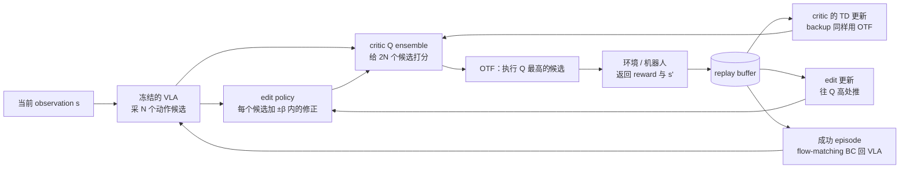
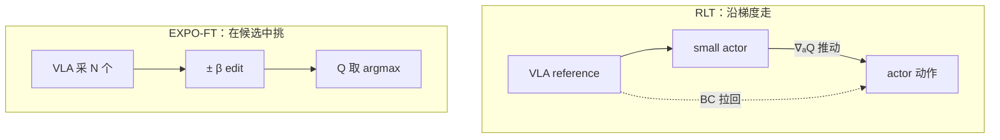

# T3·S06 讲义：让冻结的 VLA 在线变好——EXPO 的 select + edit

> 通读稿 · 2026-10-04 · 先完整读完本讲义，再进入 [S06 练习单](s06-expressive-policy-value-maximization.md)。
> 阅读推荐：[浏览器版 HTML](s06-primer.html)，公式、图与交互示例已内置，可离线打开；本 Markdown 是编辑源稿。
> 本讲义只讲知识，不出题，也不给 toy 实验结果；练习中要做的 prediction 不会在这里被提前回答。阅读完成不自动记为课次通过。

## 0 · 先看全程：一次 online RL 循环里发生了什么

你的 π0.5 已经 SFT 到一定成功率。它会出"像样"的动作，但每次采样略有不同：有时正好，有时带着系统性偏差。EXPO-FT 想在真实交互中让整个系统更可靠，又不想直接对 VLA 做容易失控的 RL。它的做法可以压成一张图：



读这张图只需要记住三句话：

1. **VLA 只负责提供候选**，不直接追 Q；它的改进来自"在成功轨迹上继续模仿"。
2. **critic 只负责在候选里挑**，挑选同时用于执行（rollout）和训练 critic 自己（TD backup）。
3. **edit 只做有界的小修正**，修正幅度有上限 β。

本讲义分七部分：第 1 部分重新激活本课用到的 RL 基础；第 2 部分说明 expressive policy 为什么难做 RL；第 3 部分讲 EXPO；第 4 部分讲 EXPO-FT 搬到 VLA 与真机时加了什么；第 5 部分把 RLT 与 EXPO-FT 放在一起看，并给出诊断地图；第 6 部分完整走一遍练习要用的 CPU toy；第 7 部分整理容易混淆的概念。附录是符号表与代码词汇。

本文的数字分两类：标【例】的是为讲清概念人为设定的；引自论文、代码或仓库报告的都附来源。toy 的实验结果不在本文中出现。

## 1 · 本课用到的 RL 基础（重新激活）

### 知识点 1 · Transition、reward、return 与 γ

一次交互记成一条 **transition**：`(s, a, r, s', done)`。`s` 是执行前的状态，`a` 是实际执行的动作，`r` 是这一步环境给的 **reward**，`s'` 是执行后的状态，`done` 表示 episode 是否在这里结束。

**Return** 是从现在起累积的 reward，常用折扣形式：

$$G_t = r_t + \gamma r_{t+1} + \gamma^2 r_{t+2} + \cdots$$

`γ`（discount factor）越接近 1，越重视远处的 reward。

【例】稀疏任务：只有成功那一步 reward=1，其他都是 0，成功即结束。如果第 3 次决策才成功，`G_0 = 0 + 0.99·0 + 0.99²·1 = 0.9801`。同一个任务早一步成功，return 更高。

工作对应：pi-expo-sim 最早按规则检测器的 0/1 成功信号设计（早期 RoboDojo 设计 §4）；StackCube X3 实际采用势差分 reward R1，见 reward 设计（内部资料） 与[复现案例集](expo-ft-casebook.md)案例 7–9。

### 知识点 2 · Qπ：先做 a，之后按 π 走

$$Q^\pi(s,a) = \mathbb{E}\big[\,G_t \mid s_t=s,\ a_t=a,\ \text{之后按 }\pi\text{ 行动}\,\big]$$

关键在"之后按 π"。同一个 `(s,a)`，后续换一个更强的 policy，Q 值就更高。所以**说一个 Q 值之前，必须先说它是哪个 policy 的 Q**。`V^π(s)` 则是在 s 直接按 π 行动的期望 return。

在"只有成功给 1、成功即结束"的任务里，Q 近似于"折扣后的成功概率"；但一般任务的 Q 不等于成功概率，reward 尺度、γ 和后续 policy 都会改变它。

**Critic** 是近似 Q 的神经网络 `Q_φ(s,a)`：输入状态和动作，输出一个数。它是估计，不是真值。

### 知识点 3 · TD target：用"一步真实 + 后面估计"当学习目标

完整 return 要等 episode 结束才知道。**Temporal difference（TD）** 的做法是：先用这一步真实拿到的 reward，再加上对 `s'` 之后的估计，拼成学习目标：

$$y = r + \gamma \cdot (1-\text{done}) \cdot Q_{\text{target}}(s', a')$$

`(1 − done)` 也常写作 `mask`。episode 已经结束时 `mask=0`，后面没有东西可以估计。这种"用自己的估计构造自己的目标"叫 **bootstrapping**。

【例】`r=0`、未结束、`Q_target(s',a')=0.5`、`γ=0.99`：`y = 0 + 0.99 × 0.5 = 0.495`。如果 `done=1` 且 `r=1`：`y = 1`。

公式里最值得盯住的是 `a'`：**它由谁给出，就决定了 critic 学到的是哪个 policy 的价值**。这一点在知识点 13 展开。

### 知识点 4 · Termination 与 truncation：什么时候 mask 该是 0

- **Termination（终止）**：任务语义上结束了，例如成功或物体掉落。之后确实没有 reward，`mask=0` 是对的。
- **Truncation（截断）**：只是时间到了，被人为切断。物理上任务还能继续，`mask=0` 会让 critic 误以为"之后什么都得不到"。

两种常见处理：

1. 把剩余时间放进 state，这样"时间快到了"本身就是状态的一部分，超时当作终止是自洽的；
2. 超时当截断，丢弃跨越截断的 TD 窗口。

EXPO-FT 两种都用了：DROID 客户端把成功、手动终止、超时都记为 `done` 且 `mask=0`；replay 采样 n-step 窗口时，遇到"done 但 mask=1"的截断就丢弃该窗口（代码核对 §2（内部资料））。本课 toy 采用第 1 种：时间步进入 state，超时当终止。

### 知识点 5 · Critic 怎样训练：回归 + target network

Critic 的 loss 是向 TD target 回归：

$$L_{\text{critic}} = \text{mean}\big[(Q_\phi(s,a) - \text{stopgrad}(y))^2\big]$$

`stopgrad` 表示 y 被当作固定答案，梯度不穿过 y。

y 本身用到 critic 的估计。如果直接用正在训练的 critic 计算 y，目标会跟着自己一起跳动。**Target network** 是 critic 的慢速副本，专门用来算 y；每次更新后用 **Polyak averaging** 缓慢跟随：

$$\phi_{\text{target}} \leftarrow (1-\tau)\,\phi_{\text{target}} + \tau\,\phi$$

【例】`τ = 0.005` 时，target 对一次变化的"记忆"约需 `ln 0.5 / ln 0.995 ≈ 138` 次更新才衰减一半。

### 知识点 6 · Replay buffer、off-policy 与 UTD

所有 transition 存进 **replay buffer**，训练时随机抽 minibatch。数据来自过去各时期的 policy，不一定是当前 policy 采的，所以这类方法叫 **off-policy**。好处是一条数据能反复使用；代价是 critic 要在"别的 policy 采的数据"上估计"当前 policy 的价值"。

**UTD ratio（update-to-data）** 是每采一个环境步做几次 critic 更新。【原文】EXPO 用 UTD 20；EXPO-FT 每次 update 调用做 20 个 critic minibatch（每个 64），约每 40 个环境步调用一次，折合约 0.5 次 critic 更新/环境步（EXPO 系列回顾 §3.1（内部资料））。

**Online** 与 **off-policy** 是两个维度：online 说的是数据在训练过程中持续采集；off-policy 说的是更新可以复用旧 policy 的数据。EXPO-FT 两者同时成立。

### 知识点 7 · 在多个估计里取最大，会系统性高估

假设 8 个候选动作的真实价值都是 0.5，critic 对每个的估计各带独立噪声，标准差 0.1。真实上它们一样好；但我们挑"估计最高"的那个，挑中的估计值期望约为：

$$0.5 + 0.1 \times \mathbb{E}[\max \text{ of 8 standard normals}] \approx 0.5 + 0.1 \times 1.42 = 0.642$$

被挑中的那个，往往正好是被高估最多的那个。这叫 **winner's curse**，也是 Q-learning 类方法 **overestimation** 的根源之一。候选越多、估计噪声越大，高估越严重。如果高估的值又进了 TD target，它会被 bootstrapping 一步步传开。

### 知识点 8 · Twin / ensemble min：给"取最大"降温

对策是训练多个 critic，在算 TD target 时取较小值。TD3 用 2 个（twin）。**REDQ** 式做法训练 K 个，每次随机挑 M 个取 min。

【例】两个独立、无偏、标准差 σ 的估计取 min，期望偏低约 `0.56σ`。它抵消了部分 winner's curse 的高估，但也可能在数据少的地方变得过于保守。

【代码】EXPO-FT 默认 `num_qs=10`、`num_min_qs=2`：10 个 Q head，TD target 中随机取 2 个求 min（代码核对 §2（内部资料））。

## 2 · 为什么 expressive policy 让 RL 变难

### 知识点 9 · Expressive policy：会采样，但给不出便宜的 log π

**Expressive policy** 指 diffusion / flow-matching 这类能表示多峰分布的 policy。π0.5 的 action expert 从噪声出发，沿学到的 vector field 积分若干步，得到一个 action chunk。

它的长处是多峰：同一状态下"从左绕"和"从右绕"都是对的，单个 Gaussian 只能取平均，可能落在两者中间、哪个都不对（A2·S02 的 mode averaging）。

它的短处是：给定一个动作 a，**没有便宜的方法算出 `log π(a|s)`**（精编 [Q20](../../references/rl-spinningup-digest.md)）。大量 RL 方法依赖这个量。

### 知识点 10 · 四条路线：Q 怎样进入一个 expressive policy

| 路线 | 代表 | 做法 | 主要代价 |
|---|---|---|---|
| Likelihood ratio | DPPO | 把 denoising 链的每一步当作一个 Gaussian 小决策，套 PPO | 链长，credit assignment 难；需要 on-policy 数据 |
| 沿采样链反传 ∇Q | Diffusion-QL 类 | 把 Q 的梯度穿过整条 denoising 链传回参数 | 长链上梯度不稳定；EXPO 论文把这列为动机 |
| Advantage weighted / conditioned | AWR、RECAP | `π̂ ∝ π_ref · exp(A/β)`：把 advantage 当权重或条件，回到监督学习 | 改进受数据支撑限制；需要可靠的 advantage |
| Value-guided selection + bounded edit | **EXPO** | base 只模仿；critic 在 base 样本和其有界修正里挑 | 每次决策和每次 backup 都要采 N 个 base 样本，计算重 |

还有一类做法不改 VLA 的参数化，而是外挂一个小网络：RLT 的 small actor 输入 VLA 的 reference 动作，沿 ∇Q 更新，再用 BC 拉回 reference（第 5 部分）。

## 3 · EXPO：select + edit

### 知识点 11 · Base policy：只模仿，从不追 Q

EXPO 的 base policy 只用 imitation learning 训练。在 EXPO-FT 中，base 就是 π0.5：RL 阶段冻结图像编码器，其余可训练部分只在**成功 episode** 上做 flow-matching BC（【代码】`actor_success_only=True`，论文正文没有写）。

这样，VLA 的分布只会往"自己做成功过的样子"收拢，不会被 Q 的误差拉到奇怪的地方。

### 知识点 12 · Edit policy 与 OTF policy

**Edit policy** 是一个小网络，看到 `(s, a_base)` 后输出一个修正：

$$\hat a = \beta \cdot \tanh(\cdot), \qquad a_{\text{edit}} = a_{\text{base}} + \hat a$$

`tanh` 把输出压到 `[−1, 1]`，乘以 β 后修正幅度不会超过 β。edit 的目标是让 `Q(s, a_base + â)` 变大。【原文】EXPO 用 SAC 式的随机 Gaussian edit：目标中加熵奖励 `−α·log π_edit`，鼓励修正保持一定随机性；温度 α 自动调节（**auto-α**），实际熵低于目标熵时 α 变大，高于目标时 α 变小。

**On-the-fly（OTF）policy** 是真正执行的那个 policy：

$$\text{OTF}(s) = \arg\max_{a \in \{a_i\} \cup \{a_i + \hat a_i\}} Q(s, a), \qquad a_i \sim \pi_{\text{base}}(\cdot \mid s),\ i=1..N$$

N 个 base 样本加上它们各自的 edit 版本，共 2N 个候选，选 Q 最高的。【代码】EXPO-FT 默认 N=8、edit 版本也是 8 个，`edit_scale=0.2`，作用于 VLA 归一化后的动作空间。

```reader-demo
best-of-n
```

### 知识点 13 · Backup 用谁，Q 就是谁的价值

回到 TD target 中的 `a'`。不同方法在这里放的东西不同，学到的价值也就不同：

| backup 中的 a' | 学到的价值 | 代表 |
|---|---|---|
| 数据里实际的下一步动作 | 采数据那个 policy 的价值 | SARSA、MC 回报 |
| 当前 actor 的动作 | 当前 actor 的价值 | TD3、SAC、RLT |
| N 个 base 样本（加 edit）中 Q 最高者 | best-of-N OTF 的价值 | EMaQ、**EXPO** |
| 全动作空间的 argmax | 最优价值 Q* | Q-learning；连续动作上会对没见过的动作外推 |

完整谱系见 RLT 方法迭代参考 §6（内部资料）。

EXPO 在 rollout 和 backup 中都用 OTF，因此 critic 估计的正好是"实际执行的那个 policy"。【原文】去掉 backup 中的 OTF、只采一个 base 样本时，更新退化为 SARSA 式，学得明显变慢（EXPO Fig 5）。

【例】某个 `s'`：单个 base 样本平均成功概率 0.58，8 选 1 挑对时约 0.9。用单样本 backup 时，target 约为 `0.99 × 0.58`；用 OTF backup 时，约为 `0.99 × 0.9`。两者差的不是"误差"，而是"在估计谁"。

```reader-demo
backup-identity
```

### 知识点 14 · Selection space：挑选能带来多少

同一状态下，如果 N 个候选的真实成功率都差不多，挑得再准也没用；候选之间差异越大，挑选的收益上限越高。用一个量来描述：

$$\text{selection space} = \mathbb{E}[\max_j p_j] - \mathbb{E}[\text{mean}_j\, p_j]$$

`p_j` 是"执行候选 j，之后由原 policy 接着做"的真实成功率。

【例】8 个候选的真实成功率为 `0.9, 0.9, 0.85, 0.1, 0.05, 0.9, 0.1, 0.8`：均值约 0.58，最大值 0.9，selection space 约 0.32。

- critic 排序完全正确：最多拿到这 0.32；
- critic 排序随机：收益为 0；
- critic 系统性偏好某一侧：可能比单次采样还差。

工作对应：早期 RoboDojo 设计 §5 的 G2 门槛就是它的 RoboDojo 版本（"同状态 8 个 VLA 样本中真实成功率最高者减均值 ≥ 10 pp"），用 snapshot 反事实 rollout 来测，训练前就能测。StackCube 上 X3.6.1 / X3.9 用多次真实接续直接测了这个量，见[复现案例集](expo-ft-casebook.md)案例 10–11。

### 知识点 15 · 为什么"挑选"比"沿梯度走"更不容易被 Q 的误差带偏

Critic 只在数据覆盖过的动作附近比较可信。设想两种使用 Q 的方式：

- **沿梯度走**（TD3、RLT 的 actor）：actor 不断往 `∇ₐQ` 的方向移动。如果 Q 在数据之外有一个虚假的高峰，梯度会把 actor 一路带过去。
- **在候选中挑**（EXPO）：候选只能来自 base 分布及其 ±β 邻域。Q 在远处的虚假高峰再高，也不在候选里，挑不到。

代价也在这里：如果正确动作在 base 分布之外、又超出 β，EXPO 也到不了。改进的上限由 base 的支撑范围和 β 决定。

### 知识点 16 · Entropy backup（EXPO 的一个变体）

【原文】数据集很窄时（例如 Adroit relocate），EXPO 在 backup 中加入软采样分布的熵项，防止 critic 在窄数据上过于自信；不加熵项时，最终性能随 IL 数据质量单调变化（Fig 7）。EXPO-FT 改用人在环干预处理窄数据问题，没有用这个变体。

## 4 · EXPO-FT：把 EXPO 搬到 VLA 和真机

### 知识点 17 · Action chunk 与 n-step

VLA 一次输出一段动作，执行其中前 C 步后再重新规划（代码中的 `replan_steps`）。EXPO-FT 把"一个 C 步的执行段"当作一次决策：edit 和 Q 都作用在这 C 步上，edit 作用于展平后的 `C × 动作维` 向量；TD 跨越 C 步：

$$y = \sum_{k=0}^{C-1}\gamma^k r_{t+k} + \gamma^{C} \cdot \text{mask} \cdot \min_{2\text{ of }K} Q_{\text{target}}(s_{t+C}, \text{OTF}(s_{t+C}))$$

这 C 步动作是数据中实际执行的，第 C 步之后才交给 OTF。若 critic 的 action 是整个实际执行的 chunk，内部 C 步是一次 macro-action 的执行后果，`γ^C` 是跨物理步的折扣。它与 primitive-action n-step 都会累加多步 reward，但是否跨越了多次 behavior policy 决策，要看 action 接口与执行边界。中途发生 replan 或人工覆盖时，先核对 replay 实际保存的动作段。

工作对应：RLT 线把执行长度 E 和回报步数 n 绑在一起（都等于 10），复审建议拆成两个旋钮（RLT 方法迭代参考 §3.3（内部资料））。【原文】EXPO-FT 在精密任务上用 C=4@10Hz，C=16 明显变差。

### 知识点 18 · Replay 的 chunk 回填与窗口丢弃

【代码】EXPO-FT 每个环境步都写入 replay；实际执行的动作之后会回填到前面各步的 chunk 中，因此任意一步都可以作为 chunk 起点。采样 n-step 窗口时，窗口内碰到截断就把该窗口标为无效、丢弃。

工作对应：早期 RoboDojo 设计 §4 的迁移清单要求单测"25 Hz、E16 下 chunk 回填与 n_step 正确，含 snapshot 起点之后的第一个 chunk"。

### 知识点 19 · 改进写回 VLA：成功 BC

EXPO-FT 中，改进分布在三处：critic、edit、以及通过成功 BC 更新的 VLA。部署时运行的是"VLA × N + edit + critic"整个组合。

于是"提升"有两个层面（早期 RoboDojo 设计 §1）：

- **系统层**：整个 OTF 组合的成功率，论文报告的是这一层；
- **模型层**：RL 之后 VLA 单独推理（单次采样、不用 critic）的成功率，论文没有报告。

【评述】论文缺一个关键对照："N=1、不用 edit、只在成功轨迹上 BC"的纯自我模仿。因此 Q 选择、edit 和成功 BC 各自贡献多少，没有拆开（EXPO 系列回顾 §3.3（内部资料））。早期 RoboDojo 设计 §6 的对照臂 A1 就是为了补这一项；StackCube X3.7 的预登记 B1 对照因条件不满足未触发，这一项至今仍未拆开（[复现案例集](expo-ft-casebook.md)案例 17）。

### 知识点 20 · Critic 的输入与结构

【原文 / 代码】EXPO-FT 的 critic 有自己的图像编码器（ResNet-50，从零训练，带数据增强），每个 s' 只编码一次；10 个 Q 只是共享特征上的 10 个 MLP head（256, 256, 256）。edit 复用 critic 的图像特征。critic 和 edit 都没有时序编码器，chunk 直接展平输入 MLP。

工作对应：critic 从像素学毫米级几何是本期风险之一；设计保留了"critic 输入特权位姿"的诊断臂，用来区分"critic 排序错是因为表征不够，还是因为数据不够"。

### 知识点 21 · 更新节奏与计算量

【代码】每次 update 调用：从 replay 采 64 × 20，拆成 20 个 critic minibatch；然后依次做 1 步 VLA BC、1 步 edit、1 步温度更新。前 10 个 episode 只采数据不更新。

最贵的一步在 backup：每个 critic minibatch 要对其中 64 个 `s'` 各算一次 VLA prefix 并采 N 个样本，一次 update 调用共 1280 个 `s'`（算力评估（内部资料））。OTF backup 的价值和它的计算代价是同一件事的两面。

### 知识点 22 · 启动条件与证据强度

【原文】EXPO-FT 先把 VLA SFT 到约 40% 以上再开始 RL。这对应两个前提：执行者要有足够的成功样本，reward 才不至于太稀疏；同一状态下的候选之间要有差异，挑选才有意义。

【评述】论文每个任务只训练一次、评测 30 次；30/30 的 95% 下界约为 88%。最硬的证据是与 HG-DAgger 的比较（合并 240/240 对 177/240）。

工作对应：X2 计划以 StackCube `success_once ≥ 40%` 作为进入 EXPO-FT 的门槛；早期 RoboDojo 设计 §5 另有 G1（RL 段成功率 40–85%）和 G2（selection space ≥ 10 pp）。X2.4 的 H16/E16 起点越过了这个门槛，X3.7 的完整在线 EXPO 仍未验证出收益：门槛是必要条件，不是充分条件（[复现案例集](expo-ft-casebook.md)案例 17）。

## 5 · RLT 与 EXPO-FT 放在一起看

### 知识点 23 · RLT 的结构回顾

RLT 冻结 VLA，从 VLA 内部压出一个紧凑的 **RL token** 作为状态表示；一个 small actor 输入 RL token、proprio 和 VLA 给出的 reference 动作 chunk，输出自己的 chunk；twin critic 按 TD3 方式训练；actor 的目标是"Q 高"加"别离 reference 太远"（BC anchoring）。在 T3·S07 中你已经用 CPU toy 比较过"只模仿 reference"和"同时接受 critic 指导"。

### 知识点 24 · 两种使用 Q 的方式

| | RLT | EXPO-FT |
|---|---|---|
| 谁执行动作 | small actor | VLA 本身（+ 有界 edit） |
| Q 怎样被使用 | actor 沿 ∇ₐQ 更新，BC 拉回 reference | 在候选中 argmax；edit 有界 |
| backup 评估谁 | 当前 actor | best-of-N OTF |
| 防止走出可信区域靠什么 | BC 权重 | base 分布 + β 上限 |
| 改进落在哪里 | small actor（部署时必须带上） | VLA（成功 BC）+ edit + critic |
| critic 表征 | RL token | 独立 ResNet-50 |



工作对应：RLT 复审发现 actor 走出了 Q 可信的范围（rollout 中 CP 修改率 60–91%，Q 与 BC 梯度余弦 −0.55），并在 §5.3 建议改试 EXPO-FT 风格，即由 VLA 执行（RLT 方法迭代参考 §5.3（内部资料））。

### 知识点 25 · 诊断地图：L0–L4 与监控项

RLT 复审按信息的因果流向把失败分成五层，每层是上一层起作用的前提（§2（内部资料））：

| 层 | 问的是 | EXPO-FT 中的对应检查 |
|---|---|---|
| L0 执行者能力 | 关掉 RL，执行者自己能成功多少 | VLA 单独成功率；G1 |
| L1 奖励信号 | 能拿到多少正结果，传到决策点还剩多少 | 成功 episode 比例；replay 中正 reward 的占比 |
| L2 actor 能力 | 出动作的网络能否复现成功行为 | EXPO-FT 中由 VLA 承担，通常不是瓶颈 |
| L3 critic 排序 | 同一状态下 Q 对候选的排序是否正确 | 同状态反事实 rollout；selection space 被挑中了多少 |
| L4 策略改进 | 使用 Q 时是否走出了 Q 可信的区域 | edit 贴着 β 上限的比例；ensemble 分歧；Q 超过回报上限 |

早期 RoboDojo 设计 §7 列出的训练中监控项（StackCube X3 的实际字段见 W&B 指标对照（内部资料）），可以按这张表归层：

- **Q 与 MC 回报的差**（固定探针 snapshot 上）：先确认二者对应同一个 policy（知识点 13），再判断是 L3 还是设计使然；
- **Q 超过回报上限的比例**：reward 最多为 1 时折扣回报不超过 1，超过就是高估的信号（知识点 7）；数值不越界不证明准确；
- **选中 edit 的比例、edit 是否贴着上限**（`select_ratio_with_edit`、`mean_edit_scaled_norm`）：大量贴着上限说明 edit 想走得更远，可能在追 Q 的误差，也可能 β 设得太小；
- **ensemble 分歧**：选中动作上的分歧明显大于数据动作上的分歧，提示正在挑数据之外的动作。

这些是排查入口，不是从单一曲线唯一归因的规则。

## 6 · 练习要用的 CPU toy，完整走一遍

练习单里不会再引入新概念。下面把 toy 的每个部件与前面的知识点对上。

### 知识点 26 · 环境与"冻结 VLA"

一维横向对齐，把它想成"把插头对准插孔"的最后几毫米：

- 状态：当前横向误差 `x`，初始在 `[−0.6, 0.6]`；以及当前是第几次决策 `t`。
- 动作：一次位移 `a ∈ [−1, 1]`。执行后 `x' = x + a + N(0, 0.02)`，`N(0, 0.02)` 是环境噪声。
- `|x'| ≤ 0.05` 成功，reward 1，结束；`|x'| > 1` 掉落，reward 0，结束；最多 3 次决策，超时当作终止（知识点 4 的第 1 种处理），`γ = 0.99`。
- 每次决策视为一个已执行的 chunk（知识点 17 中的 C 在这里等于 1 次决策）。

"冻结 VLA"是一个解析的双峰 sampler：

$$a = -x + b + \mathcal N(0,\ 0.08), \qquad b = \begin{cases}0 & \text{概率 } p_{\text{good}}=0.6\ (\text{good mode})\\ +0.30 & \text{否则}\ (\text{bad mode，系统性偏差})\end{cases}$$

`−x` 是"正好纠正误差"的动作。good mode 围绕正确答案散开；bad mode 带着 0.30 的固定偏差，比任何 edit 上限都大，edit 救不回来，只能靠挑选避开。它不训练、不更新，对应"base 只模仿、RL 阶段不追 Q"。

### 知识点 27 · Agent 的部件与配置

| 部件 | toy 中的实现 | 对应知识点 |
|---|---|---|
| 候选 | N=8 个 base 样本 + 8 个 edit 版本 | 12 |
| edit | 确定性 `0.1·tanh(MLP(x, t, a_base))`，往 ensemble 平均 Q 高处推；没有熵项 | 12 |
| critic | 10 个 MLP（输入 x、t、a，3→64→64→1） | 8、20 |
| TD target | 随机取 2 个 target Q 的 min；`mask` 覆盖成功、掉落、超时 | 3、4、8 |
| target network | Polyak `τ=0.005` | 5 |
| 更新节奏 | 前 10 个 episode 只用 base 采数据；之后每个 episode 结束做 20 个 critic minibatch（每个 64）+ 1 步 edit；共 150 个 episode | 6、21 |
| rollout 打分 | 2N 个候选用 ensemble 平均 Q 打分，取 argmax | 12 |

练习中由你口述三个函数的意图：OTF 怎样从候选里选；backup 的下一步动作在两种模式下各取什么；TD target 怎样拼。它们在 harness 里保持空白，直到你口述。

### 知识点 28 · 评测与仪表

- **主指标**：23 个固定探针初始状态 × 40 次 rollout，冻结策略后的真实成功率；
- **Q 评分 − MC 回报**：在探针上，第一个决策被选中动作的 Q 评分，减去真实折扣回报的平均（知识点 13 告诉你读这个数之前先问什么）；
- **选中 edit 的比例**：被执行的动作中，来自 edit 候选的占比；
- **训练前的 gate**（不训练）：base 单次采样的闭环成功率，以及 selection space（知识点 14 的公式，`p_j` 用"执行候选 j，之后由 base 接着做"的 20 次 rollout 估计）；
- **replay 初始化**：可以在训练前往 replay 放入若干条成功示教，对应早期 RoboDojo 设计 §3.2 讨论的 replay 初始化；
- 默认 seeds `0 1 2`，全部报告，不挑最好；改变一个设置就是一个 arm，一次只改一项。

### 知识点 29 · toy 与官方 EXPO-FT 的差别

| 维度 | 官方 EXPO-FT | 本 toy |
|---|---|---|
| base | π0.5，在线成功 BC | 固定解析 sampler，不更新 |
| edit | SAC 式 Gaussian + 熵 + 温度更新 | 确定性 tanh edit，无熵 |
| chunk / n-step | C 步 chunk，`γ^C`，逐步回填 | 每次决策视为一个 chunk |
| critic 输入 | ResNet-50 图像特征 + proprio | 真实低维状态 `(x, t)` |
| rollout 时 ensemble 的聚合 | 待核对官方代码 | ensemble 平均 |
| 更新节奏 | 约每 40 环境步一次调用 | 每 episode 一次调用 |

toy 的价值在于秒级重跑、能看到真值；它的结论不能当作 π0.5、StackCube 或 RoboDojo 的能力证据，只用来校准"该看什么、先怀疑哪一层"。

## 7 · 容易混淆的概念

- **Reward、return、Q、成功概率**：reward 是一步的信号；return 是累积；Q 是"先做 a、之后按 π"的期望 return；只在"成功给 1、成功即结束"的任务里，Q 才近似折扣成功概率。
- **Rollout 用的 policy 与 backup 评估的 policy**：两者可以不同。不同时，Q 与实际执行的 MC 回报不一致是预期的。
- **Edit 与 actor**：edit 只在 base 样本上做有界修正，不单独产生动作；RLT 的 actor 自己产生完整的 chunk。
- **挑选与梯度**：挑选只在候选中比较 Q；梯度把动作往 Q 增大的方向推，可能推出数据覆盖范围。
- **Ensemble mean 与 ensemble min**：mean 降低方差，不处理"取最大"带来的高估；min 主动往下压，用来抵消高估。
- **Termination 与 truncation**：前者是任务真结束；后者只是时间到，处理不当会让 critic 误判后果。
- **系统层与模型层**：前者测整个 OTF 组合；后者测 RL 之后 VLA 单独推理。
- **Selection space 与成功率**：成功率是平均水平；selection space 是"候选之间的差异有多大"，决定挑选的收益上限。
- **Online 与 off-policy**：数据何时采集，与更新能否复用旧数据，是两个维度。

## 附录 A · 符号（开卷参考）

| 符号 | 含义 |
|---|---|
| `s, a, r, s'` | 状态、实际执行的动作、reward、下一状态 |
| `γ` | discount factor |
| `done / mask` | episode 是否在此结束；`mask = 1 − done` |
| `Q^π(s,a)` | 先做 a、之后按 π 的期望 return |
| `Q_φ, Q_target` | critic 及其慢速副本 |
| `τ` | Polyak 系数 |
| `K, M` | ensemble 中 Q 的个数；TD target 中取 min 的个数（EXPO-FT 为 10、2） |
| `N` | 每次采的 base 样本数 |
| `β` | edit 幅度上限（代码 `edit_scale`） |
| `C` | 执行段长度（代码 `replan_steps`），也是 TD 跨越的步数 |
| `α` | SAC 式熵正则的温度 |
| `p_j` | 执行候选 j、之后由 base 接着做的真实成功率 |

## 附录 B · 读 EXPO-FT 代码前的最少词汇

| 名称 | 含义 |
|---|---|
| `EXPOLearner` | `expo_ft/agents/alg/` 下的主算法实现 |
| `replan_steps` | 执行段长度 C；replay 的 `n_step` 等于它 |
| `num_qs`, `num_min_qs` | ensemble 大小与 TD target 中取 min 的个数 |
| `n_edit_samples`, `edit_scale` | edit 候选数；edit 幅度上限 |
| `actor_success_only` | VLA 的 BC 只用成功 episode |
| `utd_ratio`, `batch_size` | 每次 update 调用的 critic minibatch 数与每个的大小 |
| `mask`, `valids` | 是否 bootstrap；n-step 窗口是否有效 |
| `is_hil`, `hil_chunk` | 人工干预的动作与包含人工动作的 chunk |
| `select_ratio_with_edit`, `mean_edit_scaled_norm` | 选中 edit 候选的比例；edit 的平均归一化幅度 |

## 材料依据

- EXPO：[arXiv 2507.07986](https://arxiv.org/abs/2507.07986)；EXPO-FT：[arXiv 2605.25477](https://arxiv.org/abs/2605.25477)；官方代码 [pd-perry/expo-ft](https://github.com/pd-perry/expo-ft)
- 仓库内：EXPO 系列回顾（内部资料）、EXPO-FT 代码核对（内部资料）、pi-expo-sim 设计（内部资料）、算力评估（内部资料）、RLT 方法迭代参考（内部资料）、[RL 问答精编](../../references/rl-spinningup-digest.md)
- 交互示例的独立版：[expo-select-edit.html](demos/expo-select-edit.html)
