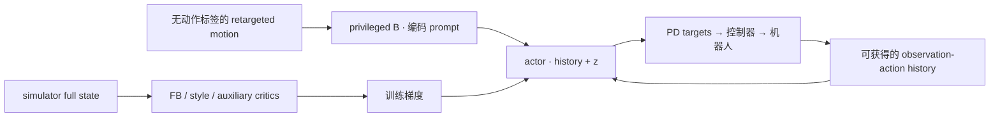

# Zero-Shot RL 讲义：从 SR / SF 到 FB 与人形 BFM

> T3·S09 · 用一个五格走廊，理解任务怎样变成可调用的行为。
> [HTML 阅读版](zero-shot-rl-primer.html)内置公式、图与三个交互示例；通读后进入 [S09 练习与陪练入口](s09-zero-shot-rl.md)。

与当前机器人工作连读：[统一温习讲义](rl-control-review-primer.html)区分 PPO / TD3 的数据更新方式、FB 的新任务接口，以及 HORA / AnyRotate 的 dynamics adaptation；[P5 实践](rl-control-practice.md)复用本章材料，保持 next-state reward、rho 与 task coordinates 约定。Zero-shot reward transfer 不自动意味着 sim2real transfer。

## 0 · 全程地图：把抽象的三个公式落到同一个环境

**这章要解决的困惑：** 为什么“学未来访问分布”能支持新奖励？为什么固定策略的 SR 还不够？FB 怎样同时学习表示和策略？从一个五格走廊到人形机器人，哪些数学保留了，哪些保证变成了工程近似？

学习顺序从 **Successor Representation（SR，后继表示）** 的表格例子开始，再到 **Successor Features（SF，后继特征）**，最后读 **Forward-Backward Representation（FB）**。论文的历史主线从 Touati & Ollivier 2021 走到 BFM-Zero（ICLR 2026）。先用 SR / SF 算清一个例子，再抓住 2021 的核心思想，就可以进入 2023 的精读。QP 留到其他专题。


### 一个 Lesson，八个学习单元

| 单元 | 要建立的机制 | 可独立停下的收获 |
|---|---|---|
| 1 · SR | 未来访问表 × 新奖励 = 旧策略价值 | 区分 policy evaluation 与 policy optimization |
| 2 · SF / GPI | 特征压缩、奖励投影、动作级策略改进 | 能判断特征遗漏与策略遗漏是两种问题 |
| 3 · FB 2021 | successor measure、F / B / z、self-consistency、坐标与 ρ | 区分任务坐标、奖励投影与策略优化误差 |
| 4 · FB 训练 | Bellman / TD / TD3、batch、target、off-policy | 能追踪一次 batch，并说明哪些数据可以复用 |
| 5 · 2023 精读 | 公平对比、改进损失、表示与数据的边界 | 读懂“85%”的分母和适用范围 |
| 6 · 2024–25 扩展 | FB-IL 四类、固定奖励陷阱、离线修补、adaptation | 区分 z 上推断、分布匹配与测试时 RL |
| 7 · Meta Motivo | conditional policy regularization | 解释 observation-only motion 如何约束行为 |
| 8 · BFM-Zero 与迁移 | history、privileged critic、DR、辅助奖励；接回 IL / VLA | 区分部署、适配与不同的学习信号 |

第一轮顺着例子读单元 1–5，建立 FB 的完整心智模型；第二轮读单元 6–8，看任务提示怎样扩展到模仿与人形控制。每个单元都可以独立停下，借助交互观察变化，再用自己的话解释它。

### 先钉住 Zero-Shot 的含义

在这条文献线里，**Zero-Shot RL** 的流程是：先在给定环境中预训练；新 reward / goal / demonstration 到来后，保持网络固定，通过简单任务编码直接调用已学策略。可复用的是这个环境中学到的动力学与行为能力。

**Behavioral Foundation Model（BFM，行为基础模型）** 在本章指预训练后可被多种任务提示调用的行为模型。FB 描述学习表示与控制的方法，BFM 描述模型的能力与接口；一个可执行系统还包含 actor、观测接口与控制器。

可以把它看成“可索引的策略族 + task description 到 z 的翻译规则”：任务提示进入模型，行为在动力学中闭环执行。据 Yuan et al. 的 [2025 年 BFM 综述 §I-C](https://arxiv.org/html/2506.20487v1#S1.SS3)，behavior(al) foundation model 这一术语首次出现在 FB-IL，即 *Fast Imitation via Behavior Foundation Models*（ICLR 2024）。

2023 论文还区分：显式给出 reward function 是严格的 zero-shot；用少量 `(state, reward)` 样本估计任务向量，属于 few-shot task specification、zero-planning。课程沿用文献的 Zero-Shot RL 名称，同时保留这个区别。[定义：2023 §2](https://arxiv.org/html/2209.14935v2#S2)

阅读后续方法时，可以沿着四个问题理解它的“即用能力”：任务由什么数据描述，网络哪些部分更新，latent 怎样得到，执行前做了什么搜索。

## 1 · SR：一张足迹表怎样复用到不同任务

### 1.1 五格走廊与时间合同

【例】状态是 `0, 1, 2, 3, 4`；动作是 `left / stay / right`；撞墙留在原格；默认折扣 $\gamma=0.5$。这是 **continuing task**：过程可以一直继续，到达目标后仍可继续得奖励。

先从 **current-state reward** 讲起：当前在 $s_t$ 就收到 $r(s_t)$。

$$M_0^\pi(s,j)=\mathbb{E}_\pi\left[\sum_{t=0}^{\infty}\gamma^t\mathbf{1}\{s_t=j\}\mid s_0=s\right],\qquad V_0^\pi(s)=\sum_j M_0^\pi(s,j)r(j).$$

$M_0$ 的行是起点，列是未来访问的状态。下标 `0` 提醒它包括当前状态。它是 **discounted occupancy（折扣访问量）**：将各时刻的访问按折扣累加，每行之和为 $1/(1-\gamma)$。默认值下行和为 2；乘以 $1-\gamma$ 才得到归一化的访问分布。

### 1.2 一直向右的完整算例

取固定策略 $\pi_R$：每个状态都选 right。从 0 出发，访问序列为 `0 → 1 → 2 → 3 → 4 → 4 → …`，权重为 `1, 0.5, 0.25, 0.125, 0.0625, …`。格 4 的总访问量是几何级数 $0.0625/(1-0.5)=0.125$。

| 起点 / 终点 | 0 | 1 | 2 | 3 | 4 |
|---|---:|---:|---:|---:|---:|
| 0 | 1 | 0.5 | 0.25 | 0.125 | 0.125 |
| 1 | 0 | 1 | 0.5 | 0.25 | 0.25 |
| 2 | 0 | 0 | 1 | 0.5 | 0.5 |
| 3 | 0 | 0 | 0 | 1 | 1 |
| 4 | 0 | 0 | 0 | 0 | 2 |

任务 A 在格 4 给奖励：$r_A=[0,0,0,0,1]^\top$。$M_0^{\pi_R}r_A$ 就是最后一列，得到 $[0.125,0.25,0.5,1,2]^\top$。

任务 B 在格 2 给奖励：$r_B=[0,0,1,0,0]^\top$。同一张表乘新奖励，得到 $[0.25,0.5,1,0,0]^\top$。无需重新学习 SR，但从格 3 / 4 出发仍得不到奖励，因为原策略一直向右。

**机制：** SR 将“给定环境、给定策略的未来访问”与“任务奖励”拆开。换 reward 后，矩阵乘法立刻给出旧策略的新价值；接下来要解决的控制问题，是怎样选出更好的动作。[理论源头：Dayan 1993](https://doi.org/10.1162/neco.1993.5.4.613)

```reader-demo
occupancy
```

### 1.3 表是怎么学出来的

有环境转移模型时：$M_0^\pi=(I-\gamma P_\pi)^{-1}$。只有 sampled transitions 时，SR 同样可以用 TD 更新一行：

$$M_0^\pi(s,\cdot)\leftarrow M_0^\pi(s,\cdot)+\alpha\left[e_s+\gamma M_0^\pi(s',\cdot)-M_0^\pi(s,\cdot)\right].$$

$e_s$ 是当前状态的 one-hot；下一步 $s'$ 来自该策略。普通价值 TD 更新一个数，SR 的 TD 更新一个“所有终点的向量”。后面的 FB 仍使用这个递推思想，只是压缩了向量并同时处理一族策略。

在真实训练里，reward relabeling 将同一条 transition 用于不同任务。它复用已有的动力学经验，因而效果取决于这些经验覆盖了哪些状态与动作。

## 2 · SF、GPI 与 USFA：压缩什么，改进什么

### 2.1 SF 把“未来每个状态”换成“未来每个特征”

**Feature map** $\varphi(s)\in\mathbb{R}^d$ 将状态映射到特征。若奖励可写为 $r(s)=\varphi(s)^\top w$，则 current-state 版 SF 为：

$$\psi_0^\pi(s)=\mathbb{E}_\pi\left[\sum_{t\ge0}\gamma^t\varphi(s_t)\mid s_0=s\right],\qquad V_0^\pi(s)=\psi_0^\pi(s)^\top w.$$

【例】选两个特征：$\varphi(s)=[\mathbf{1}\{s\in\{3,4\}\},\mathbf{1}\{s\in\{0,1\}\}]$，即右侧、左侧。对 $\pi_R$，从 0 出发的 SF 是 `[0.25, 1.5]`，从 2 出发是 `[1, 0]`，从 4 出发是 `[2, 0]`。

右侧奖励可以用 $w=[1,0]$ 表示。格 2 的特征则是 `[0,0]`，与任意 $w$ 点积都为零；“仅在格 2 得 1 分”落在这组特征的 span 之外。这是 **reward representation error**：任务所需的区别在压缩时丢失了。

特征既可以由人设计，也可以来自自编码、contrastive learning、Laplacian 或其他 learned representation。这让 SF 与多种表示学习方法相连。[Barreto et al. 2017](https://proceedings.neurips.cc/paper/2017/file/350db081a661525235354dd3e19b8c05-Paper.pdf)

### 2.2 从 reward samples 到权重

用数据分布 $\rho$ 做最小二乘：

$$C_\varphi=\mathbb{E}_\rho[\varphi\varphi^\top],\qquad w_r=C_\varphi^{-1}\mathbb{E}_\rho[\varphi r].$$

奇异时使用 pseudoinverse 或 regularization。$C_\varphi$ 是由原始特征外积平均得到的 **second-moment matrix**。$\hat r(s)=\varphi(s)^\top w_r$ 是该表示空间中、按 ρ 加权最接近原奖励的函数；当原奖励位于 feature span 内时，重构可以精确。

在真实训练里，“encoder 重建准确”与“task reward 能线性表达”是不同合同。原始低维坐标足够重建状态，却可能不足以线性表达“只在某个小区域奖励”。

<span id="23-gpi-是动作级改进不能用-max-v-代替"></span>

### 2.3 GPI：逐步重选怎样改进策略

**Generalized Policy Improvement（GPI）** 用一组旧策略在**同一个新奖励**下的 action values：

$$\pi_{\mathrm{GPI}}(s)\in\arg\max_a\max_i Q_r^{\pi_i}(s,a).$$

关键是：$Q_r^{\pi_i}(s,a)$ 允许第一步先做任意动作 $a$，之后才跟随旧策略 $\pi_i$。执行 GPI 时，每一步都会重新选择，所以它可以组合出旧策略没有完整执行过的行为。在精确 action-value 等条件下，GPI 的表现至少达到来源策略的上包络。

【例】仍用 current-state reward，目标为格 2，旧策略只有 $\pi_R$ 和 $\pi_L$。先展开 $Q_r^{\pi_R}(2,\mathrm{stay})$：**只指定第一步 stay，之后一直跟随旧策略 πR**。

| 时刻 | 状态 | 本时刻之后的动作 | 奖励对总价值的贡献 |
|---|---|---|---:|
| t = 0 | 格 2 | 指定 stay 一次 | 1 |
| t = 1 | 格 2 | 开始跟随 πR，向右 | 0.5 × 1 = 0.5 |
| t = 2 | 格 3 | πR 继续向右 | 0.25 × 0 = 0 |
| t ≥ 3 | 格 4 | πR 向右，撞墙留下 | 0 |

$$Q_r^{\pi_R}(2,\mathrm{stay})=r(2)+\gamma V_r^{\pi_R}(2)=1+0.5\times1=1.5.$$

后面的 0.5 来自晚一步在格 2 再得到的奖励 1，乘上折扣 0.5。stay 的作用是让下一时刻仍在格 2。$r(2)=1$ 是当前奖励，$V_r^{\pi_R}(2)=1$ 是之后一直向右的总回报；在这条旧策略下，两者数值恰好相等。跟随 πL 得到同样的 1.5。

第一步 right 后继续 πR，或第一步 left 后继续 πL，都只拿到起点的奖励 1；若第一步 right 后改跟 πL，则会晚两步再经过格 2，得到 $1+0.5^2=1.25$。三个动作各自的最好旧策略评分为：`left = 1.25，stay = 1.5，right = 1.25`，所以 GPI 选 stay。

**执行 GPI 时，每一步都重新用旧策略评分，再选当前动作。** 下一步仍在格 2，GPI 又比较三个动作，再选 stay，于是实际执行 `stay → stay → stay → …`，新策略价值为 $1+0.5+0.25+\cdots=2$。

完整策略 `right, right, stay, left, left` 是**状态 0–4 各自对应的动作表**。执行时按当前状态查表：

| 起点 | GPI 选的动作 | 一直 πR 的 V | 一直 πL 的 V | max(VR, VL) | 执行 GPI 的 V |
|---|---|---:|---:|---:|---:|
| 0 | right | 0.25 | 0 | 0.25 | 0.5 |
| 1 | right | 0.5 | 0 | 0.5 | 1 |
| 2 | stay | 1 | 1 | 1 | 2 |
| 3 | left | 0 | 0.5 | 0.5 | 1 |
| 4 | left | 0 | 0.25 | 0.25 | 0.5 |

从格 0 出发，一直 πR 只在 t = 2 得一次奖励，价值是 0.25；GPI 到格 2 后持续得奖励，价值是 $0.5^2(1+0.5+\cdots)=0.5$。它在这个例子里恰好最优。

`max(V_R,V_L)=[0.25,0.5,1,0.5,0.25]` 记录旧策略价值的 **envelope（上包络）**；执行 GPI 的价值是 `[0.5,1,2,1,0.5]`。前者用来比较旧策略，后者来自逐步重选后的新行为。

```reader-demo
gpi
```

### 2.4 USFA 向一族策略迈进一步

**Universal Successor Features Approximators（USFA）** 让 successor features 也带上策略参数，例如 $\psi(s,a,z)$，并结合任务泛化与 GPI。这样，一个网络可以描述一族策略的未来特征。USFA 的 preprint 是 2018，会议版为 ICLR 2019。[Borsa et al.](https://openreview.net/pdf?id=S1VWjiRcKX)

FB 继续往前走：把任务特征与 policy-conditioned successor measure 放在同一个学习标准里联合训练。

## 3 · Touati & Ollivier 2021：FB 到底承诺了什么

**Learning One Representation to Optimize All Rewards（NeurIPS 2021）** 提出 FB。进入 2023 前，应吃透本节的对象、代数与假设；2021 的完整测度论证明可按需回查，无需先从头精读。[原论文](https://arxiv.org/abs/2103.07945)

### 3.1 从表到 Successor Measure

在连续空间里，用区域代替表格的一列。**Successor measure** $M^\pi(s,a,X)$ 表示未来访问某个区域 $X$ 的折扣量。

从这里开始采用 **2023 的 next-state reward convention**：先做 $a_t$，到 $s_{t+1}$，再收到 $r(s_{t+1})$。

$$M^\pi(s,a,X)=\mathbb{E}\left[\sum_{t\ge0}\gamma^t\mathbf{1}\{s_{t+1}\in X\}\mid s_0=s,a_0=a,\pi\right].$$

$$Q_r^\pi(s,a)=\int M^\pi(s,a,\mathrm{d}s^+)\,r(s^+).$$

两个时间合同的桥梁是：五格确定性例子中，若第一步到 $f(s,a)$，则 next-state 的 state-action occupancy 行等于 $M_0^\pi(f(s,a),\cdot)$。先找到第一步到达的格子，再取那一行 SR，就完成了索引转换。2021 与 2023 的 TD 正项也因此存在索引差别；本讲义后半统一使用 2023 写法。

### 3.2 F、B、ρ 与 z 的分工

FB 用低秩模型近似一族策略的 successor measure：

$$M^{\pi_z}(s,a,\mathrm{d}s^+)\approx F(s,a,z)^\top B(s^+)\,\rho(\mathrm{d}s^+),\qquad \pi_z(s)\in\arg\max_a F(s,a,z)^\top z.$$

| 对象 | 输入 → 输出 | 可以如何理解 |
|---|---|---|
| $B$ | 终点状态 $s^+\to\mathbb{R}^d$ | 共享的终点基底，将状态放进任务表示空间 |
| $F$ | 起点、第一动作、策略参数 $(s,a,z)\to\mathbb{R}^d$ | 在该策略下，起点对未来终点基底的组合系数 |
| $z$ | reward / goal / trajectory → $\mathbb{R}^d$ | 任务描述，也是条件策略的输入 |
| $\rho$ | 数据集的状态分布 | 分解相对于它表达 successor density |
| $\pi_z$ | 当前状态与 $z\to$ action | 执行控制；连续动作通常由 actor 近似 argmax |

把 $B(s^+)$ 想成终点的“地址特征”，把 $F(s,a,z)$ 想成当前策略下未来访问这些特征的组合。二者配对才表达可达关系：同一个终点 B 可以服务不同的起点与策略，F 则随策略 z 改变。

离散状态中：$M(s,a,j)\approx F(s,a,z)^\top B(j)\rho(j)$。点积表达的是**相对于 $\rho$ 的密度**；再乘 reference mass，得到该终点的折扣访问量。这让神经网络可以用采样与点积来近似整张足迹表。

### 3.3 奖励如何翻译成任务向量

$$z_r=\mathbb{E}_{s\sim\rho}[B(s)r(s)]\approx\frac{1}{n}\sum_{i=1}^n B(s_i)r(s_i),\qquad s_i\sim\rho.$$

【例】五格均匀分布 $\rho(j)=1/5$，使用 full-rank 的 $B(j)=\sqrt5\,e_j$。这样 $\mathbb{E}_\rho[BB^\top]=I$。格 2 的指示奖励得到 $z_r=e_2/\sqrt5$。如果 next-state occupancy 行为 $[0,1,0.5,0.25,0.25]$，则 $F=\sqrt5[0,1,0.5,0.25,0.25]^\top$，点积 $F^\top z_r=0.5$，与 occupancy × reward 一致。

这里的 $1/5$ 来自 reference distribution，负责让表示与价值的量纲一致。后面会看到，实际 actor 常接收归一化的 z；那一步保留的是任务方向。

### 3.4 Self-consistency：为什么从评估走到了最优控制

理想条件下，FB 同时满足两件事：

1. $F(s,a,z)^\top B(s^+)\rho(\mathrm{d}s^+)$ 是**当前 $\pi_z$ 自己的** successor measure。
2. $\pi_z$ 对 $F(s,a,z)^\top z$ 贪心。

给出新奖励 $r$ 后令 $z=z_r$，则：

$$Q_r^{\pi_{z_r}}(s,a)=\int F(s,a,z_r)^\top B(s^+)r(s^+)\rho(\mathrm{d}s^+)=F(s,a,z_r)^\top z_r.$$

于是第二条意味着策略对**它自己的真实 $Q_r$** 贪心。在 discounted MDP、精确评估与精确 greedy 的条件下，它达到 Bellman optimality 的不动点。这是定理的力量所在。[2021 论文；2023 §4 Theorem 2 的重述](https://arxiv.org/html/2209.14935v2#S4)

记住这条闭环：**F 描述 πz 的未来，z 编码奖励，πz 对这个未来的真实价值贪心。** 表示学习与策略改进在这里接到了一起。

### 3.5 有限维的边界与 SF 的关系

定义 $C_B=\mathbb{E}_\rho[BB^\top]$。FB 与 SF 的关系可写成：$F$ 对应特征 $\varphi=C_B^{-1}B$ 的 successor features；当 $C_B=I$ 时，B 就是这组基本特征。FB 的特点是让 F、B 与条件策略围绕同一个 occupancy 目标联合学习。

有限维表示把奖励投影到一个 d 维 span 中：span 内的奖励可被精确表达，span 外的部分会被舍去。实际性能由保留下来的任务区别、分解精度、数据覆盖与策略优化共同决定。一般连续空间里，精确表达全部独立奖励通常需要无限秩。

【例】走廊的 Laplacian 基底是方便观察低秩投影的**指定基底**。前 $d$ 个正交波形保留低频结构。令 $U_d^\top U_d=I$，$B=\sqrt5U_d$，则：

$$z_r=\frac{1}{5}B^\top r,\qquad \hat r=Bz_r=U_dU_d^\top r.$$

同样是“格 2 奖励 1”，两个特征可能只保留常数奖励，三个特征保留一个中间高、两端低的山坡，五个特征可以精确恢复。山坡也可能把策略引向正确目标：奖励重构与控制效果是两个值得分别观察的量。

```reader-demo
projection
```

交互中可以直接改变指定的 Laplacian 基底维度，观察投影与策略怎样一起变化。通过 occupancy objective 实际学习 B 的过程，放在 §4.7 的 neural toy 中看。

### 3.6 任务坐标、奖励投影与旋转自由度

对给定的 $B$，可以沿着一条链理解任务坐标：先将 reward-weighted state embeddings 平均得到 $z_r$；再用二阶矩将它换算成普通回归系数 $w_r$；最后重构模型能表达的奖励 $\hat r$。同时，$z_r$ 还是条件策略的输入。

$$w_r=C_B^{-1}z_r,\qquad \hat r(s)=B(s)^\top w_r=B(s)^\top C_B^{-1}z_r.$$

当 $C_B=I$ 时，简化为 $\hat r=B^\top z_r$。从 measure 分解得到的价值公式仍为 $Q_r^{\pi_z}\approx F(s,a,z)^\top z_r$；正交化进一步简化坐标换算，并改善数值条件。

正交化固定了尺度，仍保留旋转自由度。若 $R$ 是 orthogonal matrix，同时令 $B'=RB$、$z'=Rz$，并重参数化 forward map 使 $F'(s,a,Rz)=RF(s,a,z)$，则两个点积保持不变。actor 的条件端也作相应坐标变换，就得到同一行为的另一种表示。

因此，理解 latent 最直接的方式是用已知 goal / reward 探测方向，看它实际控制什么行为。跨运行比较表示时，也应比较子空间或可执行任务，而非逐维对齐名称。

固定特征下，task encoding 对奖励是线性的：$z_{r_1+r_2}=z_{r_1}+z_{r_2}$。逻辑“且”若由乘积奖励表达，就对这个新奖励重新编码。正数放大奖励保留理想最优策略；实际 actor 常把 z 归一化到训练时的球面尺度，具体效果取决于训练分布。零向量需要单独定义处理方式，例如保留零输入并使用固定的动作平局规则。

### 3.7 ρ、推断样本与部署时的任务翻译

$\rho$ 是分解所使用的 reference state distribution，通常由 replay states 的采样过程表示。在线 replay 随采集和替换改变，训练目标、normalization statistics 与 reward inference 也应使用一致的采样约定。

标准推断 $z_r=\mathbb{E}_\rho[Br]$ 要求样本代表该分布。若实际从另一分布 $q$ 采样，直接算 $\mathbb{E}_q[Br]$ 一般会改变任务编码。FB-IL §3 给出一种回归式近似：

$$C_q=\mathbb{E}_q[BB^\top],\qquad z_{r,q}=C_B C_q^{-1}\mathbb{E}_q[Br].$$

当 $r$ 在 B 的 span 中、矩阵可逆且覆盖充分时，它能恢复相同任务。对一般 reward，它先按 q 做回归，再映回 ρ 下的任务坐标，因此投影会依赖 q。若已知密度比且 support 充分，也可以用 importance weighting 恢复 $\mathbb{E}_\rho[Br]$。参考：[FB-IL §3，式 (6)](https://proceedings.iclr.cc/paper_files/paper/2024/file/370645ae400005f888e418f46b594539-Paper-Conference.pdf)。

部署时可保存任务推断所需的代表性状态、$C_B$ 或其计算来源，以及 preprocessing 与 normalization 约定。某些 inference（例如后文 ERFB）只使用示范与预训练统计量，所需存储可以很小。

【例】任务“向前速度接近 1 m/s，并保持站立”：先在原始状态定义 `r(s) = exp(-(vx - 1)^2) * (head_height > 1.2)`，再对可用 states 计算 reward 和 B，聚合得到 z，最后调用 actor。这里需要能取得速度与头部高度，并在推断样本中覆盖相关行为。若从自然语言开始，可由额外模块生成这个 reward 或 task embedding，再接入同一个控制接口。

2023 的任务推断通常使用 10,000 个 reward samples（Maze 直接给 goal）。BFM-Zero Appendix D.1 进一步比较 replay 与 motion states，报告某些配置下 motion states 的 reward inference 更好。两个案例共同提示：推断样本的数量与分布都是可调、可评估的接口选择。[2023 §6](https://arxiv.org/html/2209.14935v2#S6) · [BFM-Zero D.1](https://arxiv.org/html/2511.04131v1#A4.SS1)

### 3.8 笔记中的 B：把“特征不准”与“策略不准”分开

下面取学习笔记中的一组给定三维特征，完整算一遍投影与最优控制。前面的 Laplacian 例子用于改变表示容量，这个例子用于定位任务失败的原因。

| 状态 | B 第 1 维 | B 第 2 维 | B 第 3 维 |
|---|---:|---:|---:|
| 0 | 1.25 | 1.70 | 0.00 |
| 1 | 0.16 | 0.64 | −1.18 |
| 2 | −0.62 | 0.20 | −1.41 |
| 3 | −1.10 | 0.39 | −0.69 |
| 4 | −1.36 | 1.22 | 1.07 |

取 $\rho=1/5$，该舍入矩阵的 $\lVert C_B-I\rVert_F\approx0.00922$。用一般公式 $\hat r=B C_B^{-1}z_r$ 重构奖励，再精确求解五格 continuing task（γ = 0.5）：

| 原任务 | z（未归一化） | 重构 reward r̂（约值） | r̂ 的最优策略，按状态 0–4 排列 |
|---|---|---|---|
| 仅格 2 奖励 1 | [−0.124, 0.040, −0.282] | [−0.086, 0.339, 0.483, 0.347, −0.084] | right, right, stay, left, left |
| 仅格 4 奖励 1 | [−0.272, 0.244, 0.214] | [0.080, −0.138, −0.084, 0.246, 0.896] | stay, right, right, right, stay |

第二行里，从格 0 永久停住的投影 reward return 约为 0.159；第一步向右、之后对投影奖励最优，约为 0.133。远处更高的奖励被延迟和中间负值折损，留在局部小正值上反而更值钱。对原始“去格 4”奖励，留在格 0 的 return 却是 0。

这样就能将两种误差分开：**r̂ 的最优策略相对原始 r 的损失，是表示投影带来的；learned actor 相对 r̂ 最优策略的差距，是策略与估值带来的。** 前者可用精确求解器定位，后者需要检查学到的 F 和 actor。

维度 d 控制表示容量，也影响训练与任务编码的统计难度。有限维投影、F 的拟合、actor 的 greedy gap 和 inference sampling，由此成为四个可分别检查的误差来源。

## 4 · FB 怎样在没有下游任务奖励时训练

### 4.1 Bellman 递推是学习信号

next-state convention 下：

$$M^{\pi_z}(s,a,X)=P(X\mid s,a)+\gamma\mathbb{E}_{s',a'\sim\pi_z}[M^{\pi_z}(s',a',X)].$$

第一项是下一步真实转移，第二项是之后的折扣未来。**Transitions 本身就提供了学习未来访问的监督信号。** 这让具体 downstream reward 可以延后给出，而长期预测与控制仍在预训练中学习。

```mermaid
flowchart TB
    T[replay · s,a,s′] --> F[在线 F 与 B]
    Z[z · 随机 / 编码采样] --> F
    U[独立终点 s⁺ · 从 ρ 抽样] --> F
    T --> A[actor · π(s′,z)]
    Z --> A
    A --> TT[target F̄ 与 B̄ · stop-gradient]
    TT --> L[Bellman loss + 正交化]
    F --> L
    L --> UP[更新 F / B]
    F --> Q[F(s,π(s,z),z)ᵀz]
    Q --> AP[更新 actor]
```

### 4.2 读懂 loss 中的两类终点

简化到一个 $F$ 网络，主 loss 写成：

$$\mathcal{L}_{\mathrm{FB}}=\mathbb{E}_{z,(s,a,s'),s^+}\left[\left(F(s,a,z)^\top B(s^+)-\gamma\bar F(s',\pi_z(s'),z)^\top\bar B(s^+)\right)^2\right]-2\mathbb{E}_{z,(s,a,s')}[F(s,a,z)^\top B(s')].$$

其中 `(s,a,s')` 是真实 transition；$s^+$ 是从 replay state marginal **独立抽样**的查询终点；横线是 non-trainable target，参数通常用 Polyak averaging 更新。s′ 提供已观察到的一步，s⁺ 指定要预测访问量的位置。

负的第二项锚定真实到达的下一状态；平方项约束整个未来访问模型的递推一致性。二者配合，将局部转移与整张足迹表接起来。这个展开来自 measure Bellman residual，并省掉了与可训练参数无关的常数。

### 4.3 Actor 与 B 的尺度

连续动作中，用 actor 近似 greedy action：

$$\mathcal{L}_{\mathrm{actor}}=-\mathbb{E}_{s,z}[F(s,\pi(s,z),z)^\top z].$$

actor update 时通常固定 critic / representation 参数，让梯度沿动作路径从 F 回到 actor；target branch 则 stop-gradient。连续控制实现还会加入 double networks、clipped estimates 或 smoothing，具体组合见 §5 的论文导航。

正交化约束为 $\mathbb{E}_\rho[BB^\top]\approx I$。分解有 gauge freedom：可同时变换 F 和 B 而保持点积。正交化帮助控制尺度、改善条件数，并让不同表示维度得到充分使用；坐标的旋转自由度仍如 §3.6 所述。

训练时不断抽取 z，让共享网络接触一族任务。实际泛化来自任务抽样覆盖、transition 覆盖以及网络在这些样本间学到的共享结构。

### 4.4 一次 batch 的形状与阶段

设 batch size 为 $N$、latent dimension 为 $d$。`F(s,a,z)`、`B(s+)`、`z` 都是 `N × d`；成对点积得到 `N` 个 scalar。用 all-pairs 训练时，$F B^\top$ 得到 `N × N` 的起点—终点分数矩阵：每个起点都与每个查询终点配对。

整个过程分为两阶段：预训练更新 `F、B、actor`，并维护 target copies；新 reward 到来后，用 B 计算 z，再将 z 交给 actor 执行。F 则可以用来查看对应动作的估值。

沿着 batch 检查实现时，可以依次追踪 replay action、next-state 时间索引、target 梯度与任务 normalization。每个量都应能对应到上图的一条信息路径。

### 4.5 Bellman、TD 与 TD3 是三个不同对象

**Bellman equation** 是长期量必须满足的关系；**Temporal Difference（TD）learning** 用 sampled transition 和 bootstrapped future estimate 学这个关系；**TD3** 是具体的连续控制算法，名字来自 Twin Delayed DDPG，而不是 Temporal Difference 的缩写。TD3 critic 的训练确实使用 TD。

通勤类比：开车 10 分钟后发现堵车，用“已过 10 分钟 + 当前估计剩余 25 分钟”修正出发时的总时长预测，这就是 bootstrap 的直觉；Monte Carlo 要等到结束再用完整结果修正。FB 对未来访问量使用同样的递推思想。

2023 的连续动作实现借用了 double networks、target smoothing 与 target copies 等 actor-critic 技巧。FB 在此基础上联合学习 B、拟合 policy-conditioned measure、采样独立终点并约束表示尺度：被学习的对象从单个任务的 scalar value 扩展成可供多任务查询的未来访问结构。[TD3 原论文](https://arxiv.org/abs/1802.09477) · [2023 Appendix G / L](https://arxiv.org/html/2209.14935v2)

### 4.6 一条 transition 为什么能配多个 z

`(s,a,s')` 记录在该环境中执行 a 后发生了什么。只要 dynamics 相同，这个一步转移就能服务不同任务；从下一状态开始，target action 再由各自的条件策略 $\pi_z$ 生成。这就是复用数据的 off-policy 路径，效果取决于 state-action coverage。

**再把 s⁺ 想成一个“奖励探测点”。** 在离散走廊中，固定一个终点 j，定义“到达 j 得 1 分”的奖励 $r_j(s')=\mathbf1\{s'=j\}$。对同一个给定策略 πz：

$$Q_j^{\pi_z}(s,a)=M^{\pi_z}(s,a,\{j\})=\mathbb{E}\left[\mathbf1\{s'=j\}+\gamma Q_j^{\pi_z}(s',\pi_z(s'))\right].$$

于是，足迹表的每一列都在回答一个点奖励的价值问题。**学习整张表，就相当于对给定 πz 并行评估许多个这样的奖励。** FB 把这些列压进共享的 F / B：$\rho(j)F(s,a,z)^\top B(j)$ 近似上面的 Q；点积本身则是除过 ρ(j) 的 density。抽取不同 s⁺，就是查询这张表的不同列。

这也说明为什么 s⁺ 要独立采样：真实 s′ 告诉模型这一步到了哪里，查询终点 s⁺ 让模型学习“从这一步出发，对其他终点的未来访问量”。连续空间中，用目标区域的指示奖励可得到同样的 Bellman 方程直觉。

| 常见困惑 | 具体解释 |
|---|---|
| 为什么 F 输入 a？ | 为了比较第一步 left / stay / right 的后果；之后才跟随 πz。它是 state-action value 的 counterpart |
| 已观察到 s′，为什么还预测 F(s,a,z)？ | 训练时用 s′ 监督；决策时由 F 预测动作后果。随机环境中，F 学同一 (s,a) 的期望未来 |
| s′ 与 s⁺ 各起什么作用？ | s′ 是这条 transition 真正到达的状态，s⁺ 是独立选取的查询终点；一次真实转移可用于评估许多查询终点 |
| 每个 s⁺ 都可以看作一个奖励吗？ | 可以。在离散空间用“到达 j 得 1 分”理解表的一列；乘上 ρ(j) 后，FB density 对应这个奖励的 Q |
| target F / B 从哪里来？ | 从 online network 初始化复制，随后做慢更新；停止 target branch 的梯度，让 bootstrap 目标更稳定 |

【例】采用 next-state convention，从格 3 先选动作，之后执行“到格 2 后停住”的策略：

| 第一动作 | 未来 discounted occupancy（终点 0–4） | 格 2 奖励下的 Q |
|---|---|---:|
| left | [0, 0, 2, 0, 0] | 2 |
| stay | [0, 0, 1, 1, 0] | 1 |
| right | [0, 0, 0.5, 0.5, 1] | 0.5 |

例如先 left 后到格 2，target policy 会 stay，Bellman target 是“一次到格 2”加上“格 2 永久停住的未来”乘 γ，即 `one_hot(2) + 0.5 × [0,0,2,0,0]`。其中第一项来自真实一步，后一项来自当前模型对续行策略的预测。

动作空间有限时，可以枚举动作做 argmax；连续动作时，再用 actor 近似这个选择。下面的 neural toy 采用前一种方式，方便把表示学习与动作选择放到同一张小图里观察。

<span id="47-怎样阅读训练实录与规模表"></span>

### 4.7 单 seed neural toy：看表示与策略怎样学起来

把五格走廊中的 B 设为 `5 × 3` 的可学习矩阵，F 设为两层宽 256 的网络；用均匀采样的真实 transitions、独立终点和随机 z 训练。这里固定 seed=0、batch=512、γ=0.5，在 CPU 上做 12,000 次 optimizer updates。它是一个可直接观察联合学习过程的最小例子。

| 已完成 updates | $\lVert C_B-I\rVert_F$ | “去格 2”的逐状态动作 | 从格 2 出发的原任务 V |
|---|---:|---|---:|
| 0 | 1.7142 | right, right, right, right, right | 1 |
| 2,000 | 1.5672 | right, right, right, stay, left | 1 |
| 6,000 | 0.8260 | right, right, right, stay, left | 1 |
| 12,000 | 0.0021 | right, right, stay, left, left | 2 |

表中 V 沿用 §1 的 current-state convention，便于对照 GPI；网络训练仍采用 §3 起的 next-state convention。在 2,000 与 6,000 两个观察点，策略会把角色带到格 3 停住；表示继续变化后，格 2 任务的重构 reward 变成约 `[-0.061, 0.303, 0.475, 0.379, -0.102]`，最终策略在格 2 停住，原任务价值达到 2。

这个模型对“越右越好”也学到最优行为；对“去格 4”，则从格 0 留在边界。后一个任务的投影 reward 在格 0 约为 0.077，永久停住得到约 0.155；第一步向右再对投影奖励最优，约为 0.140。因此，失败已经能在表示投影层解释，和 §3.8 的例子相呼应。

**把训练看成几条一起变化的线，会比只看一个 loss 更清楚。** 二阶矩误差描述尺度；measure Bellman residual 描述递推；独立 occupancy 误差描述未来访问；原始 reward 下的 return 描述最终任务。在这次单 seed 运行的终点，格 2 任务的 occupancy RMSE 约为 0.355、measure Bellman RMSE 约为 0.283，保留了有限秩近似的痕迹；同时，它的控制已经正确。

这次 CPU 运行的训练与中间评估约用 20 秒。版本、修订代码、输出身份和评估定义放在 [toy 实测记录](../../references/fb-bfm-notes-digest.md#单-seed-toy-实测2026-10-16)。它提供的是这个简化模型的一次观察；更大环境的成本要结合 transitions、并行环境数、updates、batch、UTD、网络大小与硬件一起读。

## 5 · Touati, Rapin & Ollivier 2023：精读导航

正式题名是 **Does Zero-Shot Reinforcement Learning Exist?**（ICLR 2023；arXiv 初稿 2022）。它把 SF / FB 放到可比较框架里，并在离线数据上系统检验；第一作者为 Ahmed Touati。[全文 v2](https://arxiv.org/html/2209.14935v2)

### 5.1 先读 §2 与 §4：把数学对象对应起来

§2 钉住 reward-free offline dataset 与新任务推断方式。§4 的式 (1)–(5) 依次把 SR、SF、successor measure、universal SF 与 FB 放在一张图上。读 Theorem 1 / 2 时，将表示条件、greedy 条件与结论连成完整的一句话。

读到 `ρ` 时，回看本讲义 3.2；读到 `E[BBᵀ]` 时，回看 3.5。若仍卡住，再去 2021 查询 theorem / approximation error 对应段落，带着具体问题读证明。

<span id="52-5-的改进不能漏掉"></span>

### 5.2 §5 的两层 Bellman 目标

§5.1 的 SF update 聚焦 policy 实际使用的 scalar $\psi^\top z$。§5.2 的 FB 除主 loss 和 normalization 外，还增加了 **auxiliary scalar Bellman loss**，针对 actor 使用的 $F^\top z$：

$$\mathcal{L}'=\mathbb{E}\left[\left(F(s,a,z)^\top z-B(s')^\top C_B^{-1}z-\gamma\bar F(s',\pi_z(s'),z)^\top z\right)^2\right].$$

主 loss 联合学习整个 F / B 访问模型，这个辅助 loss 则补强“当前策略参数 z 所使用的价值方向”。二者配合，将表示精度集中到 actor 实际消费的量上。实现细节看 Appendix B、G 和 L。

### 5.3 §5.3：按特征的学习目标读 baseline

| 特征来源 | 它优先保留什么 | 对新奖励的潜在缺口 |
|---|---|---|
| Autoencoder | 重新构造输入需要的信息 | 任务奖励仍需能由特征线性表达 |
| ICM / inverse dynamics | 判断动作所需的信息 | 与动作预测无关的任务因素可能丢失 |
| Transition / latent model | 下一步预测信息 | 长期控制还依赖对多步后果的区分 |
| Contrastive / APS | 配对区分或多样性 | 需用 downstream return 检验代理目标的效果 |
| Laplacian / spectral | 状态连通结构与平滑模态 | 低频截断可能损失尖锐任务 |
| FB | policy-conditioned successor occupancy | 仍受有限秩、覆盖与优化误差限制 |

按这张表阅读，可以先理解各方法保留什么信息，再进入 2023 的同数据实验看这些表示支持了哪些任务。

### 5.4 §6：把 85% 读完整

论文比较 FB 与十种 SF 方法，覆盖 Maze、Walker、Cheetah、Quadruped；replay buffers 为 RND / APS / Proto，使用多随机种子。比较对象是**同一 buffer 上、能看到下游 reward 的 supervised offline TD3**。

FB 在全部 tasks 与 buffers 上平均达到 supervised offline TD3 的约 **81%**，在 RND buffer 上约为 **85%**。这里的指标是 normalized return，分母是同一 buffer 上的 supervised offline TD3。它概括了总体表现，逐任务结果则展示各方法的优势与失败位置。[§6；Appendix H](https://arxiv.org/html/2209.14935v2#S6)

分开看 buffer 与 representation，可以将 exploration quality 与表示方法的作用拆开。读 normalized score 时再看 raw scores，就能知道这个比值背后的实际控制水平。这也是设计同数据、同评测对照的理由。

### 5.5 §7 与附录：确定哪些失败值得追

§7 讨论 finite-rank assumption 与实际限制；Appendix I / J 观察 feature rank、可视化和 hyperparameter sensitivity。把图中的结构与具体任务的 return 对照，才能理解哪些表示差异具有控制意义。

建议精读顺序：**§2 → §4 → §5.2 → §5.3 → §6 → §7**。§5.1 在比较 SF 时补读；Appendix B / G / L 在需要实现时读；证明按卡点回查。最后应能讲清任务如何被编码、策略如何被得到，以及实验支持了什么。

## 6 · 2024–25：模仿、离线修补与快速适配

这一段沿三条并行支线展开：从示范推断行为、从低质量数据学习，以及用少量交互适配新任务。

### 6.1 ICLR 2024 · Fast Imitation via Behavior Foundation Models

Pirotta、Tirinzoni、Touati、Lazaric、Ollivier 将预训练 BFM 用于 **Imitation Learning（IL）**：新示范到来后，先在已学策略族里找合适的 z，再执行对应行为。论文用四类 imitation 原理设计这个 inference 步骤。[会议正文](https://proceedings.iclr.cc/paper_files/paper/2024/file/370645ae400005f888e418f46b594539-Paper-Conference.pdf)

#### 四类 inference，共用一族预训练策略

| IL 原理 | FB-IL 方法 | 新示范怎样选 z | 要 action labels 吗？ |
|---|---|---|---|
| Reward-based | ERFB / RERFB | 用专家 states 的 B 均值或二阶矩得到闭式编码 | 否 |
| Behavioral Cloning | BCFB | 冻结模型，在 z 上优化专家动作的 likelihood | 是 |
| Feature / distribution matching | FMFB / DMFB / BBELLFB 等 | 对齐专家未来访问特征、分布或 Bellman residual，在 z 上优化 | 通常只需 states / transitions |
| Goal-based | GOALFB | 每时刻用未来 waypoint 编码 $z_t=B(s^{\mathrm{ref}}_{t+k})$ | 否 |

这四类方法保持预训练控制网络固定：ERFB / RERFB 使用闭式统计量，BCFB 等方法则在已有示范上优化 z。它们将新任务的计算集中在任务推断上。后面 §6.4 再看使用新环境 rollout 的在线 adaptation。

#### ERFB：为何专家状态直接取平均

用最简单的 **empirical-reward encoding** 建立直觉：

$$z_\tau=\frac{1}{|\tau|}\sum_{s\in\tau}B(s).$$

记专家 states 的经验分布为 $\rho_e$。在 support 充分时，为它设置相对训练分布的奖励 $r(s)=\rho_e(s)/\rho(s)$，代入 FB 推断：

$$z=\mathbb{E}_\rho\left[B(s)\frac{\rho_e(s)}{\rho(s)}\right]=\mathbb{E}_{\rho_e}[B(s)].$$

ρ 被约掉后，只需对专家状态的 B 求平均，就得到任务编码。多条示范时，论文先在每条 trajectory 内平均，再将 trajectories 等权平均。

RERFB 使用有界奖励 $\rho_e/(\rho+\rho_e)$。记 $\mu_e=\mathbb{E}_{\rho_e}[B]$、$C_e=\mathbb{E}_{\rho_e}[BB^\top]$，论文的回归式推断为：

$$z_{\mathrm{RER}}=C_B(C_B+C_e)^{-1}\mu_e.$$

它使用的仍是未中心化二阶矩。这个回归式推断将有界奖励映入有限维任务空间，提供另一种近似选择 z 的方式。见 FB-IL §4.2、式 (8)–(9)。

整段 average 描述“希望多访问哪些状态”。轨迹 `0→1→2` 与 `2→1→0` 的 average 一样，因为二者有相同的状态计数。要进一步表达“何时访问”，就要在编码中加入时间或局部参考。

局部 tracking 可以随时间滚动未来窗口，生成 $z_t$，每一步重算并闭环执行。它把“接下来希望看到哪些状态”交给策略；姿态表示、速度与窗口定义共同决定跟踪效果。

#### 固定奖励为什么可能只复制最常见的姿态

【例】专家 60% 的时间在格 2、40% 在格 3；训练 reference distribution 均匀。ERFB 对应的 reward 是 `[0,0,3,2,0]`。如果这些 occupancy 都可实现，匹配专家得到的平均 reward 是 `0.6×3 + 0.4×2 = 2.6`，全部待在格 2 则是 3。**最大化一个固定 imitation reward，可能更偏爱模式集中的行为，而不是原样匹配专家比例。**

这就引出另外两类目标：GAIL 式方法让 discriminator 随当前 policy distribution 更新；FB-IL 的 FM / DM 路线则利用 successor representation 衡量与专家未来的差别。它们都试图让优化目标更直接地反映分布匹配。[GAIL 原论文](https://arxiv.org/abs/1606.03476)

对专家与 reference states 等先验二分类，最优 $D^*(s)=\rho_e(s)/(\rho_e(s)+\rho(s))$，其 odds $D^*/(1-D^*)=\rho_e/\rho$。这解释了 RER / ER reward 的联系。若用**当前 policy**替代 reference，分母便随 policy 改变，形成动态更新的 imitation signal。

#### FM / DM 与 GOALFB 保留的信息不同

FMFB 将专家每个起点的未来特征序列，与模型预测的 policy-conditioned 未来对齐。一般形式涉及 $C_BF(s_t,z)$ 与 $\sum_k\gamma^k B(s_{t+k+1})$；$F(s_t,z)$ 在这里表示对 actor action 平均后的 forward embedding。它利用起点—后继关系，保留的信息多于整段 B 平均。DMFB 与 BBELLFB 则分别通过分布距离或 Bellman residual 构造推断目标。

【例】走廊巡逻反复经过格 3，有时要求 left、有时要求 right。只观察位置时，策略在同一输入上遇到了两种动作要求；加入 direction / phase / history，就能区分这两个阶段。真实机器人 state 中的速度，也能承担这种区分作用。

GOALFB 让 $z_t$ 随参考未来状态改变，把 phase 通过 prompt 带进来。它依赖给定 reference；示范结束后的延续行为另需定义。Meta Motivo / BFM-Zero 的 rolling-window encoding 继续使用这种随时间更新任务提示的接口，并配上各自的训练方法。

论文在其设置中报告：预训练完成后，ERFB 的新示范 inference 少于 5 秒、BCFB 约 1 分钟、BBELLFB 约 4 分钟。Imitation score 按任务 return 相对 expert 归一化。阅读这些数字时，可以分别回答“找到 z 多快”和“找到的行为获得多少任务回报”。

### 6.2 NeurIPS 2024 · Zero-Shot Reinforcement Learning from Low Quality Data

Jeen、Bewley、Cullen 研究小而同质的离线数据。引入 conservatism，得到 VC-FB / MC-FB，降低 out-of-distribution state-action 的乐观估值。[论文](https://proceedings.neurips.cc/paper_files/paper/2024/file/1e38b2a0b77541b14a3315c99697b835-Paper-Conference.pdf)

【例】走廊数据只记录 right，模型对 left 的预测就来自外推。即使格 0 奖励很高，策略要可靠向左走，仍需要相应的动力学经验。Conservatism 压低缺少数据支持的乐观分数，让策略改进更贴近已知经验。

在真实训练里，对“encoder 不够好”的归因之前，先查 replay coverage、OOD action 和 supervised same-data baseline。

### 6.3 RLJ / RLC 2025 · Finer Behavioral Foundation Models

Cetin、Touati、Ollivier 的 **Finer Behavioral Foundation Models via Auto-Regressive Features and Advantage Weighting**（preprint 2024）处理两件事：AR features 增强 task encoding；advantage-weighted offline learning 改善训练。[RLJ 2025 正文](https://rlj.cs.umass.edu/2025/papers/RLJ_RLC_2025_181.pdf)

AR 的直觉是 coarse-to-fine：先推断粗任务，后续特征块再依赖这个任务细化表示。Advantage weighting 则约束 policy improvement 与数据支持的关系。前者改变任务编码，后者改变离线优化。

论文报告 AR 的提升集中在要求空间精度或泛化的任务，整体为积极但有限的贡献；离线优化手段在若干数据集上更关键。可以结合具体任务，分别追问表示精度和离线优化各带来了多少改善。

### 6.4 RLJ / RLC 2025 · Fast Adaptation with Behavioral Foundation Models

Sikchi et al. 研究 zero-shot inference 找不到最好 latent 时，如何通过少量在线交互改进。方法包括 actor-critic 与无需 actor 的适配策略，利用预训练行为空间。[论文](https://arxiv.org/html/2504.07896v1)

这条支线把“模型中是否存在好行为”与“推断是否找到好 prompt”分开。预训练行为库保持可复用，少量交互用于寻找更合适的控制入口；这种测试时改进属于 **adaptation**。

## 7 · ICLR 2025：Meta Motivo / FB-CPR

**Zero-Shot Whole-Body Humanoid Control via Behavioral Foundation Models**（Tirinzoni et al.）提出 **FB-CPR：Forward-Backward representations with Conditional Policy Regularization**。Meta Motivo 是用它训练的仿真人形 BFM，SMPL humanoid、AMASS motions、online off-policy learning 是本案例的关键环境与数据。[论文](https://arxiv.org/html/2504.11054v1)

### 7.1 为什么需要 motion regularization

人形控制还需要自然的动作风格。把 state-only motion 通过 $B$ 编成 $z_\tau$，再让 **latent-conditioned discriminator** 比较示范中的 `(state,z)` 与策略 rollout 的 `(state,z)`，就能将行为分布向 motion dataset 靠拢。Task condition 让不同 latent 与不同 motion 对应，为可复用的控制空间加入行为先验。

actor 同时追求 FB task value 和 discriminator-derived style value。这里有两路数据：**observation-only motion** 提供状态示范，online simulator 提供 actor 执行动作后的 `(s,a,s')`。前者约束行为风格，后者支持 action-conditioned 控制学习。

### 7.2 三种 prompt，用的是同一个空间

| Prompt | 基本编码 | 希望获得的行为 |
|---|---|---|
| Reward optimization | $z_r\approx\frac1N\sum_i B(s_i)r(s_i)$ | 优化状态奖励的策略 |
| Goal / pose reaching | $z_g\propto B(s_g)$ | 靠近某个目标状态或姿态 |
| Motion tracking | $z_t\propto\sum_{k=0}^{H-1}B(s^{\mathrm{ref}}_{t+k})$ | 随滚动窗口更新的局部动作偏好 |

这里采用 Meta Motivo / BFM-Zero 的窗口内直接求和：每个时刻重算一段未来参考的任务方向，再让同一个 actor 闭环执行。

**目标编码的尺度：** 离散 $r(s)=\mathbf1\{s=g\}$ 代入投影，严格得到 $z=\rho(g)B(g)$。目标有数据覆盖、$\rho(g)>0$ 时，用 $B(g)$ 对应 positive scaling 下相同的理想最优策略，或对应相对于 $\rho$ 的 point-mass task。连续空间的 singleton indicator 通常在采样下为零；point goal、goal region、Dirac measure 是不同表述。实际 actor 常归一化到训练 latent sphere，近似控制效果仍需实测。

### 7.3 证据与应用边界

该工作展示仿真人形的 tracking、pose reaching 与 reward optimization，并分析泛化与 perturbations。论文也明确指出 proprioceptive observation 无法支撑需要环境导航或物体交互的任务。[限制：§5](https://arxiv.org/html/2504.11054v1#S5)

开源入口：[Meta Motivo code](https://github.com/facebookresearch/metamotivo)、[HumEnv](https://github.com/facebookresearch/humenv)。可以沿 reward、goal 与 motion 三种 prompt 的代码路径阅读模型。

这给出一种分层控制的设计方向：上层 VLA 或 planner 描述任务，下层 BFM 执行。研究这种组合时，首先对齐 observation、时钟与 action，再用目标任务的闭环结果检验接口是否有效。

## 8 · ICLR 2026：BFM-Zero 把接口带到真实人形

Li et al. 的 **BFM-Zero: A Promptable Behavioral Foundation Model for Humanoid Control Using Unsupervised Reinforcement Learning** 在真实 Unitree G1 上展示 promptable control。它沿用 FB-CPR，增加机器人执行需要的约束。[ICLR 2026 会议入口](https://proceedings.iclr.cc/paper_files/paper/2026/hash/80b677bb4d17f77220be88e1d1fdebde-Abstract-Conference.html) · [全文 v1](https://arxiv.org/html/2511.04131v1)

### 8.1 从数学环境到传感器与执行器

核心差别包括 **history-dependent actor、privileged critics、Domain Randomization（DR）与 auxiliary penalty rewards**。训练 actor 使用可获得的 observation / action history；critic 使用 simulator 的 privileged state。DR 改变物理参数与扰动；auxiliary rewards 约束物理可行性。

BFM-Zero 将具体 downstream task 留到推断时给出，预训练则同时使用 FB objective、motion regularization 与 robot penalties。这样，任务可复用性、动作风格与物理可行性各有对应的学习信号。



图中 privileged state 用于训练与任务编码；真机 actor 沿另一条路径工作，只消费部署时可获得的 history 与任务 z。这是 asymmetric learning 的关键安排。

### 8.2 三种 zero-shot prompt 与 few-shot 路径分别读

Zero-shot 路径给 reward / pose / reference motion，编码 $z$ 或 $z_t$ 后直接控制。Few-shot 路径则在模拟器中使用 CEM 等 sampling-based optimization 搜索更好的 prompt，再部署。两条路径都可冻结网络，区别在于后者增加了环境交互与 prompt search。

阅读时分开看 tracking error、pose error、reward return 与 perturbation robustness，再将结果对应到它使用的任务提示和测试环境。

### 8.3 Latent interpolation 的机制与边界

§3.4 展示 task latent 的组织与球面插值。对单位向量 $z_0,z_1$，$\theta=\arccos(z_0^\top z_1)$ 时：

$$\operatorname{slerp}(z_0,z_1;\alpha)=\frac{\sin((1-\alpha)\theta)}{\sin\theta}z_0+\frac{\sin(\alpha\theta)}{\sin\theta}z_1.$$

它沿球面连接**任务参数**；$\theta$ 接近 0 或 $\pi$ 时需要数值处理。每个中间 z 都会经过 actor 与动力学，产生一个完整的闭环行为。固定线性特征下，混合任务向量对应混合奖励；行为怎样过渡，则由非线性策略与环境共同决定。

论文用语义聚类与中间动作展示这个空间的经验结构。可以把它们当作值得复现的行为现象，再对照端点与中间 prompt 的真实 rollout。[§3.4](https://arxiv.org/html/2511.04131v1#S3.SS4)

### 8.4 配方数字要与信息接口一起读

BFM-Zero v1 的 G1 配方中，单帧 observable state 为 64 维、action 为 29 维、privileged state 为 463 维，history length H = 4。history 包含过去 observation-action pairs 加上当前 observation，因此维度为 `93H + 64 = 436`。

| 模块 | 论文中的输入接口 | 输出 |
|---|---|---|
| Actor | observable history + task z | 29 维 PD targets |
| F / QD / QR | observable history + privileged state + action + z | F 为 d 维，其余为 scalar |
| B | 当前 observable 与 privileged state | d 维 embedding |
| Discriminator | 当前 observable / privileged state 与 z | scalar |

这里 d = 256。actor 的目标组合为 task value、style critic 和 auxiliary critic，配方中的后两项系数为 0.05 与 0.02。理解这些系数时，要同时查看对应 reward / value 的尺度。

同一配方使用 1024 个并行环境、3M optimizer updates，每个 parallel environment step 做 16 次 updates，因此总 transitions 约为 `3M × 1024 / 16 = 192M`。Table 2 的 440.5M parameters 不计 target networks；其中 B 约 0.2M，F 约 135.8M。它们说明该版本的训练规模；运行时间还取决于硬件与实现。[BFM-Zero Appendix B.1 / B.2](https://arxiv.org/html/2511.04131v1#A2.SS1)

诊断可以按四层拆开：**representation** 能否保留任务差别；**coverage** 是否支持目标行为；**policy** 是否执行编码的任务；**inference** 是否找到合适的 latent。若 latent search 改善结果，就获得了一个定位 inference 瓶颈的线索。

## 9 · 接回 IL、RL 与 VLA：三个分类轴

<span id="91-数据来源不决定学习方法"></span>

### 9.1 数据来源、学习目标与模型接口

**Imitation Learning（IL）** 表示从示范中学习行为，**Behavioral Cloning（BC）** 是其中直接拟合 action 的一类方法。示范可以来自人、planner、RL expert 或 privileged teacher；“是谁产生数据”与“怎样使用监督”是不同问题。

Teleoperation 通常能提供目标机器人对应的 observation-action labels；ego video / mocap 则提供人的运动观测，需要 retargeting、inverse dynamics、latent action 等路径接到机器人。同一段 mocap 可以用于 reward-based tracking，也可以在取得合适 action labels 后用于 BC：关键在于如何使用这些数据。

Diffusion / flow policy 也常用于 BC，分别通过 denoising、flow matching 等目标拟合示范动作分布。VLA 描述 vision / language / action 的模型接口，可以经过 IL 预训练、RL 后训练等多个阶段；世界模型则另有视频或状态预测目标。区分模型接口与训练 objective，就能逐阶段读懂一个混合系统。[基础讲义：expressive policy](rl-foundations-primer.html#8--expressive-policy-上的-rl)

### 9.2 DAgger、teacher–student 与 RL 的边界

**DAgger（Dataset Aggregation）** 的核心是：当前 student policy 访问状态，expert 对这些 student states 标注动作，数据聚合后再训练。它把监督覆盖扩展到 student 实际会遇到的状态，是有交互的监督式 imitation。[Ross, Gordon & Bagnell 2011](https://proceedings.mlr.press/v15/ross11a.html)

经典 compounding-error 分析解释了这种采样变化为何有价值：早期动作造成的偏移会改变后续输入分布，回标让 student 练习这些偏移后的状态。实际恢复能力则通过 reward、coverage、model capacity 与真实 rollout 一起评估。

| 学习目标 / 数据采集 | 固定数据 | 跟随 learner 采新数据 |
|---|---|---|
| 拟合 expert action | offline BC、VLA SFT | DAgger 式回标与聚合 |
| 优化任务 return / 控制后果 | offline RL、offline FB | online RL、FB-CPR、BFM-Zero |

数据采集方式与学习目标是两个可以交叉的分类轴。GAIL 等方法同时属于 IL 的问题设定和 RL 的求解路径；DAgger 则展示了交互数据怎样用于监督学习。

FB 学习 policy-dependent 长期后果，并用这些后果改进控制，将具体 downstream reward 延后给出，因此属于 RL 路线。RL 也有直接用 Monte Carlo returns 更新策略的方式，例如 REINFORCE。两者的共同点在于优化行动带来的回报，区别在于如何估计与利用这个学习信号。[REINFORCE](https://doi.org/10.1007/BF00992696)

<span id="93-rlt--expo-与-fb-的-latent不要按名字混接"></span>

### 9.3 RLT / EXPO 与 FB：state、action 与 task 接口

| 接口 | latent 的含义 | 谁消费它 | 下游任务改变时 |
|---|---|---|---|
| FB 的 z | reward / goal / demonstration 的 task encoding | 条件 actor，及 policy-conditioned F | 重新推断任务向量，直接执行或另做适配 |
| RLT 的 RL token | VLA internal embeddings 的 compact state readout | 小型 online actor / critic | token 本身不自动提供通用 task-to-policy mapping |
| EXPO edit | 对 base action candidate 的有界修正 | executor 与候选 Q selection | 为目标 reward 学 critic / edit，再按候选选择执行 |

RL token 提供 **state interface**，FB 的 z 提供 **task interface**。前者回答“当前是什么情况”，后者回答“现在要做什么”。RLT actor 接受 reference chunk 并受 reference regularization 约束，EXPO 则明确学习有界 action edit。按输入、输出与优化目标画接口，比按 latent 名称分类更清楚。[RLT 课程精编](../../references/rlt-pi05-robodojo-digest.md) · [S06 select + edit 讲义](s06-primer.html)

这几条路线共享“估值是否可信、策略改进是否处于支持范围”的问题。RLT / EXPO 案例围绕已指定 reward 改善执行；FB 先预训练 task-conditioned representation，再给 downstream reward。Motion / safety regularization 又为这个可复用控制空间加入行为与物理先验。

### 9.4 什么时候值得尝试 BFM 接口

对 physics-based whole-body control，快速模拟器、proprioceptive state 与重定向 motion 让 RL 的长期控制学习较容易组织；对视觉丰富、接触复杂的 manipulation，action demonstrations 与 VLM prior 常提供有效起点。选择路线时，应从现有数据、模拟能力、任务变化方式与验证条件出发。

可研究的组合有：上层产生 task / reference，下层 BFM 执行；先 imitation 再 reward-based improvement；从无动作 human data 学表示或行为先验。每种组合都需要对齐状态、时钟与控制接口，再用 held-out rollout 判断它解决了哪个瓶颈。

## 10 · 论文时间线与输入对话的校正

### 10.1 按发表节点读，保留 preprint 与 conference 的区别

| 年份 / 节点 | 原论文 | 阅读重点与承接问题 |
|---|---|---|
| 1993 · 前序 | [Dayan · Improving Generalization for Temporal Difference Learning: The Successor Representation](https://doi.org/10.1162/neco.1993.5.4.613) | 了解 SR；固定策略的评估怎样复用 |
| NIPS 2017 · 前序 | [Barreto et al. · Successor Features for Transfer in Reinforcement Learning](https://proceedings.neurips.cc/paper/2017/file/350db081a661525235354dd3e19b8c05-Paper.pdf) | 了解 SF / GPI；压缩与控制分开 |
| ICLR 2019 · 前序（preprint 2018） | [Borsa et al. · Universal Successor Features Approximators](https://openreview.net/pdf?id=S1VWjiRcKX) | 了解条件化的 successor features |
| **NeurIPS 2021** | [Touati & Ollivier · Learning One Representation to Optimize All Rewards](https://arxiv.org/abs/2103.07945) | 读定义、核心定理和误差前提，证明按需回查 |
| **ICLR 2023**（preprint 2022） | [Touati, Rapin & Ollivier · Does Zero-Shot Reinforcement Learning Exist?](https://arxiv.org/html/2209.14935v2) | **本章精读主文**，对照单元 3–5 |
| ICLR 2024 | [Pirotta et al. · Fast Imitation via Behavior Foundation Models](https://proceedings.iclr.cc/paper_files/paper/2024/file/370645ae400005f888e418f46b594539-Paper-Conference.pdf) | 示范变 prompt，理解 occupancy 与 tracking 各需要什么信息 |
| NeurIPS 2024 | [Jeen et al. · Zero-Shot Reinforcement Learning from Low Quality Data](https://proceedings.neurips.cc/paper_files/paper/2024/file/1e38b2a0b77541b14a3315c99697b835-Paper-Conference.pdf) | 数据窄时为何需要 conservative learning |
| RLJ / RLC 2025（preprint 2024） | [Cetin et al. · Finer Behavioral Foundation Models via Auto-Regressive Features and Advantage Weighting](https://rlj.cs.umass.edu/2025/papers/RLJ_RLC_2025_181.pdf) | 精度与离线优化两条改进支线 |
| **ICLR 2025** | [Tirinzoni et al. · Zero-Shot Whole-Body Humanoid Control via Behavioral Foundation Models](https://arxiv.org/html/2504.11054v1) | Meta Motivo / FB-CPR，online motion regularization |
| RLJ / RLC 2025 | [Sikchi et al. · Fast Adaptation with Behavioral Foundation Models](https://arxiv.org/html/2504.07896v1) | zero-shot 后的快速适配，测试合同改变 |
| **ICLR 2026**（preprint 2025） | [Li et al. · BFM-Zero](https://proceedings.iclr.cc/paper_files/paper/2026/hash/80b677bb4d17f77220be88e1d1fdebde-Abstract-Conference.html) | 真机控制、sim-to-real 与 latent optimization 分开 |

并行的 2025 工作按贡献承接组织：表示精度、动作先验与任务适配各解决一个问题。沿这些问题读到 BFM-Zero，就能把抽象机制与完整控制系统接起来。

### 10.2 应带着哪些修正读原文

需要查辨一个说法时，再回到这张表。正文的主线是“未来访问 → 任务编码 → 条件控制”，这里集中保存容易混淆的边界。

| 输入对话中的简化 | 本讲义采用的表述 |
|---|---|
| “max 旧策略 V 就是 GPI” | GPI 是 `argmax_a max_i Q_i(s,a)`；执行后的价值另算 |
| “SF 特征只能人给，FB 才有一族策略” | SF 也可使用 learned features，USFA 已有条件化策略 |
| “有限维 FB 给任意奖励最优策略” | 定理有精确分解 / greedy 前提；有限秩、覆盖与优化都带来误差 |
| “B 编码哪些行为到达它” | B 是共享终点表示；可达关系需要与起点 F 配对 |
| “B 必然学成 Laplacian，不会漏掉任务” | Laplacian 是解释投影的指定基底，learned B 无此一般保证 |
| “goal indicator 代入即严格等于 B(goal)” | 离散指示奖励得到 `ρ(goal)B(goal)`；尺度、point mass 与 normalization 要分开 |
| “轨迹 B 求和天然保留动作顺序” | 整段 average 丢失顺序；滚动窗口提供局部未来条件 |
| “所有 tracking 都是折扣求和” | 以每篇 inference equation 为准，Meta Motivo / BFM-Zero 使用窗口聚合 |
| “85% 是成功率 / 最优性” | 是同 buffer 的 supervised offline TD3 normalized return |
| “BFM-Zero 完全无奖励预训练” | 不预设下游任务奖励，但引入 style 与 robot auxiliary signals |
| “冻结网络后用新环境 rollout 搜索 z 仍是 zero-shot” | 有交互 / 搜索的 adaptation，与 FB-IL 只基于已有示范的 latent inference 分开报告 |
| “z 是奖励对 B 的普通回归系数” | 一般系数是 `C_B⁻¹ z`；second moment 接近 I 才能简写 |
| “坐标能旋转，所以 learned subspace 唯一” | 旋转不识别坐标轴，不保证非凸训练得到唯一子空间 |
| “必须携带整个 replay 才能推断” | 按任务保留代表性 states / 统计量；ERFB 可只用示范 |
| “任何 stationary policy 都不能巡逻” | 完整 state 是否包含方向、速度或 phase 是关键 |
| “teacher–student 就是 DAgger” | DAgger 还要求 learner-state sampling、expert 回标与聚合 |
| “所有 BC 都直接优化 action log-likelihood” | Diffusion / flow 的训练 objective 需单独辨认 |
| “学了 Bellman 量才是 RL” | REINFORCE 可以不用 critic；按控制目标与优化路径判断 |
| “将 FB 平方损失乘 reward 再积分，就得到普通 TD loss” | 积分 measure Bellman 方程可得到 scalar Bellman 方程；平方损失与积分的顺序需另行推导 |
| “点积 FᵀB 就是到达概率” | 它近似相对 ρ 的 discounted occupancy density；离散状态还需乘 ρ(j)，近似网络输出也可能为负 |
| “C_B 是减过均值的 covariance” | 本章用未中心化的 second moment E[BBᵀ]；减均值会改变这里的投影公式 |
| “GPI 在每个环境都最优” | 精确 Q 等条件给出相对来源策略的改进保证；走廊例子恰好达到全局最优 |
| “一次正交旋转后，原 actor 会自动适配新坐标” | B、F、z 与 actor 条件端要共同重参数化，才能保留原行为 |
| “训练 random z 就穷举了所有任务” | 有限样本与共享网络提供泛化，具体任务仍需用独立 return 检验 |
| “有 observation-only motion，就完全不需要 action transitions” | FB-CPR 用 motion states 约束风格，用 online simulator 的 (s,a,s′) 学控制 |
| “latent 插值就是动作逐帧插值” | 插值发生在 task space；中间行为还经过 actor 与非线性动力学 |
| “teacher–student 的误差必然按 BC 的 T² / DAgger 的 T 缩放” | 这些是特定假设下的误差界，实际系统另需评估采样与恢复能力 |
| “RLT / EXPO / HIL-SERL 都是冻结大 VLA 加小残差” | 按各自的状态接口、action 参数化与更新对象分别读；RLT 与 EXPO 的机制见 §9.3 |
| “2021 FB 的理论来自 arXiv:2510.20542” | [该文](https://arxiv.org/abs/2510.20542)属于 2025；2021 理论及 2023 重述见 §3.4 |

## 11 · 通读后的教学接力

回看全章：**单元 1–5 建立 FB 的心智模型并精读 2023；单元 6–8 看模仿接口怎样走到人形，再用 §9 接回 IL / VLA**。现在可以试着讲一遍：新任务从哪里进入，B 怎样得到 z，F 怎样描述未来，actor 怎样把任务变成动作。

接下来进入 [S09 练习入口](s09-zero-shot-rl.md)，从当前最想澄清的一个机制开始。先作解释与预测，再用最小实践观察结果，最后根据差异修正自己的理解。
